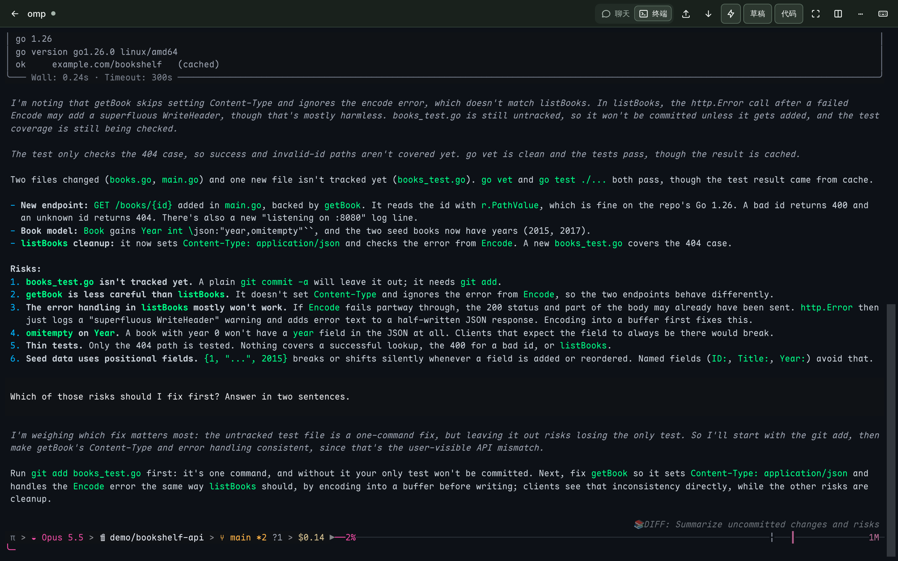

<div align="center">

<h1>
  <picture>
    <source media="(prefers-color-scheme: dark)" srcset="docs/images/brand/webmux-logo-dark.svg">
    
  </picture>
</h1>

**在浏览器里持续运行的终端 —— 为远程遥控 Claude Code、Codex 等 CLI agent 而生**

[](https://github.com/mzdluo123/webmux/actions/workflows/test.yml)
[](https://github.com/mzdluo123/webmux/releases/latest)
[](go.mod)

[](LICENSE)

[界面一览](#界面一览) · [功能](#功能) · [快速开始](#快速开始) · [文档](#文档) · [获取帮助](#获取帮助) · [参与贡献](CONTRIBUTING.md)

</div>

---

WebMux 是一个单二进制的 Web 终端服务。终端会话由服务端持有，浏览器只是“附着”上去：手机锁屏、切换网络、关闭标签页都不会结束正在运行的 agent，重新打开就能看到断线期间的全部输出。

在电脑上让 agent 开工，出门后用手机查看进度、回答它的提问、审阅它改的代码，回来再在原来的终端里接着用 —— 全程是同一个进程。

<div align="center">



</div>

## 为什么选择 WebMux

- **断线不断会话**：会话在服务端持续运行，重连只补发缺失的输出。
- **原样运行你的 agent**：Claude Code、Codex、omp 等跑在真实 PTY 里，无需插件或改配置，TUI 与原生终端一致。
- **手机上真正好用**：软键栏、触摸滚动、双指缩放、聊天视图与推送提醒，专为小屏遥控设计。
- **轻量、低侵入**：一个约 15 MB 的静态二进制，以当前用户运行，不需要 root、tmux 或数据库。
- **Windows 一等支持**：服务跑在 WSL 2 中，托盘负责安装、启动与远程访问。

完整的设计理念与特性清单见 [项目介绍](docs/overview.md)。

## 界面一览

<table>
  <tr>
    <td width="50%"><br><sub><b>会话总览</b>：按仓库分组，实时状态与屏幕预览</sub></td>
    <td width="50%"><br><sub><b>代码工作区</b>：终端旁查看 Diff，一键引用 <code>路径:行号</code></sub></td>
  </tr>
  <tr>
    <td width="50%"><br><sub><b>混合会话</b>：同一段对话在 TUI 与聊天视图间切换</sub></td>
    <td width="50%"><br><sub><b>终端</b>：原生 PTY，字节流直通 xterm.js</sub></td>
  </tr>
</table>

<table>
  <tr>
    <td width="25%"><br><sub><b>手机总览</b></sub></td>
    <td width="25%"><br><sub><b>终端 + 软键栏</b></sub></td>
    <td width="25%"><br><sub><b>聊天视图</b></sub></td>
    <td width="25%"><br><sub><b>Diff 审阅</b></sub></td>
  </tr>
</table>

<details>
<summary><b>更多功能截图</b>：分屏、终端图形、资源管理器、启动配置</summary>

<table>
  <tr>
    <td width="50%"><picture><source media="(prefers-color-scheme: dark)" srcset="docs/images/terminal-splits/after-desktop-dark.jpg">
      </picture>
      <br><sub><b>终端分屏 + 草稿</b>：最多 8 个窗格，<code>Ctrl+B</code> 前缀操作</sub></td>
    <td width="50%"><picture><source media="(prefers-color-scheme: dark)" srcset="docs/images/kitty-graphics/after-desktop-dark.png">
      </picture>
      <br><sub><b>终端图形</b>：Kitty 图形协议，agent 可直接显示图片</sub></td>
  </tr>
  <tr>
    <td width="50%"><picture><source media="(prefers-color-scheme: dark)" srcset="docs/images/file-explorer/after-desktop-dark.png">
      </picture>
      <br><sub><b>资源管理器</b>：上传、下载、重命名、移动文件</sub></td>
    <td width="50%"><picture><source media="(prefers-color-scheme: dark)" srcset="docs/images/cli-agents/after-desktop-dark.png">
      </picture>
      <br><sub><b>启动配置</b>：预置九款 CLI agent，可自由编辑</sub></td>
  </tr>
</table>

</details>

## 功能

- **会话与终端**：持久会话、断线续接、分屏、查找、草稿模式、文件上传、终端图形。详见 [使用指南](docs/usage.md)、[终端使用](docs/usage/terminal.md)。
- **Agent 协作**：预置 CLI agent 启动配置；“需要你介入”提醒；OpenCode / omp / Codex / Claude Code 在聊天与终端间切换。详见 [CLI agent](docs/cli-agents.md)、[混合会话](docs/hybrid-sessions.md)。
- **代码与仓库**：只读浏览文件与 Diff、预览 Markdown 与图片、引用代码行、管理 Git worktree。详见 [代码工作区](docs/usage.md#代码工作区)、[仓库与 worktree](docs/usage.md#仓库与-worktree)。
- **多设备**：手机软键栏与聊天视图、PWA 与 Web Push、偏好跨设备同步、`webmux run` / `attach` 在本机终端接续。详见 [移动端](docs/usage.md#移动端)、[从终端启动与附着](docs/usage.md#从终端启动与附着)。
- **部署与访问**：一键安装、systemd / launchd 用户服务、Windows 托盘、Tailscale 与 Cloudflare Tunnel 的 HTTPS 入口。详见 [部署指南](docs/deployment.md)。

## 快速开始

**1. 安装**（Linux / macOS，自动识别架构并校验 SHA-256，安装到 `~/.local/bin/webmux`）：

```sh
curl -fsSL https://github.com/mzdluo123/webmux/releases/latest/download/install.sh | sh
# 国内网络可改用镜像：
curl -fsSL https://ghfast.top/https://github.com/mzdluo123/webmux/releases/latest/download/install.sh | sh
```

**2. 运行**，然后在浏览器打开 <http://127.0.0.1:7681>，点击“新建会话”：

```sh
webmux --listen 127.0.0.1:7681
```

**3. 下一步**

- 让服务常驻后台：`webmux start`，或安装为用户服务 `webmux service install`，见 [服务管理](docs/deployment/services.md)。
- 从手机访问：绑定 Tailscale / WireGuard 等 VPN 地址并启用 token，见 [远程访问](docs/deployment/remote-access.md)。
- 在常用终端里启动 agent：`webmux run -- claude`，`Ctrl+]` 分离后去手机上继续，见 [从终端启动与附着](docs/usage.md#从终端启动与附着)。

其他安装方式：[deb / rpm 安装包](docs/deployment/install-and-upgrade.md#linux-安装包deb--rpm)、[手动下载](docs/deployment/install-and-upgrade.md#手动下载)、[Windows（WSL）托盘](docs/deployment/windows-wsl.md)、[从源码构建](CONTRIBUTING.md#从源码构建)。

> [!WARNING]
>
> - WebMux 等同于以当前系统用户身份把 shell 暴露到网络上，默认监听 `0.0.0.0:7681`。
> - 首次启动会生成带随机 token 的 0600 配置文件，可用 `webmux status --json --reveal-token` 查看。
> - 仅本机使用时请改为 `127.0.0.1:7681`；远程访问请绑定可信 VPN 地址。
> - **除非明确使用 `--tunnel` 并接受“Token 是唯一入口屏障”的风险，不要开放到公网。**
> - 详见 [安全策略](SECURITY.md) 与 [Cloudflare Named Tunnel 配置指南](docs/cloudflare-tunnel.md)。

## 文档

| 我想……               | 去看                                                                                          |
| -------------------- | --------------------------------------------------------------------------------------------- |
| 了解项目能做什么     | [项目介绍](docs/overview.md)、[User Stories](docs/user-stories.md)                            |
| 安装、配置、远程访问 | [部署指南](docs/deployment.md)、[配置](docs/deployment/configuration.md)                      |
| 学会日常操作         | [使用指南](docs/usage.md)、[混合会话](docs/hybrid-sessions.md)                                |
| 开发、了解架构与协议 | [参与贡献](CONTRIBUTING.md)、[架构设计](docs/architecture.md)、[API 与协议](docs/protocol.md) |
| 浏览全部文档         | [文档中心](docs/README.md)                                                                    |

## 获取帮助

- **先查** [常见问题与排障入口](docs/faq.md)：会话为何在重启后消失、找不到 `claude` 命令、复制粘贴受限等。
- **提问或报告问题**：[GitHub Issues](https://github.com/mzdluo123/webmux/issues)，请附上 `webmux version` 与复现步骤。
- **安全漏洞**：不要公开提交，按 [安全策略](SECURITY.md#报告漏洞) 私下报告。

## 参与贡献

欢迎提交 issue 与 PR。开发环境、测试与代码规范见 [参与贡献](CONTRIBUTING.md)；由 agent 协作开发时，规则入口是 [AGENTS.md](AGENTS.md)。

## 许可证

[MIT](LICENSE)
