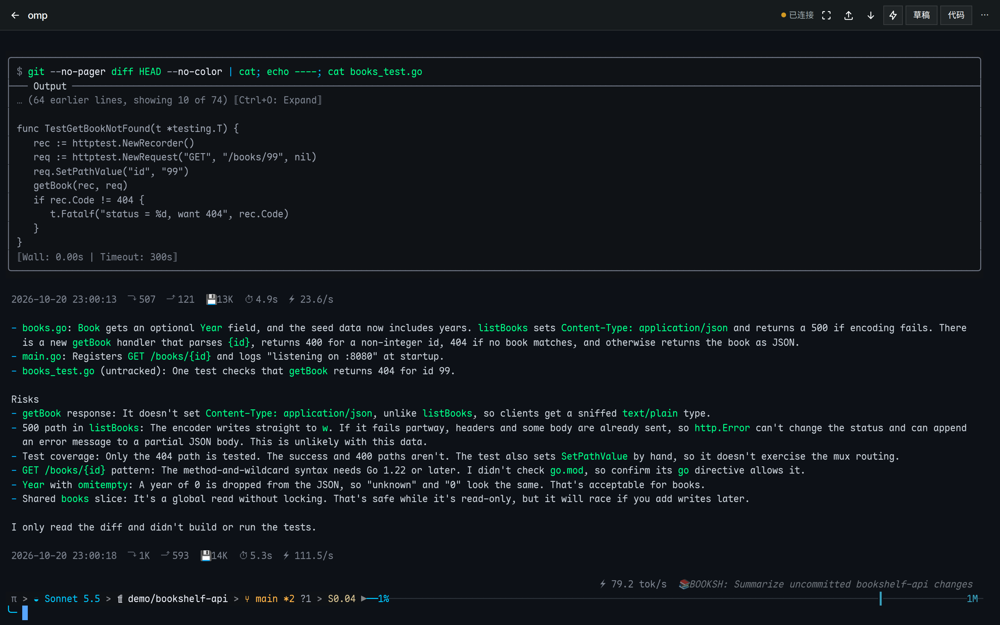
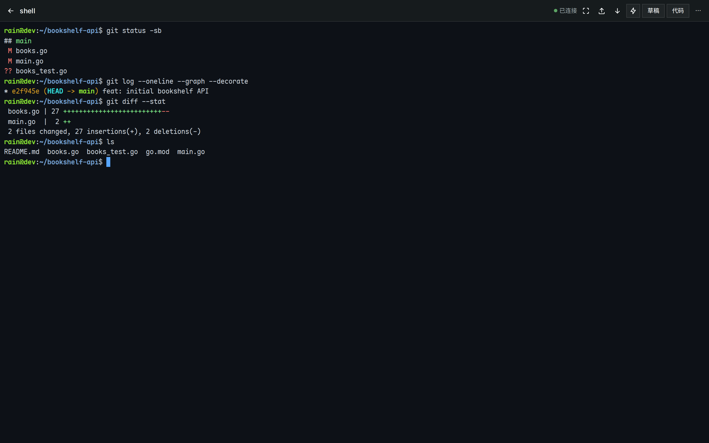
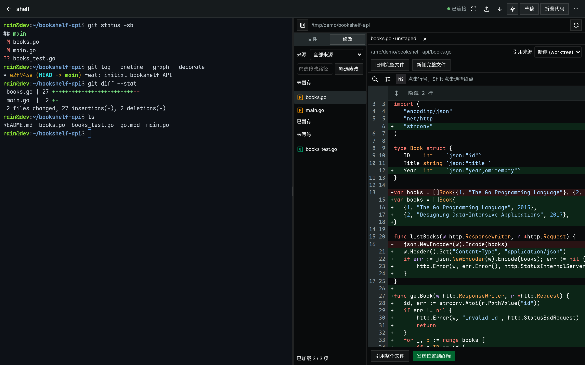
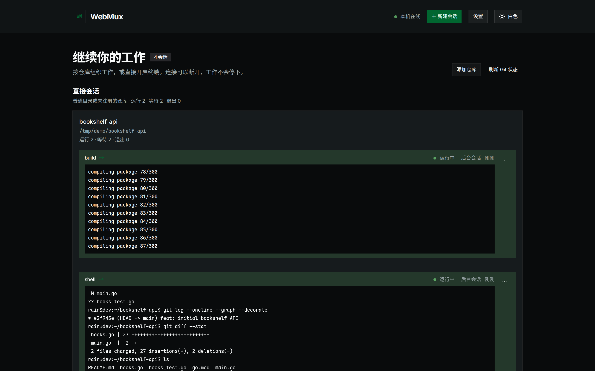
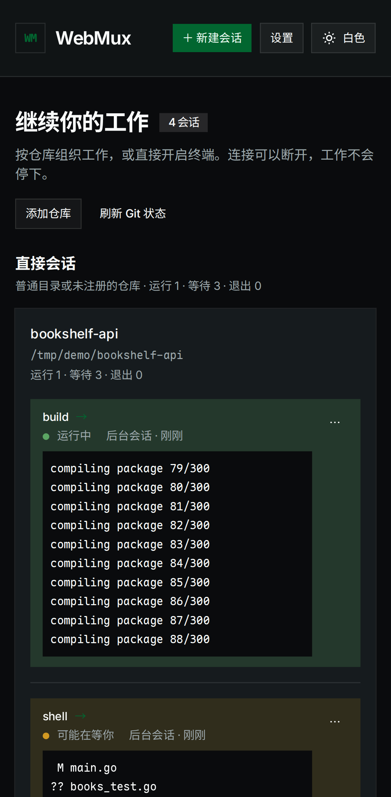
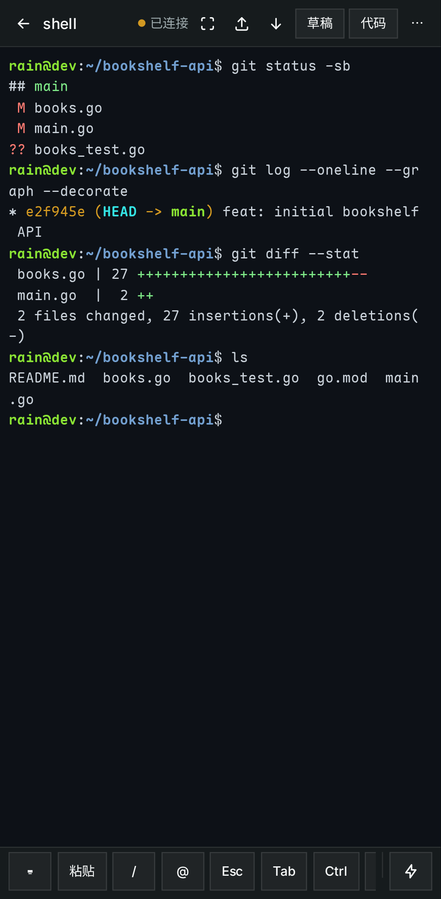
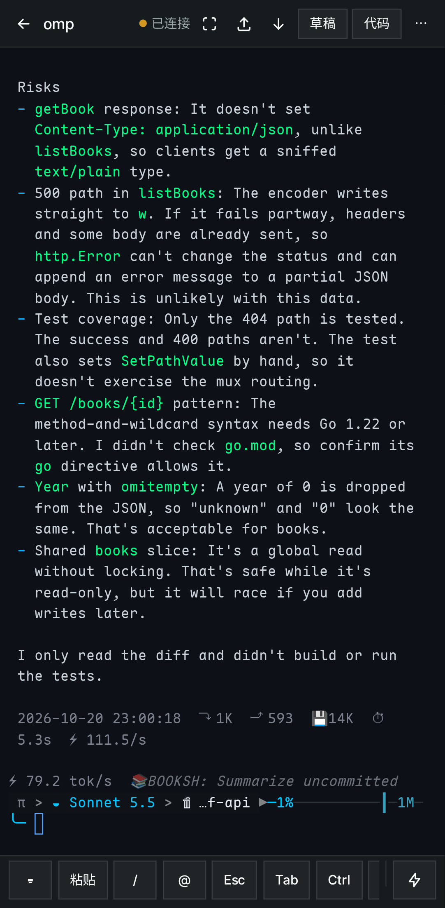
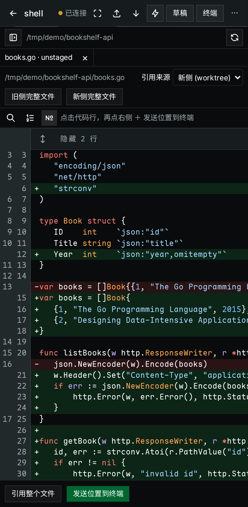

<div align="center">

# WebMux

**在浏览器里持续运行的终端 —— 为远程遥控 Claude Code、Codex 等 CLI agent 而生**

[](https://github.com/mzdluo123/webmux/actions/workflows/test.yml)
[](https://github.com/mzdluo123/webmux/releases/latest)
[](go.mod)


[快速开始](#快速开始) · [使用指南](docs/usage.md) · [部署](docs/deployment.md) · [架构](docs/architecture.md) · [协议](docs/protocol.md) · [参与贡献](CONTRIBUTING.md)

</div>

---

WebMux 是一个单二进制的 Web 终端服务。PTY 会话由服务端持有，浏览器只是“附着”上去：手机锁屏、切换网络、关闭标签页都不会结束正在运行的 agent，重新打开即可回放断线期间的全部输出。

与 ttyd 等工具不同，WebMux 把会话生命周期与浏览器连接解耦；与 tmux 方案不同，它不依赖额外的终端复用器，并针对手机和平板做了完整适配。

<div align="center">



</div>

## 界面一览

### 桌面端

<table>
  <tr>
    <td width="50%"><br><sub><b>终端</b>：原生 PTY，字节流直通 xterm.js</sub></td>
    <td width="50%"><br><sub><b>Diff</b>：终端旁只读查看 Git 修改，一键把 <code>路径:行号</code> 发送到终端</sub></td>
  </tr>
  <tr>
    <td colspan="2"><br><sub><b>会话总览</b>：按仓库分组，实时显示状态与终端屏幕预览</sub></td>
  </tr>
</table>

### 移动端

<table>
  <tr>
    <td width="25%"><br><sub><b>总览</b></sub></td>
    <td width="25%"><br><sub><b>终端 + 软键栏</b></sub></td>
    <td width="25%"><br><sub><b>omp 遥控</b></sub></td>
    <td width="25%"><br><sub><b>Diff 查看</b></sub></td>
  </tr>
</table>

> 截图由 `pnpm --dir web screenshots` 基于真实后端自动生成（桌面 1440×900，移动端 Pixel 7 模拟）。

> [!WARNING]
> WebMux 等同于以当前系统用户身份把 shell 暴露到网络上。**不要开放到公网。** 默认只监听 `127.0.0.1:7681`；远程访问请绑定 Tailscale / WireGuard 等可信 VPN 地址，并设置共享 token。详见 [安全策略](SECURITY.md)。

## 特性

- **持久会话**：浏览器断开后会话继续运行；短暂断线或回到前台时只续接缺失的输出，否则清屏并回放服务端缓冲（默认每会话 2 MiB）。
- **会话总览**：按仓库 / 工作树分组展示所有会话，实时显示标题、状态（运行中 / 可能在等你 / 空闲 / 已退出）和终端屏幕预览。
- **agent 预设**：内置 Shell、Claude Code、Codex CLI、omp 预设，也可直接输入自定义 argv。
- **Git worktree 管理**：登记已有仓库，创建 / 安全删除 worktree，并在其中直接启动 agent。
- **只读代码工作区**：在终端旁浏览文件和 Git 修改、查看 Diff，把 `路径:行号` 引用一键插入终端。
- **草稿模式**：先在多行输入框里编写、组合引用和上传路径，再一次性发送给 agent；草稿保存在本机，发送有送达确认。
- **移动端优先**：软键栏（Esc / Ctrl / Alt / 方向键等）、触摸滚动、双指缩放、长按选词复制、虚拟键盘视口适配。
- **文件上传**：选择、拖放或粘贴文件 / 图片，上传后自动把服务器路径插入终端。
- **零运行时依赖**：前端嵌入 Go 二进制，运行端只需 Linux 或 macOS 与一个 shell，无需 Node.js、Go、tmux 或数据库。

## 快速开始

### 下载预编译二进制

从 [Releases](https://github.com/mzdluo123/webmux/releases/latest) 下载对应平台的可执行文件（`linux` / `darwin`，`amd64` / `arm64`）：

```sh
curl -LO https://github.com/mzdluo123/webmux/releases/latest/download/webmux-linux-amd64
curl -LO https://github.com/mzdluo123/webmux/releases/latest/download/SHA256SUMS
sha256sum --check --ignore-missing SHA256SUMS   # macOS: shasum -a 256 -c --ignore-missing SHA256SUMS
install -m 755 webmux-linux-amd64 ~/.local/bin/webmux
```

### 运行

```sh
webmux --listen 127.0.0.1:7681
```

浏览器打开 <http://127.0.0.1:7681>，点击“新建会话”即可开始。

通过 VPN 远程访问时，绑定 VPN 地址并启用 token：

```sh
webmux --listen 100.64.0.5:7681 --token "$(openssl rand -hex 24)"
```

### 从源码构建

需要 Go 1.26+、Node.js 24 LTS、pnpm 12.11.2 与 GNU Make：

```sh
git clone https://github.com/mzdluo123/webmux.git
cd webmux
corepack enable && corepack prepare pnpm@12.11.2 --activate
make build          # 产物：bin/webmux
make install        # 安装到 ~/.local/bin/webmux
```

## 配置

默认读取 `~/.config/webmux/config.toml`（不存在时使用默认值）。命令行参数 `--config`、`--listen`、`--token` 优先于配置文件。

```sh
mkdir -p ~/.config/webmux
cp deploy/config.example.toml ~/.config/webmux/config.toml
chmod 600 ~/.config/webmux/config.toml
```

| 配置项               | 默认值                       | 说明                                           |
| -------------------- | ---------------------------- | ---------------------------------------------- |
| `listen`             | `127.0.0.1:7681`             | HTTP / WebSocket 监听地址                      |
| `token`              | 空（不认证）                 | 共享 token                                     |
| `scrollback_bytes`   | `2097152`                    | 每会话保留的原始终端字节数                     |
| `default_cwd`        | `~`                          | 新建会话的默认目录                             |
| `state_dir`          | `$XDG_STATE_HOME/webmux`     | 仓库清单目录；不保存会话或终端内容             |
| `shell`              | `$SHELL` 或 `/bin/bash`      | Shell 预设使用的程序，以 `-l -i` 启动          |
| `idle_after_seconds` | `30`                         | 无等待特征时判定为空闲的阈值                   |
| `prompt_patterns`    | 常见提示符 / 确认模式        | 判定“可能在等你”的 Go 正则列表                 |
| `allowed_origins`    | `[]`                         | 额外允许的完整 Origin（如 HTTPS 反向代理域名） |
| `presets`            | shell / claude / codex / omp | 启动预设（argv 数组），配置后替换默认列表      |

完整说明、systemd / launchd 服务、Tailscale 与 HTTPS 配置见 [部署指南](docs/deployment.md)。

## 文档

| 文档                                    | 内容                                               |
| --------------------------------------- | -------------------------------------------------- |
| [使用指南](docs/usage.md)               | 会话、终端、草稿模式、代码工作区、worktree、移动端 |
| [部署指南](docs/deployment.md)          | 配置、systemd / launchd、手机访问、HTTPS、平台差异 |
| [架构设计](docs/architecture.md)        | 会话模型、缓冲与回放、状态探测、并发与资源         |
| [API 与协议](docs/protocol.md)          | REST API、WebSocket 帧格式、错误码                 |
| [参与贡献](CONTRIBUTING.md)             | 开发环境、测试、代码规范、OpenSpec 工作流          |
| [安全策略](SECURITY.md)                 | 安全模型与漏洞报告                                 |
| [产品能力 baseline](baseline/README.md) | 可复现评测、统计口径与首次量化结果                 |

## 常见问题

<details>
<summary><b>重启服务后会话去哪了？</b></summary>

会话、PTY 和缓冲只保存在内存中，服务重启即结束所有会话。这是有意的设计边界：WebMux 不使用数据库、不做守护进程分离，也不与 tmux 互通。只有显式登记的仓库清单会持久保存。

</details>

<details>
<summary><b>创建会话时找不到 claude / codex？</b></summary>

systemd 和 launchd 不会加载你的交互 shell 配置。检查 `which claude` 的结果，并把所在目录加入服务的 `PATH`，参见 [部署指南](docs/deployment.md#agent-的-path)。

</details>

<details>
<summary><b>两台设备同时打开同一会话，布局互相影响？</b></summary>

两端共享同一个 PTY，但只有控制端决定终端尺寸：先打开的设备控制，后打开的设备观察（按原网格显示、可平移）。在观察端输入或点击“接管控制”即可切换。

</details>

<details>
<summary><b>粘贴 / 复制没有权限？</b></summary>

HTTP 不是浏览器安全上下文，Clipboard API 不可用。WebMux 会回退到文本框手动粘贴 / 复制；也可以通过 `tailscale serve` 或 Caddy 提供 HTTPS。

</details>

<details>
<summary><b>重连后首行有少量乱码？</b></summary>

缓冲按字节环形存储，最旧的数据可能从多字节字符或转义序列中间开始，属于设计允许范围。

</details>

## 技术栈

Go（`creack/pty`、`coder/websocket`）· Svelte 5 · TypeScript · Vite · xterm.js · shadcn-svelte · Tailwind CSS · Zod · CodeMirror
