<div align="center">

<h1>
  <picture>
    <source media="(prefers-color-scheme: dark)" srcset="docs/images/brand/webmux-logo-dark.svg">
    
  </picture>
</h1>

**在浏览器里持续运行的终端 —— 为远程遥控 Claude Code、Codex 等 CLI agent 而生**

[](https://github.com/mzdluo123/webmux/actions/workflows/test.yml)
[](https://github.com/mzdluo123/webmux/releases/latest)
[](go.mod)

[](LICENSE)

[三步看懂](#三步看懂) · [界面一览](#界面一览) · [功能](#功能) · [快速开始](#快速开始) · [文档](#文档) · [获取帮助](#获取帮助) · [参与贡献](CONTRIBUTING.md)

</div>

---

<div align="center">

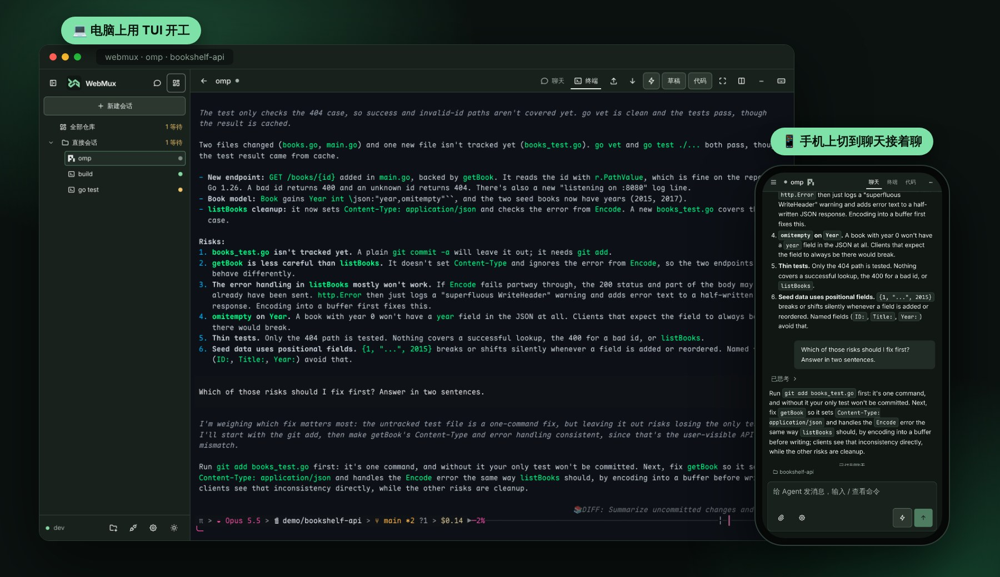

### 让 agent 在服务器上一直跑，你在任何设备上随时接管。

</div>

你在电脑前让 Claude Code 重构一个模块，然后得出门。合上笔记本，agent 还在干活；地铁上手机亮起，它停下来问你一个问题，回一句话它就继续；到了公司打开浏览器，改动的 Diff 已经摆在终端旁边，审完在同一个终端里接着干。**这一路是同一个进程，一行输出都不会丢。**

WebMux 就是为这件事做的：一个约 15 MB 的单二进制，把终端会话放在服务端，浏览器、手机和本机终端都只是“附着”上去。

### 三步看懂

<table>
  <tr>
    <th width="34%">① 电脑上开工</th>
    <th width="32%">② 手机上接管</th>
    <th width="34%">③ 回到电脑审阅</th>
  </tr>
  <tr>
    <td>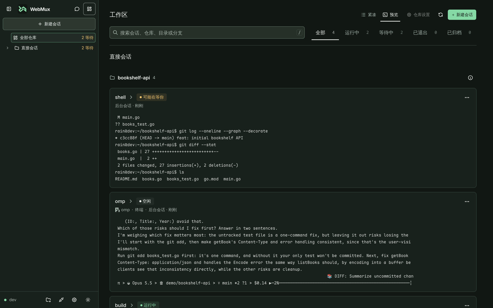</td>
    <td>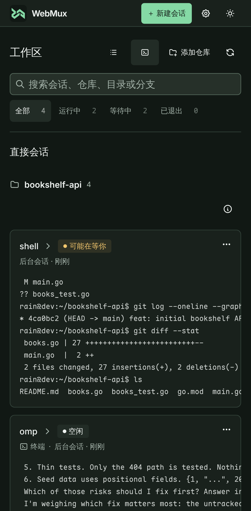
      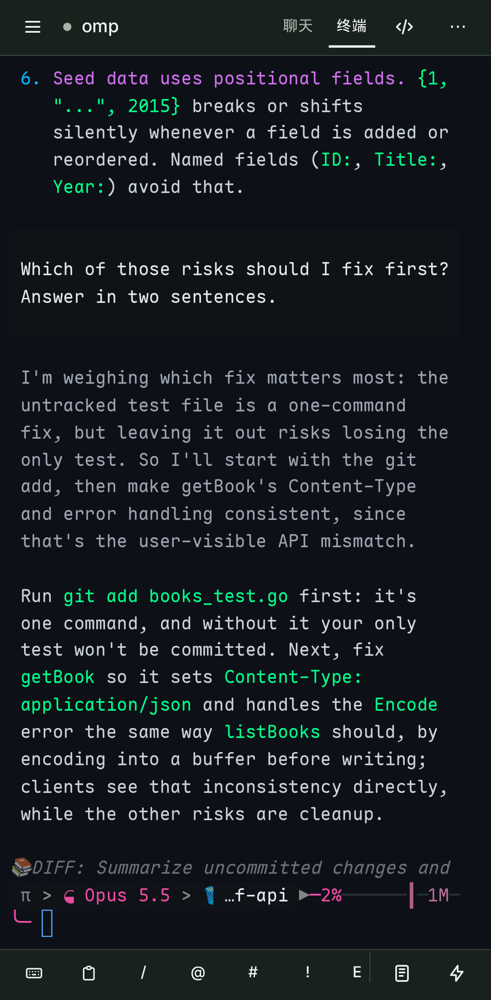</td>
    <td>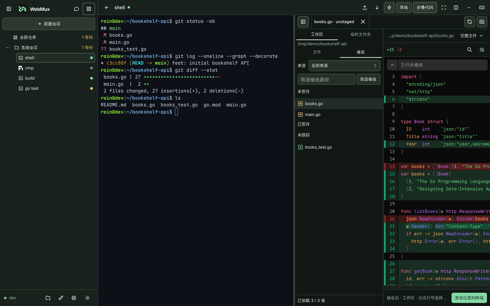</td>
  </tr>
  <tr>
    <td><sub>同时跑多个 agent，总览里一眼看出谁在干活、谁在<b>等你</b>。</sub></td>
    <td><sub>锁屏推送叫你回来；软键栏、触摸滚动，TUI 照样好用。</sub></td>
    <td><sub>终端旁直接看 Diff，一键把 <code>路径:行号</code> 发给 agent。</sub></td>
  </tr>
</table>

### 为什么会爱上它

<table>
  <tr>
    <td width="33%">🔌 <b>断线不断会话</b><br><sub>锁屏、换网、关标签页都不影响；重连只补发缺失的输出。</sub></td>
    <td width="33%">🤖 <b>原样运行你的 agent</b><br><sub>Claude Code、Codex、omp 等十一款 CLI 预置即用，跑在真实 PTY 里。</sub></td>
    <td width="33%">💬 <b>TUI ↔ 聊天一键切换</b><br><sub>同一段对话，电脑上用 TUI，手机上用聊天视图，历史完整保留。</sub></td>
  </tr>
  <tr>
    <td>🔔 <b>它在等你时会告诉你</b><br><sub>识别 agent 的提问与授权请求：总览标记、标签页提示、锁屏推送。</sub></td>
    <td>🧑‍💻 <b>写代码的工作台</b><br><sub>分屏、草稿模式、资源管理器与 Diff、多格式预览、Git worktree、终端里显示图片。</sub></td>
    <td>🪶 <b>轻到可以忘了它</b><br><sub>单二进制、空闲约 13 MB 内存，无需 root、tmux 或数据库；Windows 经 WSL 2 一等支持。</sub></td>
  </tr>
</table>

完整的设计理念与特性清单见 [项目介绍](docs/overview.md)。

## 界面一览

<table>
  <tr>
    <td width="50%" colspan="3">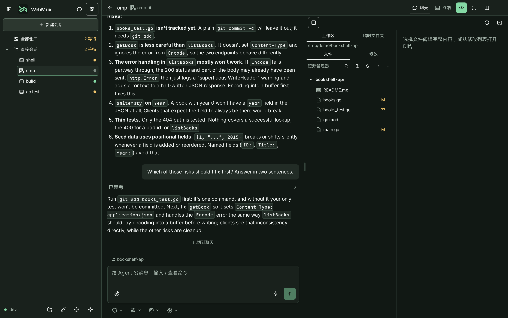<br><sub><b>混合会话</b>：同一段对话在 TUI 与聊天视图间切换</sub></td>
    <td width="50%" colspan="3">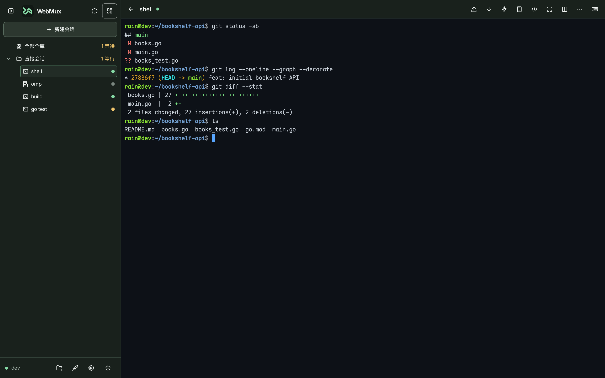<br><sub><b>终端</b>：原生 PTY，字节流直通 xterm.js</sub></td>
  </tr>
  <tr>
    <td width="33%" colspan="2">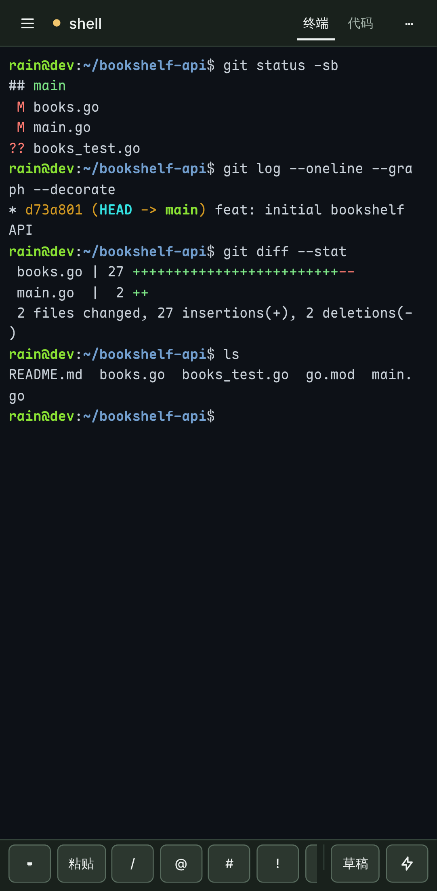<br><sub><b>终端 + 软键栏</b></sub></td>
    <td width="33%" colspan="2">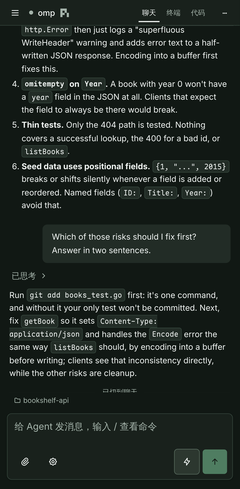<br><sub><b>聊天视图</b></sub></td>
    <td width="33%" colspan="2">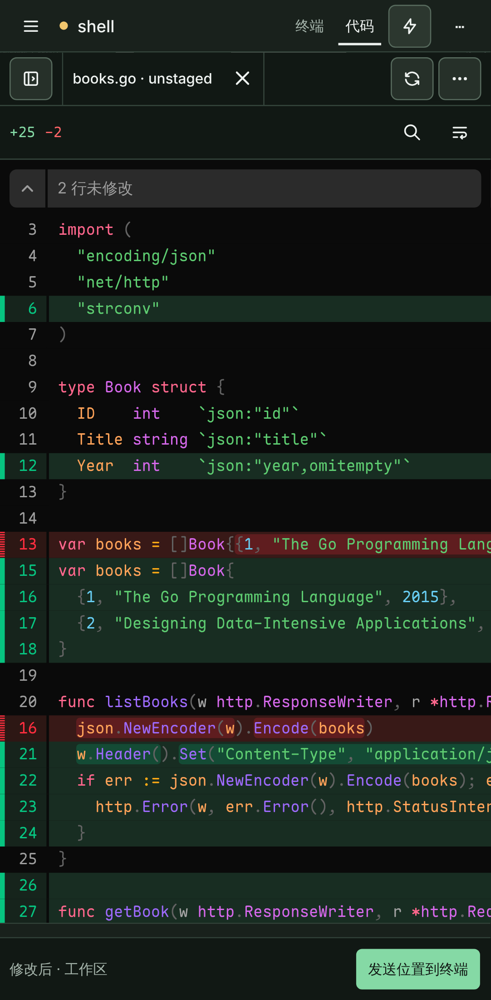<br><sub><b>Diff 审阅</b></sub></td>
  </tr>
</table>

<details>
<summary><b>更多功能截图</b>：分屏、终端图形、资源管理器、启动配置</summary>

<table>
  <tr>
    <td width="50%"><picture><source media="(prefers-color-scheme: dark)" srcset="docs/images/terminal-splits/after-desktop-dark.jpg">
      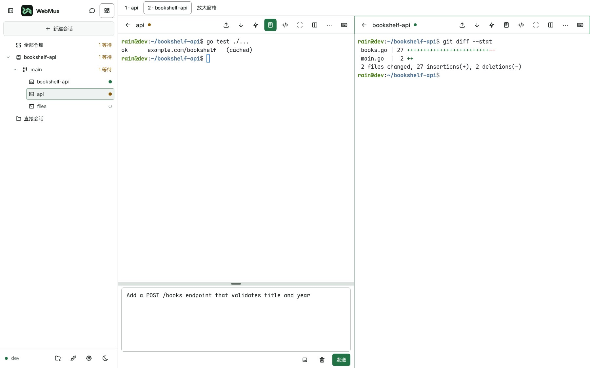</picture>
      <br><sub><b>终端分屏 + 草稿</b>：最多 8 个窗格，<code>Ctrl+B</code> 前缀操作</sub></td>
    <td width="50%"><picture><source media="(prefers-color-scheme: dark)" srcset="docs/images/kitty-graphics/after-desktop-dark.png">
      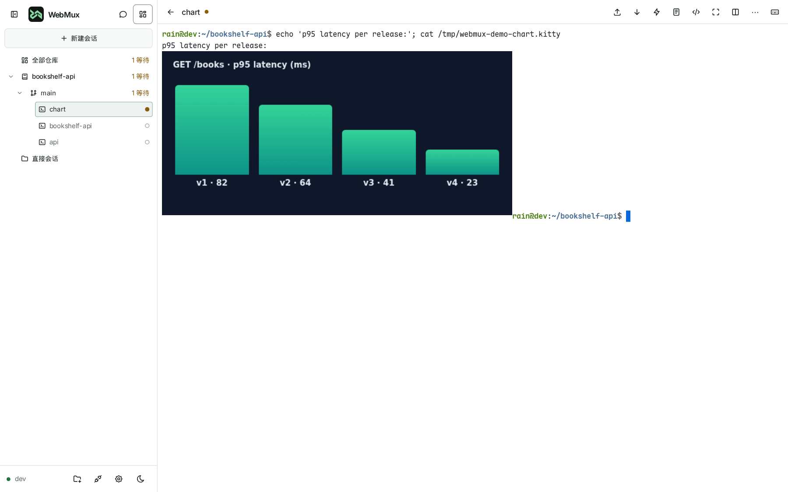</picture>
      <br><sub><b>终端图形</b>：Kitty 图形协议，agent 可直接显示图片</sub></td>
  </tr>
  <tr>
    <td width="50%"><picture><source media="(prefers-color-scheme: dark)" srcset="docs/images/file-explorer/after-desktop-dark.png">
      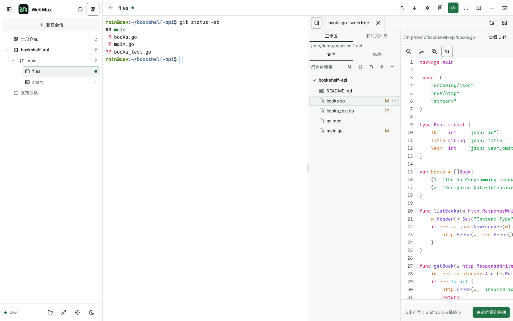</picture>
      <br><sub><b>资源管理器</b>：上传、下载、重命名、移动文件</sub></td>
    <td width="50%"><picture><source media="(prefers-color-scheme: dark)" srcset="docs/images/cli-agents/after-desktop-dark.png">
      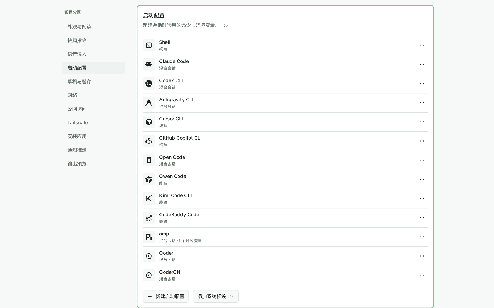</picture>
      <br><sub><b>启动配置</b>：预置十一款 CLI agent，可自由编辑</sub></td>
  </tr>
</table>

</details>

## 功能

- **会话与终端**：持久会话、断线续接、tmux 风格分屏（`Ctrl+B`）、缓冲查找、草稿模式、文件上传、锁定终端尺寸、快捷键参考、Kitty 终端图形。详见 [使用指南](docs/usage.md)、[终端使用](docs/usage/terminal.md)。
- **Agent 协作**：预置十一款 CLI agent 启动配置；“需要你介入”提醒；Claude Code / Codex / OpenCode / omp / Qoder / QoderCN 在聊天与终端间切换，聊天端支持附件、权限请求作答与 Token 用量。详见 [CLI agent](docs/cli-agents.md)、[混合会话](docs/hybrid-sessions.md)。
- **代码与仓库**：资源管理器（上传、下载、ZIP、重命名、移动、删除）、Git Diff、多格式预览（Markdown、HTML、表格、JSON、PDF、图片）、[会话临时文件夹](docs/usage/terminal.md#会话临时文件夹)、Git worktree。详见 [代码工作区](docs/usage.md#代码工作区)、[仓库与 worktree](docs/usage.md#仓库与-worktree)。
- **多设备**：手机软键栏（可锁定 Shift）与聊天视图、PWA 与 Web Push、偏好跨设备同步、`webmux run` / `attach` 在本机终端接续。详见 [移动端](docs/usage.md#移动端)、[从终端启动与附着](docs/usage.md#从终端启动与附着)。
- **部署与访问**：一键安装、deb / rpm 包、systemd / launchd 用户服务、Windows 安装程序与托盘、Tailscale 与 Cloudflare Tunnel 的 HTTPS 入口。详见 [部署指南](docs/deployment.md)。

## 快速开始

**1. 安装**（Linux / macOS，自动识别架构并校验 SHA-256，安装到 `~/.local/bin/webmux`）：

```sh
curl -fsSL https://github.com/mzdluo123/webmux/releases/latest/download/install.sh | sh
# 国内网络可改用镜像：
curl -fsSL https://ghfast.top/https://github.com/mzdluo123/webmux/releases/latest/download/install.sh | sh
```

**2. 运行**，然后在浏览器打开 <http://127.0.0.1:7681>，点击“新建会话”：

```sh
webmux --listen 127.0.0.1:7681
```

**3. 下一步**

- 让服务常驻后台：`webmux start`，或安装为用户服务 `webmux service install`，见 [服务管理](docs/deployment/services.md)。
- 从手机访问：绑定 Tailscale / WireGuard 等 VPN 地址并启用 token，见 [远程访问](docs/deployment/remote-access.md)。
- 在常用终端里启动 agent：`webmux run -- claude`，`Ctrl+]` 分离后去手机上继续，见 [从终端启动与附着](docs/usage.md#从终端启动与附着)。

其他安装方式：[deb / rpm 安装包](docs/deployment/install-and-upgrade.md#linux-安装包deb--rpm)、[手动下载](docs/deployment/install-and-upgrade.md#手动下载)、[Windows（WSL）托盘](docs/deployment/windows-wsl.md)、[从源码构建](CONTRIBUTING.md#从源码构建)。

> [!WARNING]
>
> - WebMux 等同于以当前系统用户身份把 shell 暴露到网络上，默认监听 `0.0.0.0:7681`。
> - 首次启动会生成带随机 token 的 0600 配置文件，可用 `webmux status --json --reveal-token` 查看。
> - 仅本机使用时请改为 `127.0.0.1:7681`；远程访问请绑定可信 VPN 地址。
> - **除非明确使用 `--tunnel` 并接受“Token 是唯一入口屏障”的风险，不要开放到公网。**
> - 详见 [安全策略](SECURITY.md) 与 [Cloudflare Named Tunnel 配置指南](docs/cloudflare-tunnel.md)。

## 文档

- **了解项目**：[项目介绍](docs/overview.md)、[User Stories](docs/user-stories.md)；**安装与访问**：[部署指南](docs/deployment.md)、[配置](docs/deployment/configuration.md)。
- **日常使用**：[使用指南](docs/usage.md)、[混合会话](docs/hybrid-sessions.md)；**开发**：[架构设计](docs/architecture.md)、[API 与协议](docs/protocol.md)。
- **全部文档**：[文档中心](docs/README.md)。

## 获取帮助

- **先查** [常见问题与排障入口](docs/faq.md)：会话为何在重启后消失、找不到 `claude` 命令、复制粘贴受限等。
- **提问或报告问题**：[GitHub Issues](https://github.com/mzdluo123/webmux/issues)，请附上 `webmux version` 与复现步骤。
- **安全漏洞**：不要公开提交，按 [安全策略](SECURITY.md#报告漏洞) 私下报告。
- **参与贡献**：欢迎 issue 与 PR，开发环境、测试与规范见 [参与贡献](CONTRIBUTING.md)；agent 协作的规则入口是 [AGENTS.md](AGENTS.md)。

## 许可证

[MIT](LICENSE)
