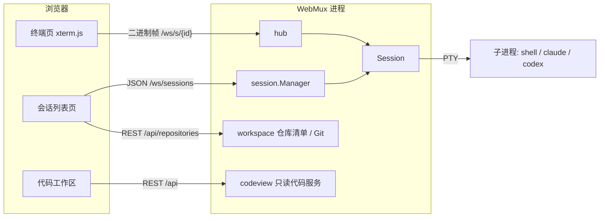

# 架构设计

## 设计目标

WebMux 是运行在单台 Linux / macOS 机器上的单用户 Web 终端。核心问题是：ttyd 一类工具在浏览器断开后会话即终止，手机锁屏、切网都会丢掉正在运行的 agent。WebMux 把 PTY 生命周期与浏览器连接解耦，会话由服务端持有，浏览器随时断开、随时重连。

**非目标**

- 多机网关、多用户或权限体系：以启动服务的系统用户身份运行。
- 服务重启后的会话存活：会话只在内存中，重启即结束。
- 进程沙箱：命令以服务用户身份执行，不做隔离。
- 依赖或兼容 tmux。

## 总体结构



浏览器断线后 Session 继续从 PTY 读取并写入环形缓冲；重连时先发送缓冲快照再续接实时流，因此断线期间的输出不会丢失。

## 模块划分

| 包                   | 职责                                                          |
| -------------------- | ------------------------------------------------------------- |
| `cmd/webmux`         | CLI 参数、配置加载、显式依赖注入、信号处理与优雅退出          |
| `internal/config`    | TOML 解析、默认值与校验                                       |
| `internal/session`   | PTY、环形缓冲、OSC 标题、屏幕预览、状态探测、进程树清理       |
| `internal/hub`       | 终端 WebSocket：快照与订阅、输出合并、输入写入与取消          |
| `internal/api`       | REST 路由、认证、Origin 检查、上传、静态资源与 SPA 回退       |
| `internal/workspace` | 仓库清单持久化、Git worktree 查询 / 创建 / 删除、启动目录协调 |
| `internal/codeview`  | 只读文件浏览、Git 修改列表、内容快照与变化检测                |
| `web/`               | Svelte 5 前端，构建后通过 `go:embed` 嵌入二进制               |

`cmd/webmux` 先加载配置，再构造 `session.Manager`、workspace 与 codeview 服务，最后注入 `api.New`。各模块通过构造函数显式依赖，不使用全局状态。

## 关键设计原则

- **会话与连接解耦**：Session 的生命周期只由子进程决定；WebSocket 连接只是观察者，可以有零个或多个。
- **服务端只传字节**：PTY 原始字节直接进入缓冲并转发给 xterm.js，服务端不做终端仿真；OSC 标题与屏幕预览只是旁路解析。
- **重连优先增量续接**：输出有绝对字节 offset 与会话运行代际；客户端带着已渲染的位置重连，服务端仍保留后续字节时只补发缺失部分，否则清屏全量回放。服务端仍不做终端仿真。
- **会话只在内存中**：无数据库；只有显式登记的仓库清单写入状态目录，Git 自己持有 worktree 与分支状态。
- **控制端决定尺寸**：多端同时附着时，只有控制端的 resize 生效；用户输入取得控制，控制端离开后不自动转交。终端自动回复只写入一个连接的回答。

## 会话生命周期

1. **创建**：校验并规范化 cwd，组装 argv（预设 argv + 追加参数，或 `custom` 的完整 argv），设置 `TERM=xterm-256color`、`COLORTERM=truecolor` 和 `WEBMUX_SESSION_ID`，在新会话（`setsid`）中启动 PTY。
2. **运行**：reader 循环读取 PTY → 写入环形缓冲 → 更新 OSC 标题与屏幕预览 → 广播给订阅者。
3. **退出**：子进程结束后先清理残留子进程、排空 PTY，再发布退出事件，保证退出帧之前的输出完整。
4. **关闭**：向进程组发送 SIGHUP，5 秒后 SIGKILL。按会话 ID 与进程树查找其他 job-control 进程组；Linux 另按继承的 `WEBMUX_SESSION_ID` 查找，并通过 subreaper 回收孤儿进程。
5. **移除**：只允许移除已退出的会话。

服务收到 SIGTERM 时关闭所有会话，等待最多 10 秒后退出。

## 环形缓冲与回放

缓冲按**字节**而非行存储（默认 2 MiB），写满后覆盖最旧数据。agent 输出大量使用光标移动和重绘（spinner、进度条、TUI），按行截断会破坏转义序列；按字节回放由 xterm.js 重新解释最为稳妥。代价是最旧数据可能从转义序列中间开始，首行偶有乱码。

快照捕获与订阅注册在同一把锁内完成，保证回放与实时流之间没有缺口。

缓冲记录累计写入字节数，因此每个字节都有绝对 offset。每次回放前先发送位置帧（代际、起止 offset、是否截断）。客户端只统计已交给 xterm 的字节；页面隐藏时停止写入并保留 offset，回到前台重连后由服务端补发其后的字节。代际不符或 offset 已被覆盖时退回全量快照。

## 提交与控制端

- **提交**：草稿与带回车的快捷指令以“提交”帧发送（JSON 头 + 原始字节），绑定唯一 ID 与运行代际。服务端在会话锁内查重、登记后，在一次输入锁持有期间写入正文与提交键，并回报 received / written / partial / failed。会话保留最近 256 条、30 分钟的记录，重复 ID 不再写入，客户端可在重连后查询。已登记的提交不随连接取消，仍受 10 秒写期限约束。
- **控制端**：每个标签页有稳定的客户端 ID。首个附着的客户端成为控制端，同一客户端重连保持控制；非自动回复的输入、提交或显式接管把控制权交给发送方。只有控制端的 resize 生效，尺寸或控制变化时向所有连接广播控制帧，观察端按该网格渲染。

## 屏幕预览与标题

- **OSC 标题与侧信道**：增量状态机识别 `ESC ] 0/2 ; text BEL|ST` 标题（最多 512 字节），以及裸 BEL、`OSC 9` 通知（跳过 `9;4` 等数字子命令）、`OSC 777;notify` 通知和 `warp://cli-agent` 结构化事件；支持跨读取块拼接，单个 OSC 最多累积 4096 字节，DCS/APC 等字符串内的 BEL 不计入。结构化事件只取 `event` 名，正文从不保存。
- **屏幕预览**：使用 `github.com/0magnet/xterm-go/vt` 只读跟踪当前屏幕（零 scrollback），提取底部最多 100 条非空行，每行最多 120 个字符。预览解析器从不向 PTY 写入，也不改写原始字节流。

## 状态探测

每 500 ms 评估一次，进程表每秒刷新：

```text
if exited                                   → exited
else if 存在关注（attention）                → waiting
else if 最近 2 秒有输出                      → running
else if 末行匹配提示符 || 在等待终端输入      → waiting
else if 超过 idle_after_seconds 无输出       → idle
else                                        → running
```

关注是锁存值：侧信道信号按优先级 question = permission > error > done > notify > bell 置位，弱信号不覆盖强信号，后续输出不清除；仅成功写入的用户输入（只含 OSC/DCS、设备属性、光标位置、状态报告和焦点事件的终端应答除外）、`prompt_submit` / `permission_replied` / `session_start` 事件或进程退出清除。用户输入后 1 秒内的 BEL 被忽略。会话环境会移除宿主终端与多路复用器的身份变量（如 `TMUX`、`TERM_PROGRAM`、`WARP_*`），并在 `agent_protocol` 开启时设置 `WARP_CLI_AGENT_PROTOCOL_VERSION=1`。

进程树检查在 Linux 读取 `/proc/*/stat`，分类时再读会话叶子的 `wchan`；在 macOS 使用 `sysctl kern.proc.all` 的等待信息，以及 `proc_pidinfo` 的运行线程数和可执行文件路径。其他平台返回 false。叶子全部是计时休眠（命令名或可执行文件名为 `sleep`，或等待频道为 nanosleep；Darwin 上该频道截断为 `nanosle`）时不算在等终端输入；看不出来的睡眠仍视为可能在等输入，以免漏掉无提示符的 `read`。没有这些等待特征时，2 秒到 `idle_after_seconds` 之间保持 running，而不是 waiting。状态只用于展示，误判无害。

## 并发与背压

- Manager 与 Session 状态由各自的锁保护，锁不跨越阻塞的网络或 PTY 操作。
- 共享的 PTY 输出块不可变；每个连接只有一个写 goroutine，负责合并输出（最多 64 KiB）并写入 WebSocket。
- 订阅者队列有界，慢客户端被断开（关闭码 4408）后重连回放，而不会阻塞 PTY reader。
- PTY 使用 Go netpoll 支持的非阻塞描述符；连接断开可取消阻塞中的输入写入，不影响持久会话。输入在等待写锁前后都会检查取消状态，单次写入最长 10 秒。

## 仓库与 worktree

- 仓库清单为版本化 JSON，通过临时文件 + fsync + 原子替换保存，进程文件锁防止多实例覆盖。
- Git 以 argv 方式调用，使用 NUL 分隔的机器输出并禁用交互；读操作期限 10 秒，写操作 30 秒。
- 所有会话创建经过统一协调层登记启动目录；删除预留会阻止目标目录的新启动。
- 删除预览生成 5 分钟内单次有效的确认 ID，绑定目录、分支、锁和会话集合，执行前重新验证。强制删除等待相关会话完全退出后执行单次 `git worktree remove --force`，不使用递归删除兜底。

## 只读代码工作区

- 根目录在首次读取时绑定到会话启动目录所在的 worktree 顶层，之后不随终端中的 `cd` 变化。
- 路径从根目录描述符逐段 `openat(O_NOFOLLOW)` 打开，拒绝符号链接遍历、特殊文件、`.git` 内部和嵌套仓库。
- Git 查询设置 `GIT_OPTIONAL_LOCKS=0`，禁用 clean / process filters 与 fsmonitor，从不修改索引或对象。
- 内容快照归属会话，总预算 64 MiB、最长 10 分钟；过期返回 410，不会用新内容冒充旧快照。
- Diff 在浏览器 Web Worker 中使用 jsdiff 计算，服务端只返回冻结的双侧原文。

## 前端

- Svelte 5 + TypeScript + Vite，基础控件使用 shadcn-svelte，样式基于 Tailwind CSS。
- 所有 HTTP 响应、WebSocket JSON 和本地设置都先经 Zod 校验（`web/src/schemas.ts`），再进入页面状态。
- 终端使用 xterm.js 5 与 WebGL 渲染；WebGL 不可用、上下文丢失或像素尺寸不一致时回退到 DOM 渲染器，不重置终端。
- PTY 数据始终以二进制传输，不转为 JSON 或解码文本。

## 已知实现要点

- `pty.Read` 在子进程退出后返回 `EIO`，是正常的结束信号。
- `coder/websocket` 的写入不是并发安全的，所有写操作都经由连接的单个 writer。
- xterm.js 的 `write` 是异步的，回放完成后需在回调中滚动到底部。
- SPA 回退对 `/assets/*` 返回 404，避免缺失资源被 `index.html` 替代。
- 未构建前端时 `go test` 仍可运行，但 HTTP 页面返回 503。
