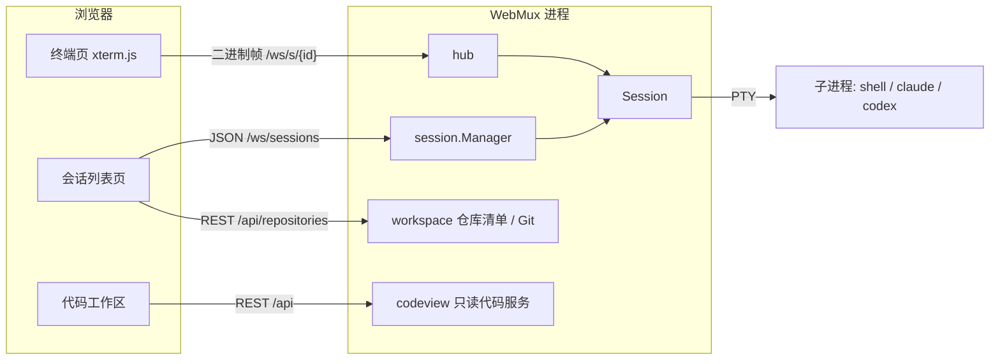
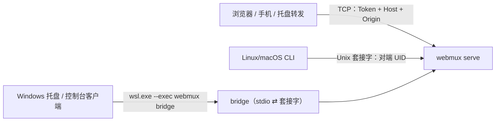

# 架构设计

## 设计目标

WebMux 是运行在单台 Linux / macOS 机器上的单用户 Web 终端。核心问题是：ttyd 一类工具在浏览器断开后会话即终止，手机锁屏、切网都会丢掉正在运行的 agent。WebMux 把 PTY 生命周期与浏览器连接解耦，会话由服务端持有，浏览器随时断开、随时重连。

**非目标**

- 多机网关、多用户或权限体系：以启动服务的系统用户身份运行。
- 服务重启后的会话存活：普通会话只在内存中，重启即结束。混合会话只持久化 webmux 会话与 agent 会话之间的对应关系（`hybrid-sessions.json`），重启后可从记录恢复，完整历史由 agent 自己保存。
- 进程沙箱：命令以服务用户身份执行，不做隔离。
- 依赖或兼容 tmux。

## 总体结构



浏览器断线后 Session 继续从 PTY 读取并写入环形缓冲；重连时先发送缓冲快照再续接实时流，因此断线期间的输出不会丢失。

## 模块划分

| 包                                            | 职责                                                                                            |
| --------------------------------------------- | ----------------------------------------------------------------------------------------------- |
| `cmd/webmux`                                  | 子命令分发、配置加载、显式依赖注入、信号处理与优雅退出                                          |
| `internal/settings`                           | 服务端偏好、修订号、原子订阅与有界事件队列                                                      |
| `internal/jsonutil`                           | 无业务依赖的严格 JSON 与必需字段检查                                                            |
| `internal/runtime`                            | 运行时记录、实例锁、进程身份、本机套接字与对端凭据                                              |
| `internal/contract`                           | 只依赖标准库的线上类型：REST 请求与响应、WebSocket 事件与终端帧、本机控制面与 `/local/v1` 路径  |
| `internal/wire`                               | Controller 层：Service 类型与 `contract` 线上类型之间的双向转换                                 |
| `internal/pathutil`, `internal/attentionkind` | 共享的路径展开与注意力种类，供 Service、配置与客户端共用                                        |
| `internal/localclient`                        | 经任意拨号器访问 HTTP/WS API 的客户端，可交叉编译到 Windows                                     |
| `internal/client`                             | CLI 侧的实例定位、链接推导、`status`/`stop` 退回逻辑                                            |
| `internal/config`                             | TOML 解析、默认值与校验                                                                         |
| `internal/session`                            | PTY、环形缓冲、OSC 标题、屏幕预览、状态探测、进程树清理                                         |
| `internal/hub`                                | 终端 WebSocket：快照与订阅、输出合并、JSON 控制帧编码、输入写入与取消                           |
| `internal/api`                                | REST 路由、认证、Origin 检查、上传请求解析、错误到状态码的映射、静态资源与 SPA 回退             |
| `internal/files`                              | 目录补全、创建目录、上传文件落盘（私有临时目录）                                                |
| `internal/workspace`                          | 仓库清单持久化、Git worktree 查询 / 创建 / 删除、启动目录协调                                   |
| `internal/launch`                             | 启动配置持久化（`launch-configs.json`）、独立文件锁、校验与不可用状态                           |
| `internal/tunnelsettings`                     | 隧道设置持久化、独立文件锁、校验与故障关闭                                                      |
| `internal/tailscale`                          | Tailscale CLI 定位、状态/入口解析、Serve/Funnel 精确应用与移除、WSL/Windows provider 检测       |
| `internal/tailscalesettings`                  | Tailscale 网页设置持久化、独立文件锁、校验与故障关闭                                            |
| `internal/wsl`                                | 共享的 WSL 判定与 `wslinfo --networking-mode` 探测                                              |
| `internal/codeview`                           | 只读文件浏览、Git 修改列表、内容快照与变化检测                                                  |
| `internal/push`                               | Web Push 订阅存储、注意力提醒与出站推送                                                         |
| `internal/archtest`                           | 只含测试：分层清单与架构规则 R0–R10                                                             |
| `internal/docguard`                           | 只含测试：文档与 spec 的行数、体积、目录扇出与树状组织规则                                      |
| `internal/wslclient`                          | Windows 客户端共用：`wsl.exe --exec webmux bridge` 拨号器、目标发行版解析、Windows→WSL 路径换算 |
| `internal/attach`                             | 原生终端附着核心（帧、控制权、尺寸、分离键、退出码）与 Unix / Windows 控制台适配                |
| `internal/sessioncmd`, `cmd/webmux-windows`   | `run`/`attach`/`ls`/`open` 共用实现；Windows 控制台客户端入口                                   |
| `internal/tray`                               | 托盘平台无关核心：设置、`wsl.exe` argv、启动方式、状态机、转发判定与日志                        |
| `internal/tray/forward`                       | 托盘转发：同源校验后把请求中转到 WebMux 的 TCP 监听                                             |
| `internal/tray/winui`, `cmd/webmux-tray`      | Windows 托盘界面、通知、剪贴板、登录启动与单实例（`//go:build windows`）                        |
| `web/`                                        | Svelte 5 前端，构建后通过 `go:embed` 嵌入二进制                                                 |

`cmd/webmux` 先加载配置，用 `cmd/internal/assemble` 把配置转换为 `session.Options` 与 `tailscale.Options`，再构造 `session.Manager`、启动配置、workspace、codeview、files、push、tunnelsettings、tailscalesettings 与 tailscale 检测服务，最后以 `api.Deps` 注入 `api.New`。Tailscale 控制器在绑定监听前对账并清理旧入口，监听开始后异步应用，网页更新时先移除不再符合新设置的本实例入口再应用；它与 Cloudflare 隧道控制器分别持有 `cloudflare` 与 `tailscale` 来源，互不清除。HTTP 控制器不直接访问状态文件。各模块通过构造函数显式依赖，不使用全局状态。

持久化文件清单与写入入口由同包的 `TestPersistence*` 单独检查，规则、现状与边界见 [配置与持久化清单](persistence.md)。

## 分层与架构测试

后端分为五层，`internal/archtest` 用 `golang.org/x/tools/go/packages` 加载带类型信息的源码检查规则；违规让 `go test ./...` 失败，一次列出全部违规，每条形如 `文件:行 [Rn] 消息 — 修复提示`。规则基于类型解析，导入别名、点导入和函数值都绕不过。

| 层             | 包                                                                                                                | 职责                                                                               |
| -------------- | ----------------------------------------------------------------------------------------------------------------- | ---------------------------------------------------------------------------------- |
| 装配根         | `cmd/...`                                                                                                         | 唯一构造 Service、把配置转换为 Service 选项并注入 Controller 的位置                |
| Controller     | `internal/api`、`internal/hub`、`internal/wire`                                                                   | HTTP/WebSocket 传输：解析请求、调用注入的 Service 方法、映射状态码、编解码线上类型 |
| Service        | `session`、`workspace`、`launch`、`push`、`codeview`、`files`、`tunnelsettings`、`tailscale`、`tailscalesettings` | 业务规则、状态、文件系统与进程                                                     |
| 共享           | `contract`、`config`、`runtime`、`statefile`、`fetch`、`pathutil`、`attentionkind`                                | 线上契约与基础设施，不依赖 Service 或 Controller                                   |
| 服务器外客户端 | `client`、`localclient`、`attach`、`sessioncmd`、`tray/...`、`wslclient`、`tunnel`、`service`                     | 只通过线上协议访问服务器，只依赖共享层和其他客户端                                 |

| 规则 | 检查                                                                                                                                                                                                                                                                                          |
| ---- | --------------------------------------------------------------------------------------------------------------------------------------------------------------------------------------------------------------------------------------------------------------------------------------------- |
| R0   | `internal/` 下每个包都在清单中，清单没有过期条目；出站与编码登记指向 Service 包；纯函数登记具有理由、真实包级函数及 Controller 使用点                                                                                                                                                         |
| R1   | 依赖方向：Service 不导入 Controller、`cmd/`、WebSocket 库或 `net/http/httptest`；共享层与客户端不导入 Service 或 Controller                                                                                                                                                                   |
| R2   | 只有 `cmd/` 导入 `internal/api`                                                                                                                                                                                                                                                               |
| R3   | Controller 不导入 `os/exec`、`syscall`、`golang.org/x/sys/...`、PTY 库或 `internal/statefile`                                                                                                                                                                                                 |
| R4   | Controller 不使用读写、创建或删除文件系统条目的 `os` 函数（`os.Hostname` 等不受限）                                                                                                                                                                                                           |
| R5   | Controller 的构造、状态和 I/O 操作只调用注入实例的方法；只允许显式登记并附理由的 Service 包级纯函数（目前为 `push.Validate`、`hybrid.FormValue`）；可以引用 Service 的类型、常量与哨兵错误                                                                                                    |
| R6   | Service 不使用服务端 HTTP 符号，不声明以 `*http.Request` 为参数的函数；只有登记为出站的 `push` 可以使用 HTTP 客户端符号                                                                                                                                                                       |
| R7   | Service 错误不携带整数 `Status`/`StatusCode`/`HTTPStatus`/`HTTPStatusCode` 字段，不提供错误到整数状态的同名方法或函数；显式 HTTP 状态方法或函数始终禁止。允许大小、行号、退出码等业务整数及非错误对象的 `Status() int`；HTTP 状态映射归 `internal/api/errors.go`                              |
| R8   | Controller 编解码的每个 JSON 值都是 `contract` 中的具名类型（可经指针、切片、映射）；汇点是 `encoding/json` 的编解码函数和登记的包装函数 `api.reply`/`decode`/`decodeOptional`/`serveCode`、`hub.jsonFrame`；接口类型的值只能出现在登记的包装函数内；`contract` 类型的字段不引用 Service 类型 |
| R9   | Service 不声明 `MarshalJSON`；JSON 编码器只能在登记函数体内直接调用（Web Push 载荷与 VAPID 头、代码视图摘要）。检查整个源码，包括包级初始化；禁止保存编码器函数值或方法值，即使位于登记函数中                                                                                                 |
| R10  | `contract` 不导入 Service 或 Controller                                                                                                                                                                                                                                                       |

**维护方式**

- 新增 `internal/` 包时，在 `internal/archtest/layers_test.go` 的清单中归类；删除包时同时删除条目。
- 例外只能写进清单的登记表（`outbound`、`sinks`、`encoders`、`pure`），并附理由，评审时可见。纯函数登记不能用于构造、状态访问或 I/O；缺失、未使用或指向非函数的条目使测试失败。依赖方向没有例外。
- 每条规则由 `internal/archtest/testdata/fixture` 中带 `// want Rn` 注释的故意违规验证；修改规则时同步增加违规与合规样例。
- Service 以哨兵错误报告错误种类（`workspace.ErrConflict`、`codeview.ErrGone`、`files.ErrTooLarge` 等），Controller 用 `errors.Is` 映射状态码，错误文本不变。
- 线上类型集中在 `internal/contract`，转换集中在 `internal/wire`，并保持 nil 与空集合的区别（`null` 与 `[]`/`{}` 不同）。持久化类型（`workspace` 的仓库清单、`launch.Config`、`push` 存储）保留自己的 json 标签，但不直接上线。

**线上快照**

`internal/api/testdata/wire/*.json` 是每个 REST 端点、`/ws/sessions` 事件和终端 JSON 帧的规范化快照。只按端点/帧的明确 JSON 路径处理动态时间、随机 ID、主机名及临时路径；业务正文、确定性 Git OID、版本摘要和固定输入保留，路径替换检查边界。六组场景各自持有夹具、期限和归一化状态，可用 `-run '^TestWireSnapshots$/codeview$'` 等单独运行。线上形状变化会给出 JSON 差异；有意的协议变更同时修改 `web/src/schemas.ts` 并重新录制：

```sh
go test ./internal/api -run TestWireSnapshots -update
```

快照文件的差异随变更一起评审。

真实终端输出分配基准：`go test ./internal/hub -run '^$' -bench '^BenchmarkAttachOutput$' -benchmem`。覆盖连续输出、输出间的控制消息与大块输出，通过真实 PTY 和 WebSocket 校验字节及顺序；比较前后版本时使用同一份基准和参数，不能把短采样中的耗时波动直接解释为吞吐提升。

## 客户端与通讯方案

服务端（`webmux serve`）是会话、认证与配置解析的唯一权威。所有客户端只使用同一套 HTTP/WebSocket API，按监听器区分认证策略：



- **TCP 监听**是网络边界，认证、Host 与 Origin 校验不变；本机专属的 `/local/*` 在 TCP 上返回 404。
- **Unix 套接字** `<state_dir>/run/webmux.sock`（0600，目录 0700）是本机边界：接受连接时校验对端有效 UID 与服务端相同，不同即关闭；浏览器无法连接 Unix 套接字，因此不做 Token、Host、Origin 校验。套接字额外提供 `/local/v1/status|shutdown|token|configuration`。
- **WSL 桥接**：WSL 2 的 Unix 套接字与 Windows 不互通，Windows 客户端启动 `webmux bridge`，把其标准输入输出当作一条连接，上层协议不变。
- **引导与兜底**保留为子命令：`serve` 启动服务，`config` 不需要服务在运行，`status` 在本机 API 不可用时读取运行时记录并做 TCP 健康检查，`stop` 在服务卡死时按记录发送信号。
- **信任边界**：能连接套接字的进程本来就能读取 0600 配置得到 Token 或向服务发信号，免 Token 不扩大权限。来自 WebMux 会话内部的连接（Linux 带 `WEBMUX_SESSION_ID` 环境变量或位于会话进程树中；macOS 只看进程树）可以创建、列出、附着会话，但 `shutdown` 与 `token` 返回 403。托盘转发只能指向 TCP 监听。
- **运行时记录** `<state_dir>/run/server.json` 在监听就绪后写入、正常退出时删除，由 `server.json.lock` 保证每个状态目录只有一个实例拥有记录与套接字；第二个实例照常提供 TCP 服务并在日志中警告。记录包含 PID 与进程启动标识，读取方据此识别 PID 复用；不包含 Token 明文。

## 关键设计原则

- **会话与连接解耦**：Session 的生命周期只由子进程决定；WebSocket 连接只是观察者，可以有零个或多个。
- **服务端只传字节**：PTY 原始字节直接进入缓冲并转发给 xterm.js，服务端不做终端仿真；OSC 标题与屏幕预览只是旁路解析。
- **重连优先增量续接**：输出有绝对字节 offset 与会话运行代际；客户端带着已渲染的位置重连，服务端仍保留后续字节时只补发缺失部分，否则清屏全量回放。服务端仍不做终端仿真。
- **会话只在内存中**：无数据库；仓库清单、启动配置、推送设置与隧道设置写入状态目录，Git 自己持有 worktree 与分支状态。
- **控制端决定尺寸**：多端同时附着时，只有控制端的 resize 生效；用户输入取得控制，控制端离开后不自动转交。终端自动回复只写入一个连接的回答。

## 会话生命周期

1. **创建**：解析已保存的自定义启动配置或使用请求中的完整 argv，校验并规范化 cwd，移除宿主终端与多路复用器的身份变量，设置 `TERM=xterm-256color`、`COLORTERM=truecolor`、`TERM_PROGRAM=webmux`、当前 `TERM_PROGRAM_VERSION` 和 `WEBMUX_SESSION_ID`，在新会话（`setsid`）中启动 PTY；不隐式经过 shell 或展开参数。启动配置显式提供的终端变量仍可覆盖这些默认值，以便用户选择 Kitty 等专用兼容模式。
2. **运行**：reader 循环读取 PTY → 写入环形缓冲 → 更新 OSC 标题与屏幕预览 → 广播给订阅者。
3. **退出**：子进程结束后先清理残留子进程、排空 PTY，再发布退出事件，保证退出帧之前的输出完整。
4. **关闭**：向进程组发送 SIGHUP，5 秒后 SIGKILL。按会话 ID 与进程树查找其他 job-control 进程组；Linux 另按继承的 `WEBMUX_SESSION_ID` 查找，并通过 subreaper 回收孤儿进程。
5. **移除**：只允许移除已退出的会话。

服务收到 SIGTERM 时关闭所有会话，等待最多 10 秒后退出。

## 混合会话

混合会话（`internal/hybrid`）把同一段 agent 对话放在原生 TUI 与 ACP 聊天视图之间切换，webmux 会话 ID 不变。

- **外壳与运行**：`session.Session` 是外壳（ID、信息、列表发布、终端订阅者与控制端），每次 PTY 进程是一次运行。普通会话恰好一次运行，行为不变；混合会话由 `hybrid` 以驱动身份经 `Manager.CreateShell` 创建，可以没有运行（聊天端），也可以在同一 ID 下以新代际重新启动运行。切换导致运行结束时不发布退出帧，而以 4409 关闭终端连接。
- **伴随进程**：ACP 进程由外壳以 `StartSidecar` 启动，环境与 PTY 运行相同（同一 `WEBMUX_SESSION_ID`），经 `startChild` 登记以免 subreaper 抢走退出状态；bashrc 包装下 agent 的 stdout 改走 fd 3，`.bashrc` 的输出不进入协议通道。
- **单写者**：每个混合会话一个 actor 拥有全部可变状态；进入目标端之前必须观察到原端进程组退出，任何时刻至多一个进程打开该 agent 会话（omp 在 TUI 持有租约时另一进程写入会分叉会话）。资格探测的临时进程只调用 `session/list`。
- **协议边界**：`internal/acp` 是只依赖标准库的 ACP v1 客户端（共享层），`internal/agentprofile` 是纯数据档案（命令写法、参数分类、恢复与 ACP 命令、身份映射）。ACP 更新在 `hybrid` 中翻译为 webmux 自己的规范化事件（按 `messageId`/`toolCallId` upsert），前端与 `contract` 不接触 ACP 原文。
- **生命周期**：从终端或聊天开始；切换失败自动回到原端；TUI 自行退出或回滚失败标记 `interrupted`；ACP 意外退出自动重连一次；聊天端空闲 `chatIdleSleepMinutes` 分钟后休眠并在下次命令时唤醒；关闭记为 `closed`；服务启动时把 `active` 记录改为 `interrupted`，并结束 PID 与启动标识都匹配的残留进程组。协议见 [混合会话接口](protocol/http-hybrid.md)。

## 环形缓冲与回放

缓冲按**字节**而非行存储（默认 2 MiB），写满后覆盖最旧数据。agent 输出大量使用光标移动和重绘（spinner、进度条、TUI），按行截断会破坏转义序列；按字节回放由 xterm.js 重新解释最为稳妥。代价是最旧数据可能从转义序列中间开始，首行偶有乱码。

快照捕获与订阅注册在同一把锁内完成，保证回放与实时流之间没有缺口。

缓冲记录累计写入字节数，因此每个字节都有绝对 offset。每次回放前先发送位置帧（代际、起止 offset、是否截断）。客户端只统计已交给 xterm 的字节；页面隐藏时停止写入并保留 offset，回到前台重连后由服务端补发其后的字节。代际不符或 offset 已被覆盖时退回全量快照。

终端查找完全在浏览器中由官方 SearchAddon 搜索 xterm 活动缓冲，无新增服务端接口或文本索引。查找栏覆盖在网格上方，不触发 PTY resize 或输入；全量回放清除结果，增量续接保留视口。清除时同时清理装饰、选区与响应式结果；1000 个高亮上限不代表匹配总数。

## 提交与控制端

- **提交**：草稿与带回车的快捷指令以“提交”帧发送（JSON 头 + 原始字节），绑定唯一 ID 与运行代际。服务端在会话锁内查重、登记后，在一次输入锁持有期间写入正文与提交键，并回报 received / written / partial / failed。会话保留最近 256 条、30 分钟的记录，重复 ID 不再写入，客户端可在重连后查询。已登记的提交不随连接取消，仍受 10 秒写期限约束。
- **控制端**：每个标签页有稳定的客户端 ID。首个附着的客户端成为控制端，同一客户端重连保持控制；非自动回复的输入、提交或显式接管把控制权交给发送方。只有控制端的 resize 生效，尺寸或控制变化时向所有连接广播控制帧，观察端按该网格渲染。

## 屏幕预览与标题

- **OSC 标题与侧信道**：增量状态机识别 `ESC ] 0/2 ; text BEL|ST` 标题（最多 512 字节），以及裸 BEL、`OSC 9` 通知（跳过 `9;4` 等数字子命令）、`OSC 777;notify` 通知、`warp://cli-agent` 结构化事件、`OSC 7501` 程序状态（含 `7501;?` 探测）、`OSC 133;A` 提示符与 RIS；支持跨读取块拼接，单个 OSC 最多累积 4096 字节，DCS/APC 等字符串内的 BEL 不计入。结构化事件只取 `event` 名，`OSC 7501` 只取根记录的 `state` 与 `kind`，正文从不保存。
- **屏幕预览**：使用 `github.com/0magnet/xterm-go/vt` 只读跟踪当前屏幕（零 scrollback），提取底部最多 100 条非空行，每行最多 120 个字符。预览解析器从不向 PTY 写入，也不改写原始字节流。

## 状态探测

每 500 ms 评估一次，进程表每秒刷新：

```text
if exited                                   → exited
else if 存在 OSC 7501 根记录                 → blocked: waiting；idle: idle；
                                               done/error: 有关注 waiting，否则 idle；
                                               working: 超过 idle_after_seconds 无输出 idle，否则 running
else if 存在关注（attention）                → waiting
else if 最近 2 秒有输出                      → running
else if 未收到过结构化信号 &&
        (末行匹配提示符 || 在等待终端输入)    → waiting
else if 超过 idle_after_seconds 无输出       → idle
else                                        → running
```

“结构化信号”指进程生命周期内收到过的任何 `OSC 7501` 根记录或 Warp 事件。

关注是锁存值，来源分层为 `OSC 7501` 根记录 > Warp 事件 > `OSC 9`/`777` 通知 > BEL。根记录存在时只由其变化置位、替换或清除关注，其余来源被忽略；否则按优先级 question = permission > error > done > notify > bell 合并，弱信号不覆盖强信号，较低层不覆盖较高层，后续输出不清除。成功写入的用户输入（只含 OSC/DCS、设备属性、光标位置、状态报告和焦点事件的终端应答除外）、根记录变为 working/idle/clear 或被 `OSC 133;A`/RIS 作废、无根记录时的 `prompt_submit` / `permission_replied` / `session_start` 事件，以及进程退出会清除关注。

会话在读取路径识别到 `OSC 7501;?` 时，在把这段输出发布给订阅者之前把应答放入有界队列（上限 4 条）。任何写入者取得输入闸门后都先写出队列中的应答，后台 goroutine 也会在没有客户端时写出，因此应答必然早于浏览器对随后 DA1 的回复。回放不触发应答，`webmux attach` 也不把探测转发给本地终端。用户输入后 1 秒内的 BEL 被忽略。会话环境会移除宿主终端与多路复用器的身份变量（如 `TMUX`、`KITTY_*`、`WARP_*`），设置 `TERM_PROGRAM=webmux` 及运行服务版本的 `TERM_PROGRAM_VERSION`，并保留 `TERM=xterm-256color` 与 `COLORTERM=truecolor` 的兼容默认值；启动配置显式提供的同名变量优先。`agent_protocol` 开启时另设置 `WARP_CLI_AGENT_PROTOCOL_VERSION=1`。

进程树检查在 Linux 读取 `/proc/*/stat`，分类时再读会话叶子的 `wchan`；在 macOS 使用 `sysctl kern.proc.all` 的等待信息，以及 `proc_pidinfo` 的运行线程数和可执行文件路径。其他平台返回 false。叶子全部是计时休眠（命令名或可执行文件名为 `sleep`，或等待频道为 nanosleep；Darwin 上该频道截断为 `nanosle`）时不算在等终端输入；看不出来的睡眠仍视为可能在等输入，以免漏掉无提示符的 `read`。没有这些等待特征时，2 秒到 `idle_after_seconds` 之间保持 running，而不是 waiting。状态只用于展示，误判无害。

## 并发与背压

- Manager 与 Session 状态由各自的锁保护，锁不跨越阻塞的网络或 PTY 操作。
- 共享的 PTY 输出块不可变；每个连接只有一个写 goroutine，负责合并输出（最多 64 KiB）、把状态、位置、提交与控制消息编码为 JSON 帧并写入 WebSocket。订阅者队列里是 `session.Message`：输出与快照仍是共享字节块，其余是类型化消息，入队位置与锁范围不变。
- `Message` 由集中构造函数创建，必须恰有一个载荷；原始帧必须带 0/1 前缀，空快照仍保留前缀。Hub 在编码与合并前校验；非法消息或 JSON 编码失败以 1011 关闭当前连接，不记录载荷，也不结束持久会话。待发消息用值加布尔标记保存，避免 channel 接收变量因取地址而逃逸；控制消息、快照、超出合并上限的输出和退出消息保持顺序。
- 订阅者队列有界，慢客户端被断开（关闭码 4408）后重连回放，而不会阻塞 PTY reader。
- PTY 使用 Go netpoll 支持的非阻塞描述符；连接断开可取消阻塞中的输入写入，不影响持久会话。输入在等待写锁前后都会检查取消状态，单次写入最长 10 秒。

## 仓库与 worktree

- 仓库清单为版本化 JSON，通过临时文件 + fsync + 原子替换保存，进程文件锁防止多实例覆盖。
- Git 以 argv 方式调用，使用 NUL 分隔的机器输出并禁用交互；读操作期限 10 秒，写操作 30 秒。
- 所有会话创建经过统一协调层登记启动目录；删除预留会阻止目标目录的新启动。
- 删除预览生成 5 分钟内单次有效的确认 ID，绑定目录、分支、锁和会话集合，执行前重新验证。强制删除等待相关会话完全退出后执行单次 `git worktree remove --force`，不使用递归删除兜底。

## 只读代码工作区

- 根目录在首次读取时绑定到会话启动目录所在的 worktree 顶层，之后不随终端中的 `cd` 变化。
- OSC 7 报告的目录只用于列表展示和显式的相对路径定位。会话归属、代码根、读取边界和命令执行环境仍取启动目录及其 worktree；远端主机的报告不参与本机路径解析。定位由服务端完成：报告目录和启动目录可能是经过符号链接的逻辑路径，而代码根已规范化，因此先解析符号链接再与根比较。
- 路径从根目录描述符逐段 `openat(O_NOFOLLOW)` 打开，拒绝符号链接遍历、特殊文件、`.git` 内部和嵌套仓库。
- Git 查询设置 `GIT_OPTIONAL_LOCKS=0`，禁用 clean / process filters 与 fsmonitor，从不修改索引或对象。
- 内容快照归属会话，总预算 64 MiB、最长 10 分钟；过期返回 410，不会用新内容冒充旧快照。
- Diff 在浏览器 Web Worker 中使用 jsdiff 计算，服务端只返回冻结的双侧原文。

## 前端

- Svelte 5 + TypeScript + Vite，基础控件使用 shadcn-svelte，样式基于 Tailwind CSS。
- 所有 HTTP 响应、WebSocket JSON 和本地设置都先经 Zod 校验（`web/src/schemas.ts`），再进入页面状态。
- 终端使用 xterm.js 5 与 WebGL 渲染；WebGL 不可用、上下文丢失或像素尺寸不一致时回退到 DOM 渲染器，不重置终端。
- PTY 数据始终以二进制传输，不转为 JSON 或解码文本。

## 已知实现要点

- `pty.Read` 在子进程退出后返回 `EIO`，是正常的结束信号。
- `coder/websocket` 的写入不是并发安全的，所有写操作都经由连接的单个 writer。
- xterm.js 的 `write` 是异步的，回放完成后需在回调中滚动到底部。
- SPA 回退对 `/assets/*` 返回 404，避免缺失资源被 `index.html` 替代。
- 未构建前端时 `go test` 仍可运行，但 HTTP 页面返回 503。
