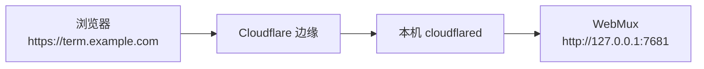

# Cloudflare Named Tunnel 配置指南

本指南面向第一次配置 Cloudflare Tunnel 的 WebMux 用户，说明如何获得一个固定的 HTTPS 公网入口，并从手机等外部设备访问自己的终端。只需要照着“5 分钟配置”操作；遇到问题可跳到“故障排查”。

## 1. 先选访问方式

| 方式                  | 入口是否固定   | 前提                                   | 适合                                            |
| --------------------- | -------------- | -------------------------------------- | ----------------------------------------------- |
| 本机回环              | 固定           | 无                                     | 只在这台电脑上使用                              |
| Tailscale / WireGuard | 通常固定       | 服务器与每台设备安装并加入同一网络     | 可信设备之间的远程访问，推荐优先使用            |
| Quick Tunnel          | 每次启动都变化 | 无，不需要 Cloudflare 账号             | 临时演示、一次性排障                            |
| Named Tunnel          | 固定           | Cloudflare 账号，域名已接入 Cloudflare | 长期手机访问、Web Push 推送、需要稳定地址的场景 |

无论使用哪种公网方式，WebMux 都要求 Token。公网入口等同于把 shell 暴露给能拿到链接和 Token 的人，请先阅读[安全策略](../SECURITY.md)。

## 2. 工作原理



WebMux 启动并管理 `cloudflared` 子进程；Cloudflare 边缘把公共主机名的请求转发到本机 WebMux。浏览器看到的始终是 HTTPS 地址，手机因此可以使用推送等需要安全上下文的功能。

## 3. 前置条件

- 一个 Cloudflare 账号。
- 一个已添加到 Cloudflare 并生效的域名。Cloudflare 只会为已接入的域名提供公共主机名。
- WebMux 已能正常运行。隧道模式下若显式配置根 `token`，至少需要 43 个字符；留空则每次启动自动生成。`webmux config init` 生成的 Token 满足要求。
- 允许 `cloudflared` 出站访问 Cloudflare 边缘。除 HTTPS 外，通常还需要放行出站 TCP/UDP 7844。
- 如果本机尚未安装 `cloudflared`，WebMux 会尝试从 GitHub 下载固定版本，失败时按配置的镜像回退；也可以提前手动安装。

## 4. 5 分钟配置

### 4.1 创建隧道

打开 Cloudflare 控制台，进入 **Networking → Tunnels → Create a tunnel**，选择 **Cloudflared**，为隧道取一个名字并保存。

> 较新的控制台把 Tunnels 放在 **Networking** 下；旧界面位于 **Zero Trust → Networks → Tunnels**。按钮名称可能随界面更新略有变化，认准 “Create a tunnel / Cloudflared” 即可。

### 4.2 复制隧道 Token

打开刚创建的隧道，进入 **Overview → Add a replica**。安装命令中形如 `eyJ...` 的长字符串就是隧道 Token。

复制它，但**不要运行这条安装命令**。WebMux 会自己启动 `cloudflared`，再运行 Cloudflare 的安装命令只会多出一个不受管理的连接器。

如果需要更换凭据，可在同一页面刷新 Token，然后同步修改 WebMux 配置并重启。

### 4.3 发布应用

进入 **Routes → Add route → Published application**：

- 填写一个子域名和你的域名，例如 `term.example.com`；
- Path 留空；
- Service URL 填 `http://127.0.0.1:7681`。

Service URL 的端口必须与 WebMux 的 `listen` 一致。如果 `listen` 改成了 `127.0.0.1:9000`，这里也要写 `http://127.0.0.1:9000`。

> 旧界面把这一步称为 **Public Hostname**，填写内容相同。

### 4.4 写入 WebMux 配置

编辑配置文件（默认 `~/.config/webmux/config.toml`，也可用 `webmux config path` 查看），加入：

```toml
[tunnel]
enabled = true
token = "Cloudflare 隧道 Token"
hostname = "term.example.com"
```

- `token` 填第 4.2 步复制的 Cloudflare 隧道凭据；
- `hostname` 填第 4.3 步发布的公共主机名；
- 不要把 WebMux 的登录 Token 填到 `[tunnel].token`。

保存后运行：

```sh
webmux config check
```

输出 `<配置路径>: OK` 表示格式和必填项没有问题。

### 4.5 重启并验证

重启 WebMux。使用 systemd / launchd 时执行 `webmux service restart`；Windows 托盘用户见第 6 节。**重启会结束所有终端会话。**

验证顺序：

1. 服务日志出现 `WebMux public: https://term.example.com/...`；
2. Cloudflare 控制台的隧道状态为 Healthy；
3. 浏览器打开 `https://term.example.com`，输入 WebMux Token 后能进入；
4. 手机上打开同一地址，确认可以新建或续接会话。

隧道就绪后，服务输出还会打印带 Token 的链接和二维码，扫码即可登录。

## 5. 配置项说明

| 配置项             | 说明                                                                                                          |
| ------------------ | ------------------------------------------------------------------------------------------------------------- |
| `enabled`          | 启动时是否自动开启隧道。运行中通过托盘开关不会改写这个值，下次启动仍按配置决定；托盘开关状态本身不保存。      |
| `token`            | 空表示 Quick Tunnel；非空表示 Named Tunnel，值是 Cloudflare 隧道凭据，不是 WebMux 登录 Token。                |
| `hostname`         | Named Tunnel 的公共主机名。必须是纯主机名，不能带 `https://`、端口、路径、查询参数或通配符；IDN 用 punycode。 |
| `cloudflared`      | 可选，显式指定 `cloudflared` 可执行文件路径。指定后不再自动查找或下载。                                       |
| `download_mirrors` | 可选，替换内置下载镜像列表；`[]` 表示只从 GitHub 下载。                                                       |

补充说明：

- `hostname` 必须与 Cloudflare 的公共主机名完全一致。WebMux 用它做 Host / Origin 校验，不一致时公网请求会被拒绝。
- 根 `token` 和 `[tunnel].token` 是两套凭据，见第 8 节。
- 修改任何 `[tunnel]` 配置后都需要重启 WebMux；运行中不会重新读取配置。
- 隧道就绪后如果意外退出，WebMux 不会自动重试，公网地址立即失效；本机会话不受影响。

## 6. Windows / WSL 托盘

1. 还没有配置文件时，托盘显示 **初始化配置（生成 Token）**：先用它生成配置（含满足隧道要求的根 Token）；
2. 在托盘中打开 **打开 WebMux 配置文件**；
3. 按第 4.4 节加入或修改 `[tunnel]`；
4. 保存后选择托盘菜单的 **重启**（会结束所有会话）；
5. 需要临时开关时，使用 **公网隧道（Cloudflare）** 勾选项。它只影响本次运行，不修改配置文件；
6. 隧道启动后，菜单显示公网地址，**复制公网链接** 会带上 WebMux Token；
7. 查看错误时使用 **打开日志 → 打开 WebMux 日志**。

配置文件已存在时托盘不再提供初始化入口。若提示 Token 不足 43 个字符，在配置文件中把根 `token` 改为至少 43 个字符的随机值，或删除该行让 WebMux 每次启动自动生成，然后重启 WebMux。

WSL 中 WebMux 通常监听 `127.0.0.1:7681`，Cloudflare 的 Service URL 也填 `http://127.0.0.1:7681`。这里的回环地址指 WSL 内部，不是 Windows 的 `localhost`。

## 7. 手机推送

Web Push 只支持从 Named Tunnel 的 `https://<hostname>` 开启，Quick Tunnel 每次启动都会更换地址，旧订阅会失效。

- 只需在配置中写入 `[tunnel].token` 与 `hostname`，推送来源就按该主机名判定，即使隧道当前没有运行；
- 手机必须从这个 HTTPS 地址打开 WebMux，再进入 设置 → 通知推送 开启；
- 修改 `hostname` 后，需在各设备重新开启推送；
- 隧道关闭期间推送仍会发出，但点开通知要等隧道恢复后才能打开页面。

详见[部署指南的手机推送章节](deployment.md#手机推送web-push)。

## 8. 安全

- **根 `token`**：WebMux 的登录 Token，隧道模式下至少 43 个字符。拿到它就能以服务用户身份执行命令。
- **`[tunnel].token`**：Cloudflare 隧道凭据，能让连接器接入你的 Cloudflare 隧道。它不能用于登录 WebMux。WebMux 通过 `TUNNEL_TOKEN` 环境变量把它传给 `cloudflared`，不出现在进程命令行和 `ps` 输出中；启动 Quick Tunnel 时也会清除继承的同名变量。
- 两者泄露的后果不同：根 Token 泄露等于 shell 泄露；隧道凭据泄露则可能被他人接入隧道。发现泄露后应立即更换：根 Token 修改配置后重启，隧道凭据在 Cloudflare 控制台刷新后同步配置并重启。
- 带 Token 的链接和二维码会出现在启动日志、托盘剪贴板或手机浏览历史中；以 systemd / launchd 运行时请限制日志访问权限。
- Quick Tunnel 没有 Cloudflare Access，任何拿到链接和 Token 的人都能访问。Named Tunnel 可以额外叠加 Cloudflare Access，但 WebMux 仍会要求自己的 Token。
- 不需要公网访问时，关闭隧道（托盘开关或本机 API），或把 `enabled` 改为 `false` 后重启。

## 9. 故障排查

| 现象                                                                 | 可能原因                                                            | 处理                                                                                |
| -------------------------------------------------------------------- | ------------------------------------------------------------------- | ----------------------------------------------------------------------------------- |
| Cloudflare 显示 1033 或隧道未连接                                    | `cloudflared` 没有启动、凭据无效或出站网络被拦截                    | 查看 WebMux 日志；检查出站 7844 与 HTTPS；在 Cloudflare 控制台刷新 Token 后更新配置 |
| 打开域名显示 502 Bad Gateway                                         | Service URL 端口与 `listen` 不一致，或 WebMux 没有运行              | 把 Service URL 改为 `http://127.0.0.1:<listen 端口>`，确认 WebMux 正在监听          |
| 域名返回 403                                                         | `tunnel.hostname` 与公共主机名不一致，或请求不是从该 HTTPS 来源进入 | 改成 Cloudflare 上的纯主机名并重启；不要用其他域名或 HTTP 访问                      |
| `tunnel.hostname is required when tunnel.token is set`               | 配置了隧道凭据但没有写 `hostname`                                   | 补充 `hostname`，或清空 `token` 改用 Quick Tunnel                                   |
| `tunnel mode requires the webmux token to be at least 43 characters` | 根 `token` 太短                                                     | 在现有配置中把根 `token` 改为至少 43 个字符，或删除该行自动生成，然后重启           |
| `tunnel.hostname ... must be a bare hostname such as ...`            | `hostname` 带了协议、端口、路径或空格                               | 只保留公共主机名，例如 `term.example.com`                                           |
| `tunnel.hostname ... must use the ASCII/punycode form`               | `hostname` 含非 ASCII 字符                                          | 中文等国际化域名改用 punycode（`xn--` 开头）形式                                    |
| `tunnel.hostname ... not a wildcard`                                 | `hostname` 是通配符                                                 | 填 Cloudflare 实际转发的具体主机名                                                  |
| 下载 `cloudflared` 失败                                              | GitHub 或镜像不可达，或文件校验失败                                 | 手动安装并把 `tunnel.cloudflared` 指向可执行文件；或调整 `download_mirrors`         |
| 隧道运行一段时间后断开                                               | `cloudflared` 意外退出                                              | WebMux 不会自动重连；在托盘重新开启或重启 WebMux，并查看日志                        |
| 改了配置但没有生效                                                   | 配置只在启动时读取                                                  | 重启 WebMux（会结束所有会话）；托盘开关不会保存，也不等于修改 `enabled`             |
| 手机无法开启推送                                                     | 没有配置 Named Tunnel，或当前不是从其 HTTPS 地址打开                | 配置 `[tunnel].token` 与 `hostname`，重启后用 `https://<hostname>` 打开再开启推送   |
| 托盘里开启隧道失败                                                   | 根 Token 不足 43 个字符，或 `cloudflared` 无法定位                  | 按上文修改根 `token`；安装 `cloudflared` 或设置 `tunnel.cloudflared`，然后重启      |

## 10. 相关文档

- [部署指南：公网访问](deployment.md#公网访问cloudflare-tunnel)
- [部署指南：手机推送](deployment.md#手机推送web-push)
- [部署指南：Windows / WSL](deployment.md#windowswsl)
- [安全策略](../SECURITY.md)
- [配置样例](../deploy/config.example.toml)
