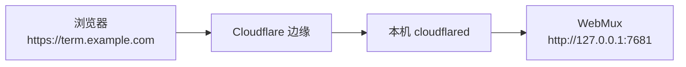

# Cloudflare Named Tunnel 配置指南

本指南面向第一次配置 Cloudflare Tunnel 的 WebMux 用户，说明如何获得一个固定的 HTTPS 公网入口，并从手机等外部设备访问自己的终端。只需要照着“5 分钟配置”操作；遇到问题可跳到“故障排查”。

## 1. 先选访问方式

| 方式                  | 入口是否固定   | 前提                                   | 适合                                            |
| --------------------- | -------------- | -------------------------------------- | ----------------------------------------------- |
| 本机回环              | 固定           | 无                                     | 只在这台电脑上使用                              |
| Tailscale / WireGuard | 通常固定       | 服务器与每台设备安装并加入同一网络     | 可信设备之间的远程访问，推荐优先使用            |
| Tailscale Serve       | 固定           | Tailscale、HTTPS 证书；`[tailscale]`   | tailnet 内自动 HTTPS，无需公网暴露              |
| Tailscale Funnel      | 固定           | 显式 `mode = "funnel"`、funnel 属性    | 需要公网 HTTPS 且不想使用 Cloudflare 的场景     |
| Quick Tunnel          | 每次启动都变化 | 无，不需要 Cloudflare 账号             | 临时演示、一次性排障                            |
| Named Tunnel          | 固定           | Cloudflare 账号，域名已接入 Cloudflare | 长期手机访问、Web Push 推送、需要稳定地址的场景 |

无论使用哪种公网方式，WebMux 都要求 Token。公网入口等同于把 shell 暴露给能拿到链接和 Token 的人，请先阅读[安全策略](../SECURITY.md)。

Tailscale Serve 只需 tailnet 内可达，适合可信设备；Funnel 会公开到互联网，风险与 Named Tunnel 相当。两者的配置与手工移除命令见 [Tailscale Serve / Funnel 入口](tailscale.md)。Web Push 支持 Cloudflare Named Tunnel、Tailscale Serve/Funnel 等已授权的 HTTPS 入口以及本机回环地址；Quick Tunnel 每次启动更换地址，仍不支持。

## 2. 工作原理



WebMux 启动并管理 `cloudflared` 子进程；Cloudflare 边缘把公共主机名的请求转发到本机 WebMux。浏览器看到的始终是 HTTPS 地址，手机因此可以使用推送等需要安全上下文的功能。

## 3. 前置条件

- 一个 Cloudflare 账号。
- 一个已添加到 Cloudflare 并生效的域名。Cloudflare 只会为已接入的域名提供公共主机名。
- WebMux 已能正常运行。隧道模式下若显式配置根 `token`，至少需要 43 个字符；留空则每次启动自动生成。`webmux config init` 生成的 Token 满足要求。
- 允许 `cloudflared` 出站访问 Cloudflare 边缘。除 HTTPS 外，通常还需要放行出站 TCP/UDP 7844。
- 如果本机尚未安装 `cloudflared`，WebMux 会尝试从 GitHub 下载固定版本，失败时按配置的镜像回退；也可以提前手动安装。

## 4. 5 分钟配置

### 4.1 创建隧道

打开 Cloudflare 控制台，进入 **Networking → Tunnels → Create a tunnel**，选择 **Cloudflared**，为隧道取一个名字并保存。

> 较新的控制台把 Tunnels 放在 **Networking** 下；旧界面位于 **Zero Trust → Networks → Tunnels**。按钮名称可能随界面更新略有变化，认准 “Create a tunnel / Cloudflared” 即可。

### 4.2 复制隧道 Token

打开刚创建的隧道，进入 **Overview → Add a replica**。安装命令中形如 `eyJ...` 的长字符串就是隧道 Token。

复制它，但**不要运行这条安装命令**。WebMux 会自己启动 `cloudflared`，再运行 Cloudflare 的安装命令只会多出一个不受管理的连接器。

如果需要更换凭据，可在同一页面刷新 Token，然后在 WebMux 网页“设置 → 公网访问”填写新凭据并保存；不需要重启 WebMux。

### 4.3 发布应用

进入 **Routes → Add route → Published application**：

- 填写一个子域名和你的域名，例如 `term.example.com`；
- Path 留空；
- Service URL 填 `http://127.0.0.1:7681`。

Service URL 的端口必须与 WebMux 的 `listen` 一致。如果 `listen` 改成了 `127.0.0.1:9000`，这里也要写 `http://127.0.0.1:9000`。

> 旧界面把这一步称为 **Public Hostname**，填写内容相同。

### 4.4 在网页保存设置

打开 WebMux **设置 → 公网访问 → Named Tunnel**：

1. 公共主机名填写第 4.3 步发布的 `term.example.com`，不要带协议、端口、路径或通配符；
2. Cloudflare 隧道凭据填写第 4.2 步取得的 Token，不是 WebMux 登录 Token；
3. 点击 **保存并应用**。凭据只写不读，保存成功后输入框清空；之后留空表示保留已保存凭据；
4. 点击 **启用公网访问**，阅读公开 Shell 风险并确认。开启状态会保存，服务下次启动时自动恢复。

若只需临时地址，可选择 Quick Tunnel，无需 Cloudflare 账号。保存 Quick 模式会清除已保存的 Named 凭据与主机名。

### 4.5 验证

1. 网页状态由“启动中”变为“已就绪”，显示公网地址；
2. Cloudflare 控制台的隧道状态为 Healthy；
3. 浏览器打开 `https://term.example.com`，输入 WebMux Token 后能进入；
4. 手机上打开同一地址，确认可以新建或续接会话。

保存、启停、更换凭据和主机名都无需重启 WebMux，不结束终端会话。切换配置会重启 cloudflared，公网连接可能短暂中断；若从当前公网入口操作，确认框会提示断线风险。本机或 VPN 访问不受影响。

网页复制的链接不含登录 Token，需要在新设备登录。运行时开启不在日志打印登录 Token；显式启动隧道时仍沿用原有链接与二维码输出规则。

### 4.6 运维配置与持久化优先级

没有网页覆盖时，可继续通过 TOML 提供默认设置：

```toml
[tunnel]
enabled = true
token = "Cloudflare 隧道 Token"
hostname = "term.example.com"
```

网页和托盘开关保存到 `<state_dir>/tunnel.json`，文件权限 0600、目录权限 0700，原子写入并使用独立锁。文件存在时，其开关、模式、凭据和主机名覆盖 TOML；`cloudflared` 与 `download_mirrors` 仍由 TOML 管理。不会改写 `config.toml`。

- `--tunnel` / `--tunnel=false` 只覆盖本次进程，不改持久化开关；之后网页或托盘操作以新选择为准。
- “恢复配置文件设置”删除网页覆盖并停止当前隧道；下次启动按 TOML 决定是否开启。
- 文件损坏、不可读或锁冲突时保持隧道关闭，继续提供本地 HTTP 服务并显示故障；不会回退到可能开启公网的旧 TOML。只有确认文件不存在时才采用 TOML 默认值。
- 网页托管隧道在 HTTP 开始监听后恢复；cloudflared 不可用或登录 Token 过短只让隧道失败，不阻止服务启动。没有网页覆盖时，TOML 与显式 `--tunnel` 的启动前校验仍适用。
- 存储写入失败时，开启或配置更新不会应用；**关闭仍立即撤销公网授权并停止进程**，但页面会说明关闭状态未能保存。修复存储后再次保存关闭，避免下次启动恢复旧设置。

## 5. 配置项说明

| 配置项             | 说明                                                                                                          |
| ------------------ | ------------------------------------------------------------------------------------------------------------- |
| `enabled`          | 没有网页覆盖时的启动默认开关。网页或托盘修改的开关单独保存，重启后恢复。                                      |
| `token`            | 空表示 Quick Tunnel；非空表示 Named Tunnel，值是 Cloudflare 隧道凭据，不是 WebMux 登录 Token。                |
| `hostname`         | Named Tunnel 的公共主机名。必须是纯主机名，不能带 `https://`、端口、路径、查询参数或通配符；IDN 用 punycode。 |
| `cloudflared`      | 可选，显式指定 `cloudflared` 可执行文件路径。指定后不再自动查找或下载。                                       |
| `download_mirrors` | 可选，替换内置下载镜像列表；`[]` 表示只从 GitHub 下载。                                                       |

补充说明：

- `hostname` 必须与 Cloudflare 的公共主机名完全一致。WebMux 用它做 Host / Origin 校验，不一致时公网请求会被拒绝。
- 根 `token` 和 `[tunnel].token` 是两套凭据，见第 8 节。
- 手工修改 TOML 后需要重启；已有网页覆盖时，先恢复配置文件设置才会重新采用其隧道默认值。通过网页修改隧道配置无需重启。
- 设置页显示摘要，“管理公网访问”进入完整配置页；页面轮询运行状态与当前有效开关，凭据从不回填。
- 隧道就绪后如果意外退出，WebMux 不会自动重试，公网地址立即失效；本机会话不受影响。

## 6. Windows / WSL 托盘

1. 点击托盘 **打开公网访问设置…**，在默认浏览器配置 Quick/Named Tunnel；
2. **公网隧道（Cloudflare）** 保留为快捷开关，与网页共享服务端持久化设置；勾选反映当前进程的有效期望开关，包括命令行覆盖以及启动失败但仍希望开启的状态；
3. 隧道就绪后可 **复制公网链接**；该托盘链接仍可带 WebMux Token，应按敏感凭据保管；
4. 查看错误时使用 **打开日志 → 打开 WebMux 日志**。托盘不保存隧道设置，不会在自身重启时改写服务端开关。

根登录 Token 不足 43 个字符仍需通过现有配置文件或配置命令修复并重启；网页不管理根 Token。新托盘连接不支持网页配置的旧服务端时，不显示新页面入口，仍保留该服务端支持的快捷开关和配置说明。

WSL 中 WebMux 通常监听 `127.0.0.1:7681`，Cloudflare 的 Service URL 也填 `http://127.0.0.1:7681`。这里的回环地址指 WSL 内部，不是 Windows 的 `localhost`。

## 7. 手机推送

Web Push 可从通过 Host/Origin 校验的 HTTPS 入口开启，包括 Named Tunnel 的 `https://<hostname>`、托管 Tailscale Serve/Funnel，以及 `allowed_origins` 中的 HTTPS 反向代理；Quick Tunnel 每次启动都会更换地址，旧订阅会失效，因此不支持。

- 网页保存的 Named 凭据和主机名（无覆盖时为 TOML）决定 Named 来源，即使隧道当前没有运行；Tailscale Serve/Funnel 就绪后同样登记为 HTTPS 来源；
- 手机必须从这个 HTTPS 地址打开 WebMux，再进入 设置 → 通知推送 开启；
- 修改 `hostname` 或 Tailscale 入口端口后，已有订阅保留登记时的旧地址，不自动迁移；需从新地址在各设备重新开启推送；
- 隧道或 Tailscale 入口关闭期间推送仍会发出，但点开通知要等入口恢复后才能打开页面。

详见[部署指南的手机推送章节](deployment.md#手机推送web-push)。

## 8. 安全

- **根 `token`**：WebMux 的登录 Token，隧道模式下至少 43 个字符。拿到它就能以服务用户身份执行命令。
- **`[tunnel].token`**：Cloudflare 隧道凭据，能让连接器接入你的 Cloudflare 隧道。它不能用于登录 WebMux。WebMux 通过 `TUNNEL_TOKEN` 环境变量把它传给 `cloudflared`，不出现在进程命令行和 `ps` 输出中；启动 Quick Tunnel 时也会清除继承的同名变量。
- 两者泄露的后果不同：根 Token 泄露等于 shell 泄露；隧道凭据泄露则可能被他人接入隧道。发现泄露后应立即更换：根 Token 修改配置后重启，隧道凭据在 Cloudflare 控制台刷新后通过网页保存并应用。
- 带 Token 的链接和二维码会出现在启动日志、托盘剪贴板或手机浏览历史中；以 systemd / launchd 运行时请限制日志访问权限。
- Quick Tunnel 没有 Cloudflare Access，任何拿到链接和 Token 的人都能访问。Named Tunnel 可以额外叠加 Cloudflare Access，但 WebMux 仍会要求自己的 Token。
- 不需要公网访问时，在网页、托盘或本机 API 关闭。网页隧道凭据只在认证写请求体及服务端受限状态文件中保存，不进入响应、日志或浏览器持久化。

## 9. 故障排查

| 现象                                                                 | 可能原因                                                       | 处理                                                                                     |
| -------------------------------------------------------------------- | -------------------------------------------------------------- | ---------------------------------------------------------------------------------------- |
| Cloudflare 显示 1033 或隧道未连接                                    | `cloudflared` 没有启动、凭据无效或出站网络被拦截               | 查看 WebMux 日志；检查出站 7844 与 HTTPS；在 Cloudflare 控制台刷新 Token 后更新配置      |
| 打开域名显示 502 Bad Gateway                                         | Service URL 端口与 `listen` 不一致，或 WebMux 没有运行         | 把 Service URL 改为 `http://127.0.0.1:<listen 端口>`，确认 WebMux 正在监听               |
| 域名返回 403                                                         | 生效主机名与 Cloudflare 公共主机名不一致，或使用了未授权的来源 | 在网页保存正确主机名并检查 Cloudflare 回源；不要用其他域名或 HTTP 访问                   |
| `tunnel.hostname is required when tunnel.token is set`               | 配置了隧道凭据但没有写 `hostname`                              | 补充 `hostname`，或清空 `token` 改用 Quick Tunnel                                        |
| `tunnel mode requires the webmux token to be at least 43 characters` | 根 `token` 太短                                                | 在现有配置中把根 `token` 改为至少 43 个字符，或删除该行自动生成，然后重启                |
| `tunnel.hostname ... must be a bare hostname such as ...`            | `hostname` 带了协议、端口、路径或空格                          | 只保留公共主机名，例如 `term.example.com`                                                |
| `tunnel.hostname ... must use the ASCII/punycode form`               | `hostname` 含非 ASCII 字符                                     | 中文等国际化域名改用 punycode（`xn--` 开头）形式                                         |
| `tunnel.hostname ... not a wildcard`                                 | `hostname` 是通配符                                            | 填 Cloudflare 实际转发的具体主机名                                                       |
| 下载 `cloudflared` 失败                                              | GitHub 或镜像不可达，或文件校验失败                            | 手动安装并把 `tunnel.cloudflared` 指向可执行文件；或调整 `download_mirrors`              |
| 隧道运行一段时间后断开                                               | cloudflared 意外退出                                           | 在网页点击“重试开启”或通过托盘重新开启，并查看错误原因                                   |
| 改了 TOML 但没有生效                                                 | 网页设置优先于 TOML，或尚未重启                                | 优先在网页修改；需要回到 TOML 时先恢复配置文件设置，再按需重启                           |
| 手机无法开启推送                                                     | 当前入口不是已授权的 HTTPS，或是 Quick Tunnel 地址             | 用 Named Tunnel、Tailscale Serve/Funnel 等 HTTPS 入口打开后开启推送；Quick Tunnel 不支持 |
| 开启隧道失败                                                         | 登录 Token 不足或 cloudflared 无法定位                         | 按页面原因修复根 Token 或 cloudflared 运维配置                                           |
| 存储不可用或关闭返回 503                                             | 损坏文件、锁冲突、只读目录或磁盘写满                           | 保留文件并修复存储；关闭仍会立即停止当前隧道，但必须重新保存关闭才能保证重启状态         |

## 10. 相关文档

- [部署指南：公网访问](deployment.md#公网访问cloudflare-tunnel)
- [部署指南：手机推送](deployment.md#手机推送web-push)
- [部署指南：Windows / WSL](deployment.md#windowswsl)
- [安全策略](../SECURITY.md)
- [配置样例](../deploy/config.example.toml)
