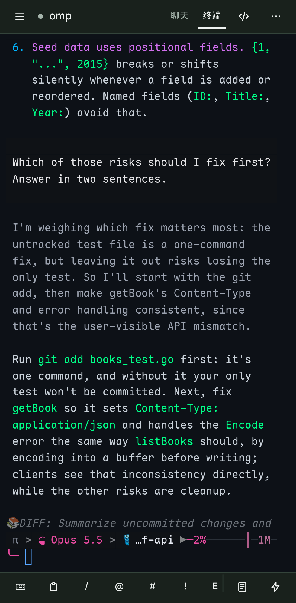
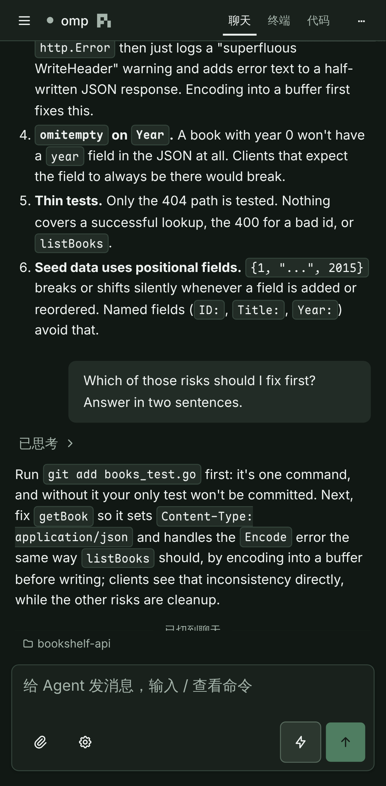

# 项目介绍

WebMux 是一个单二进制的 Web 终端服务，为在浏览器和手机上遥控 Claude Code、Codex、omp 等 CLI agent 而设计。本页是首页 [README](../README.md) 的完整版：定位、设计理念、全部特性与技术栈。操作步骤见 [使用指南](usage.md)，部署见 [部署指南](deployment.md)。

## 定位

PTY 会话由服务端持有，浏览器只是“附着”上去：手机锁屏、切换网络、关闭标签页都不会结束正在运行的 agent，重新打开即可回放断线期间的全部输出。

- 与 ttyd 等工具不同，WebMux 把会话生命周期与浏览器连接解耦。
- 与 tmux 方案不同，它不依赖额外的终端复用器，并针对手机和平板做了完整适配。
- 服务运行在 Linux、macOS 或 Windows 的 WSL 2 中；Windows 端提供托盘程序和原生控制台客户端。
- 主题、预览、代码阅读、快捷指令、主页工作树和底部工具栏偏好由服务端保存并跨设备同步；终端字号、设备凭据与草稿仍保留在本机。详见 [跨设备偏好](usage/sessions.md#跨设备偏好)。

边界：WebMux 不是进程沙箱，也不是持久会话存储。命令以服务用户身份运行，服务重启会结束所有终端会话（混合会话可恢复，见 [常见问题](faq.md)）。安全模型见 [安全策略](../SECURITY.md)。

## 设计理念

### 第一级别的 WSL 支持

Windows 不是“顺带能用”的平台。

- WebMux 运行在 WSL 2 发行版中。
- Windows 托盘负责安装 / 升级（校验发布摘要）、启动、监控、自动重启和远程访问转发。
- `webmux.exe` 控制台客户端在 PowerShell / Windows Terminal 中直接 `run` / `attach` WSL 里的会话。
- Windows 客户端经 `wsl.exe --exec webmux bridge` 访问本机 API：无需 Token，也不依赖 WSL 的 localhost 转发或网络模式；当前 Windows 目录自动换算为 WSL 路径。

### 低侵入性

- 一个静态二进制，以当前用户身份运行，不需要 root 或管理员权限。
- 不改写 shell 配置，不依赖 tmux、数据库或语言运行时。
- 用户级服务由 `webmux service` 管理（systemd --user / launchd），卸载时保留配置。
- 会话只在内存中；状态目录只保存显式登记的 JSON 文件（仓库清单、启动配置、偏好、推送、隧道与 Tailscale 设置、混合会话记录），见 [配置与持久化清单](persistence.md)。
- 托盘不静默安装或升级，也不修改防火墙。

### 融入现有终端 agent 工作流

- Claude Code、Codex、omp 等 agent 的终端端原样运行在真实 PTY 中，无需插件或改写其配置。
- 聊天端（[混合会话](hybrid-sessions.md)）经 ACP 连接同一个 agent 会话；Codex 与 Claude Code 需要另外安装第三方 ACP 连接器，缺失时终端端照常使用。
- 原始字节直通 xterm.js，TUI 渲染与原生终端一致。
- 在习惯的终端里 `webmux run -- claude` 启动，`Ctrl+]` 分离后在手机上继续，回到电脑 `webmux attach <ID>` 接续，全程是同一个进程。

### 高性能、低占用

- 服务端只转发 PTY 原始字节，不做终端仿真。
- 每会话固定大小的字节环形缓冲（默认 2 MiB），重连只补发缺失部分；慢客户端被断开，而不会阻塞 PTY 读取。
- 含前端的 Linux amd64 二进制约 15 MB；实测空闲常驻内存约 13 MB，运行一个 shell 会话约 18 MB。
- CI 在 4 倍 CPU 降速下检查布局位移与交互延迟，见 [布局稳定性与 4× CPU 回归](performance.md)。

## 特性

### 会话与终端

- **持久会话**：浏览器断开后会话继续运行；短暂断线或回到前台时只续接缺失的输出，否则清屏并回放服务端缓冲（默认每会话 2 MiB）。
- **两种导航模式**：侧栏支持在 **工作台模式**（首次打开默认，按仓库 / 工作树分组并展示会话总览卡片）与 **聊天模式**（按创建时间从新到旧稳定列出全部聊天，搭配一键创建独立 worktree 并进入对话的 **快速开始** `/new`）之间切换，侧栏宽度可拖动调整（256–480px）。
- **会话总览**：按仓库 / 工作树分组展示所有会话，实时显示标题、状态（运行中 / 可能在等你 / 空闲 / 已退出）和终端屏幕预览。
- **终端分屏**：同一页面左右 / 上下嵌套最多 8 个窗格，拖动调整比例。
  - tmux 风格 `Ctrl+B` 前缀切换、放大和关闭窗格。
  - 终端菜单可锁定尺寸，避免手机键盘弹出导致 TUI 重绘。
- **草稿模式**：先在多行输入框里编写、组合引用和上传路径，再一次性发送给 agent；草稿保存在本机，发送有送达确认。
- **文件上传**：选择、拖放或粘贴文件 / 图片，上传后自动把服务器路径插入终端。
- **查找与复制**：在保留的终端输出中查找并跳转；程序经 OSC 52 发出的复制请求写入浏览器剪贴板，见 [终端使用](usage/terminal.md)。
- **终端图形**：支持 Kitty 图形协议的直接传输，omp 等程序可以在浏览器终端里显示图片，见 [终端图形](usage/terminal.md#终端图形)。
- **快捷指令**：在设置中保存常用命令或提示词，从终端菜单一键发送。
- **原生终端附着**：`webmux run` / `attach` / `ls` / `open` 在本机终端中创建、附着和接续会话，与浏览器共享同一个 PTY 与控制权。

### Agent 协作

- **自定义启动配置**：在设置页保存 Shell、Open Code、Claude Code、Codex、omp 等程序的完整命令与环境变量，新建会话时统一选用。
  - 新安装首次启动时预置 [十一款 CLI agent](cli-agents.md)，以及 Shell 和 omp；每项附带本地品牌图标，均可编辑或删除。
  - Codex CLI、Antigravity CLI、Open Code、omp、Claude Code、Qoder 与 QoderCN 默认开启混合模式；也可填写一次性命令。
- **ACP 混合会话**：OpenCode / omp / Codex CLI / Claude Code / Antigravity CLI / Qoder / QoderCN 对话在原生 TUI 与聊天视图之间切换，支持多设备队列、插话、权限请求、附件与重启恢复，见下节。
- **需要你介入的提醒**：识别 agent 的终端通知与状态信号，在总览、侧栏、标签页和手机推送中提示，见 [需要你介入的提醒](usage/attention.md)。

### 代码与仓库

- **Git worktree 管理**：登记已有仓库，创建 / 安全删除 worktree，设置仓库初始化指令模板，并在工作树中直接启动 agent。
- **代码工作区**：在终端或聊天旁浏览文件和 Git 修改、查看与审阅 Diff，预览 Markdown、图片、HTML、CSV / TSV、JSON 与 PDF，把 `路径:行号` 引用或行级评论一键插入对话；支持弹出独立浏览器窗口双屏对照。
  - 资源管理器右键即可上传、下载（目录打包 ZIP）、重命名、复制、移动和删除文件，并提供直达本会话上传与产物目录的 **会话临时文件夹**。

### 多设备与平台

- **移动端优先**：软键栏（Esc / Ctrl / Alt / Shift / 方向键等）、触摸滚动、长按选词复制、虚拟键盘视口适配。
- **安装为应用与推送**：可安装为 PWA；agent 等你回复时，锁屏的手机也能收到 Web Push 通知，见 [安装为应用与手机推送](deployment/pwa-and-push.md)。
- **远程访问**：推荐 Tailscale / WireGuard 等可信 VPN；也可托管 [Tailscale Serve / Funnel](tailscale.md) 或 [Cloudflare Named Tunnel](cloudflare-tunnel.md) 提供 HTTPS 入口。
- **Windows（WSL）**：托盘程序管理 WSL 中的服务与访问入口，控制台客户端在 PowerShell / Windows Terminal 中附着会话。
- **零运行时依赖**：前端嵌入 Go 二进制，运行端只需 Linux、macOS 或 WSL 2 与一个 shell，无需 Node.js、Go、tmux 或数据库。

## 混合会话（ACP 聊天 ↔ 终端）

OpenCode、omp、Codex CLI、Claude Code、Antigravity CLI、Qoder 与 QoderCN 的同一段对话可以在原生 TUI 与基于 [ACP（Agent Client Protocol）](https://agentclientprotocol.com) 的聊天视图之间随时切换：电脑上用 TUI 精细操作，手机上切到聊天视图阅读和回复。

- 切换前后是同一个 WebMux 会话、同一个 agent 会话，历史由 agent 自己保存。
- 正在执行的回合会先中断，失败自动回到原来的一端。
- Codex 与 Claude Code 的聊天端需要另外安装第三方连接器 [codex-acp](https://github.com/agentclientprotocol/codex-acp) 或 [claude-agent-acp](https://github.com/agentclientprotocol/claude-agent-acp)，未安装时页面给出安装命令。

主要能力：

- **聊天视图**：消息、思考（默认折叠）与工具调用（可展开，diff 可在代码面板查看）按时间线展示。
  - 输入框下方选择模型、模式与权限（“全部接受”或“每次询问”）。
  - 圆环显示上下文用量，点击查看 Token 详情。
- **多设备协作**：回合进行中的消息进入所有设备共享的队列，omp 与 Codex 还支持插话；权限请求与表单在所有设备同步。
  - 上传的图片与文件按 agent 能力以 ACP 内容块直接发送。
- **持久运行、可恢复**：聊天端保持 agent 进程运行直到切换或显式归档；归档或服务重启后，从首页所属工作树的“已归档”中恢复到聊天或终端。

新安装预置的 Open Code、omp、Codex CLI、Claude Code、Antigravity CLI、Qoder 与 QoderCN 启动配置已开启混合模式：

- 既可以在 **快速开始（`/new`）** 中选定仓库和分支，一键创建 worktree 并直接进入聊天视图；
- 也可以在新建会话对话框中选择“从终端开始”或“从聊天开始”（按 agent 记住你的偏好）。详见 [混合会话](hybrid-sessions.md)。

## 截图

首页截图由 `pnpm --dir web screenshots` 基于真实后端自动生成（桌面 1440×900，移动端 Pixel 7 模拟），顶部合成主图由 `pnpm --dir web screenshots:hero` 从其中两张合成，重新生成方法见 [参与贡献](../CONTRIBUTING.md#更新-readme-截图)。其余功能截图来自各 PR 的界面证据，位于 `docs/images/<主题>/`。

<table>
  <tr>
    <td width="50%"> <b>手机遥控 omp</b>：原生 TUI 在手机上完整渲染</td>
    <td width="50%"> <b>手机聊天视图</b>：同一段对话切到聊天阅读和回复</td>
  </tr>
</table>

## 技术栈

Go（`creack/pty`、`coder/websocket`）· Svelte 5 · TypeScript · Vite · xterm.js · shadcn-svelte · Tailwind CSS · Zod · CodeMirror · @pierre/diffs

实现细节见 [架构设计](architecture.md) 与 [API 与协议](protocol.md)。
