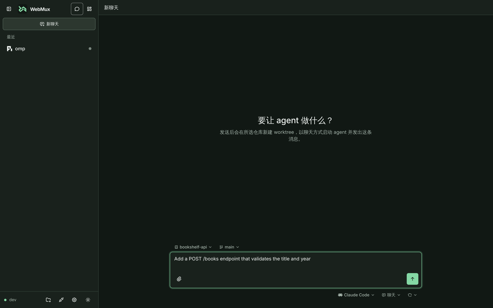

# 使用指南

浏览器打开 WebMux 后，你可以把服务器上的 CLI agent 或 Shell 会话跑在后台，随时从电脑或手机接管。

如果你是第一次使用，按以下两步即可上手：

1. **选择工作模式**：左上角的两个按钮在**聊天模式**与**工作台模式**之间切换：
   - **想直接把任务交给 Agent**：切到**聊天模式**（`/new`），选好仓库、基准分支和 Agent，输入任务并发送——服务端会自动新建 Git worktree、以聊天方式启动 Agent 并发出第一条消息。
   - **想管理多个终端或查看全局状态**：切到**工作台模式**，点击右上角「新建会话」，选择目录与启动配置（如 Claude Code、Codex、Shell）即可进入终端。
2. **随时审阅与接管**：在会话页顶栏可一键切换**聊天 ↔ 终端**视图（混合会话），或点「代码」在旁边查看文件树与 Git Diff。关闭标签页或锁屏不会结束会话。

**按主题深入了解：**

- [终端使用](usage/terminal.md)：回放与多设备控制、查找、tmux 风格分屏、复制粘贴、终端图形与文件上传。
- [仓库与 worktree](usage/worktrees.md)：仓库登记、上游基线刷新、工作树创建与安全删除。
- [需要你介入的提醒](usage/attention.md)：识别 Agent 的提问、授权请求与完成信号（`OSC 7501`、Warp 事件等）。
- [移动端使用](usage/mobile.md)：软键栏、虚拟键盘、触摸手势、锁定尺寸与全屏。
- [端口转发预览](usage/port-forwarding.md)：把服务器上的开发服务器经 WebMux 转发到浏览器预览。
- [Shell 目录报告](usage/shell-directory.md)：可选的 `OSC 7` 目录报告与 bash / zsh 配置片段。

## 侧栏与两种模式

首页、快速开始页和会话页左侧共用同一个侧栏。左上角的两个按钮切换模式，当前浏览器记住上次的模式：

- **聊天模式**：侧栏上方按最近活动列出正在运行的聊天，下方默认折叠列出已归档记录（带数量），点已归档的聊天会直接恢复到聊天端；点「新聊天」回到快速开始页 `/new`。
  - **快速开始**：在输入框上方选择仓库与基准分支（可搜索本地分支，按名称区分），下方选择 Agent（只列出开启了混合模式的配置）、配置项与权限模式（默认“全部接受”）。选中或切换 Agent 时会临时读取它的配置项（读取期间相关控件禁用，失败时沿用上次记住的清单）。
  - **附件**：与聊天视图相同，可通过上传按钮、粘贴或拖放添加附件（会话创建前暂存在服务端，创建后随首条消息发送）。
  - **进入已有聊天**：输入框上方只读显示该会话所在的仓库与 worktree 分支（进入时刷新）。

  

- **工作台模式**：侧栏是「仓库 → 工作树 → 会话」导航树，主区域是会话总览。仓库行的「+」打开新建工作树弹窗。
- **仓库初始化指令**：在首页工具栏的「仓库设置」按钮中填写（侧栏选中某个仓库，或只登记了一个仓库时显示）：
  - 指令是一段多行模板（最多 4000 字符），可用 `{{快捷指令名称}}` 引用设置里的快捷指令，用内置的 `{{user}}` 指定你的第一条消息放在哪里（不写则接在指令后面），用内置的 `{{dir}}` 代表新会话的临时文件夹路径。
  - 快速开始页和新建会话弹窗在仓库有指令时都会显示“使用初始化指令”勾选框（默认勾选，只影响本次发送），勾选时展开后的指令随首条消息一起发送。

侧栏只是两种导航方式：打开任何会话都不会改变当前模式；在会话页切换模式只更换侧栏。

- **侧栏底部**：连接状态与主机名、「添加仓库」按钮（收起为窄栏时同样可用）、端口转发、设置和主题切换。
- **侧栏宽度**：桌面端拖动侧栏右边缘调整（224–480px，未保存时默认 288px，保存在当前浏览器），也可收起成窄栏；手机上从页面顶栏左侧的按钮打开抽屉。
- **侧栏会话行**：行尾彩色圆点表示状态（绿色工作中、琥珀等待、灰色空闲、空心已结束），与计数一起贴着行尾右对齐：
  - 电脑上鼠标移到行上时“⋯”按钮出现在圆点的位置，手机上按钮常驻在圆点右侧。
  - 点击它打开会话操作菜单，可修改标题、关闭或停止并归档。
  - 已归档聊天可恢复或删除记录：关联的 linked worktree 仍在时走删除 worktree 确认流程一并清理，不在则直接确认删除记录。

## 会话列表

工作台首页按「仓库 → 工作树 → 会话」分组：

侧栏导航树可切换单个仓库、全部仓库或直接会话，点工作树只显示该工作树下的会话。首次多仓库进入优先选有会话的仓库，之后记忆当前浏览器的明确选择；已移除仓库回退全部。搜索与状态筛选只作用于当前范围。

仓库路径（可复制）、工作树比例、会话计数与 Git 读取时间收在仓库标题栏的详情按钮里，“从列表移除仓库…”也在其中；工作树路径、正常状态和会话计数可通过详情按钮查看。异常状态与错误始终可见。

- 仓库按登记顺序排列，可折叠；工作树按路径排列，组内会话按创建时间倒序排列。
- 每个仓库只在首页显示“已添加到主页”的工作树：
  - 默认只有主工作区，通过页面新建的 worktree 自动添加。
  - 标题栏的「主页显示 n/m」打开列表，可搜索并勾选或取消勾选任一工作树；这只改变主页展示，不启动会话。
  - 工作树菜单中的「从主页移除」只是不再显示，不会删除工作树。
  - 有会话的工作树始终显示，未添加的会标注「未添加到主页」。
  - 这项工作树选择保存在服务端，并在设备间同步。
- 未关联已登记仓库的会话显示在「直接会话」中；工作树已失效的会话保留在「已不可用工作区」。
- 默认以输出预览显示终端输出或聊天端最新消息；顶部可切换为紧凑列表，只显示标题、状态、最近活跃时间、连接设备数与混合会话所在端。显式选择的显示方式在当前浏览器记忆，预览行数仍使用启动配置或全局设置。
- 点击会话行在当前标签页进入该会话，宽屏顶栏的返回按钮回到当前模式的主页；首页会立即显示上次的会话列表与设置并在后台刷新，慢速网络下不必等待加载。需要同时观察多个会话时，可用中键或 Ctrl/⌘ 点击在新标签页打开。
- 启用可选 shell 集成后，会话行还会显示「Shell 报告目录」（程序通过 OSC 7 报告的当前目录）：
  - 它只是导航线索，不改变会话按启动目录或仓库工作树的归属；远端主机报告的目录会标注「远端」，不会用于本机文件定位。
  - 会话菜单可复制该目录（没有报告时复制启动目录），配置片段见 [Shell 目录报告](usage/shell-directory.md)。
- 列表通过 WebSocket 实时更新；Git 状态在打开页面、切回前台、重连、手动刷新和操作完成后重新读取。

会话标题优先使用创建时填写的名称，其次是程序设置的标题（终端通过 OSC 0/2，聊天端通过 ACP `session_info_update`），最后是工作目录名。会话卡片菜单的“修改标题”可手动设置标题，它优先于其余来源（omp 的聊天端不会自动生成标题，可用它命名）；留空保存则恢复自动标题。

### 会话状态

| 状态       | 含义                                                                  |
| ---------- | --------------------------------------------------------------------- |
| 运行中     | 最近 2 秒内有输出，或已无输出但没有提示符、终端读取或关注信号         |
| 可能在等你 | 末行像提示符 / 确认问题，或进程在等待终端输入；`sleep` 等计时休眠不算 |
| 空闲       | 超过 `idle_after_seconds` 无输出，且没有上述等待特征                  |
| 已退出     | 进程已结束，显示退出码（信号退出记为 `128 + signal`）                 |

上表是没有任何程序信号时的启发式。程序报告了自己的状态时以报告为准，按下面的顺序判定：

1. 进程已退出：已退出。
2. 程序通过 `OSC 7501` 报告了状态：工作中显示“运行中”（超过 `idle_after_seconds` 没有任何输出时视为空闲），阻塞显示等待，空闲显示“空闲”；完成或出错在提醒未处理前显示等待，处理后显示“空闲”。
3. 存在介入提醒：等待。
4. 程序曾发出 `OSC 7501` 或 Warp 结构化事件：这类 agent 总在读终端，末行也可能像提示符，因此不再使用“可能在等你”的启发式，只按输出新旧显示运行中或空闲。
5. 其他：上表的启发式。

状态只用于展示，不触发任何自动动作。

浏览器标签页的运行指示复用上述 `running` 状态：

- 当前终端会话或首页任一会话处于运行中时，标签页标题增加 `▶` 前缀并循环播放本地生成的 favicon 动画。
- 等待、空闲和已退出会恢复静态图标与基础标题。
- 该判定是启发式的，长时间无输出的命令可能在 `idle_after_seconds` 后停止动画；`waiting` 不显示执行中动画。
- 指示不读取或输出终端正文，也不产生逐帧网络请求。
- 系统启用“减少动态效果”时图标保持静态运行帧，标题仍保留标记。

### 需要你介入的提醒

程序主动发出的终端信号（`OSC 7501`、Warp 结构化事件、桌面通知与响铃）优先于上述启发式：一旦收到，会话显示具体提醒（**需要回答**、**等待授权**、**出错停止**显示为醒目的红色徽章，**本轮完成**、**有通知**、**响铃提醒**显示为琥珀色）并保持“等待”。

omp、Codex CLI（0.164.0+）与 Claude Code（2.1.295+）无需配置即可自动报告状态。完整的信号来源表、优先级、清除规则与旧版本 hook 配置见 **[需要你介入的提醒](usage/attention.md)**。

### 设置分区导航

设置页桌面左侧为分区导航，手机为顶部吸顶的横向导航（可左右滑动）。点击“外观与阅读”“快捷指令”“启动配置”“草稿与暂存”“网络”“公网访问”“Tailscale”“安装应用”“通知推送”或“输出预览”滚动定位，当前分区随滚动高亮。导航支持键盘、地址片段直达与浏览器前进后退，不卸载表单，不丢失未保存输入。

### 预览设置

首页“设置”可调整预览显示的行数（1–50，默认 10）和跳过末尾的行数（0–50，默认 1）。设置保存到服务端并同步到已连接设备；保存失败不会覆盖最后确认值。这些全局值用于临时命令和未单独配置预览的启动配置。

启动配置可单独覆盖预览：编辑配置时可取消“跟随全局默认”，填写适合该 agent 底栏高度的显示行数与跳过末尾行数。例如 OpenCode 的底栏比 Claude 高，可为其配置跳过更多行。首页会话卡片按创建时使用的启动配置读取当前预览值；修改配置后回到首页生效，配置被删除时回退全局设置。预览只是展示设置，不影响会话进程。

会话卡片始终为生效的预览行数保留高度，暂无输出时也不收起。列表按创建时间排列，后台输出和状态更新不会重新排序或挤动其他会话。

## 新建会话

新建会话对话框围绕 **位置** 和 **运行** 两个核心选择展开，下方提供可选的**用户指令**（创建后自动发送的第一条消息）。底部一句汇总（如“将在 webmux · 主工作区 · main 运行 Claude Code”）说明将要发生什么；默认值齐全时打开后可以直接按「创建并进入」。会话名称收在“高级：会话名称”里。

### 1. 选择位置

默认位置按以下优先级确定，对话框里改选位置不会改变首页当前选中的仓库：

1. 上下文入口：工作树旁的「新建会话」预选该树，终端分屏预填源会话的目录。
2. 首页当前选中的仓库：其可用主工作区，否则该仓库其他可用工作树；都不可用时保留该仓库并要求选择。
3. 最近目录，最后是服务默认目录。

从首页点「新建会话」时，“位置”列表会根据当前在侧栏选中的范围自动收窄：

- **选中了某个仓库**：只列出该仓库的所有工作树和“新建工作树…”，不列最近目录、其他仓库与直接目录。
- **选中了某个工作树**（或点了工作树行的「新建会话」）：只列出该工作树（直接在其中启动）和“从当前工作树分支新建…”，后者的起始分支默认是该工作树的分支。
- **选中“全部仓库”或“直接会话”**，以及从终端分屏或会话页打开时不收窄，完整列表包含：
  - **直接目录**：选中后出现工作目录输入框与「浏览」，支持路径补全（↑↓ 选择，Enter / Tab 进入，Alt+↑ 返回上级），目录不存在时可确认创建。
  - **工作树**：在已登记仓库的某个工作树中启动；条目显示分支与路径，不可用或 bare 工作树显示但不可选。
  - **新建工作树…**：每个仓库分组末尾都有此项，选中后在位置行下方填写分支，先创建 Git worktree，再启动会话。起始提交与存放目录收在“高级：起始提交与存放目录”里。

### 2. 选择运行方式与起始端

“运行”列表包含保存的启动配置和末尾的“自定义命令…”，可搜索、可用键盘选择，Esc 只关闭列表：

- **启动配置**：每项显示图标、名称与命令，以及环境变量数量（不显示值）；长命令可通过完整提示查看。配置保存在服务端，换浏览器或设备后仍可选用。
- **自定义命令…**：选中后出现命令输入框，填写一次性命令，不会写入服务端；没有保存配置或配置存储不可用时也可使用。在两者之间切换时保留已选配置与已输入命令，只提交当前选择；命令为空或引号未闭合时不能创建会话。
- **起始端（混合模式配置）**：选中勾选了混合模式的启动配置时，下方以单选卡片选择**“从终端开始”**或**“从聊天开始”**（默认终端，浏览器会按每个 Agent 分别记住你上次选择的起始端）。

成功创建后，当前浏览器记住最近一次启动方案（启动配置及每个 Agent 的混合起始端，或自定义命令），下次打开直接填入；创建失败不会覆盖它。记住的配置已被删除时显示“选择启动方式”，不会改用其他配置。

### 3. 用户指令与初始化指令（可选）

无论选择哪种启动方式，对话框下方都可以填写**用户指令**，在会话创建后自动发出：

- **从聊天开始**：作为聊天的第一条消息发送。
- **从终端开始或自定义命令**：等待程序启动输出并在安静约 0.7 秒后（最长等待 15 秒）自动输入到终端并回车；多行文本在程序开启括号粘贴时按粘贴发送。
- **使用初始化指令**：当所选位置属于已登记仓库（或分屏保持源会话工作区）且该仓库设置了初始化指令时，上方会显示默认勾选的“使用初始化指令”复选框；勾选后会把展开的仓库初始化指令放在你的用户指令前面一起发送。

### 4. 预置与自定义启动配置

新安装首次启动会预置 Shell、十一款 CLI agent 和 omp 启动配置，可在设置页编辑或删除，没有不可修改的内置预设。完整列表见 [CLI agent 接入](cli-agents.md)。

- Claude Code、Codex CLI、Antigravity CLI、Open Code、Qoder、QoderCN 和 omp 的预置配置带有自动批准工具调用的参数（其中 Codex 参数同时关闭其沙箱）；需要逐次批准时在设置页删掉对应参数。
- Cursor、Copilot、Qwen、Kimi 和 CodeBuddy 的配置使用各 CLI 默认的授权行为。
- Open Code、omp、Codex CLI、Claude Code、Antigravity CLI、Qoder 与 QoderCN 预置配置默认开启[混合模式](hybrid-sessions.md)。已有安装的 `launch-configs.json` 不会被改写。

命令按 argv 直接执行，**不经 shell 展开**；引号、空参数与参数边界会保留。需要管道、变量等 shell 语法时，请显式写成 `bash -lc 'npm run dev | tee dev.log'`。WebMux 不会自动安装 agent。

在设置页可为每条启动配置选择 **图标**（自动匹配、通用终端、十一款 CLI 品牌图标或 Pi / omp），并可设置：

- **“输出预览”**：单独设置行数与跳过末尾行数；不设置时跟随服务端全局预览。
- **“加载 shell 启动文件”**：勾选后可选 Bash（`~/.bashrc`）或 Zsh（`~/.zshrc`），保存为 `bash -ic 'exec -- "$@"' webmux …` 或 `zsh -ic 'exec -- "$@"' webmux …` 的完整 argv：
  - 命令与参数原样传给 `exec`，不展开 `$HOME`、管道或命令替换；
  - 再次编辑保持勾选与所选 shell，不重复包裹；新建配置按服务端 `$SHELL` 预选，其他 shell 回退 Bash。

首次启动的默认预设只在 `launch-configs.json` 不存在时写入，删除后不会自动重新出现。需要时可在设置页「新建启动配置」旁的「添加系统预设」菜单中补回单个或全部缺失的预设；同名配置已存在时不会覆盖。启动配置存储不可用时，设置页显示原因与文件路径，仍可填写临时命令启动。

勾选了 **混合模式** 的配置会创建混合会话，可在聊天视图与终端之间切换、归档后从首页所属工作树的“已归档”中恢复，详见 [混合会话](hybrid-sessions.md)。聊天输入框支持上传、拖放或粘贴附件（单文件上限 10 MiB，单条消息最多 8 个、合计 20 MiB；Agent 支持时原生发送，否则按服务器路径降级并提示）。

## 公网访问设置

从“设置 → 公网访问”进入 `/settings/tunnel`，选择 Quick Tunnel 或填写 Named Tunnel 的凭据与公共主机名，保存后启用。配置与开关保存在服务端，跨设备与服务重启保留；无需为了改隧道配置重启或结束终端会话。

凭据只写不读，留空保留已配置凭据，切换 Quick 会删除 Named 凭据。开启前须确认公开 shell 的风险，WebMux 登录 Token 至少 43 字符；它与 Cloudflare 凭据不同。公网来源上关闭或修改配置会断开当前页面，请保留本机/VPN 入口。完整步骤与故障恢复见 [配置指南](cloudflare-tunnel.md)。

## 后台启动

没有 systemd / launchd 时，可以用 `webmux start` 让服务脱离当前 shell 继续运行：

```sh
webmux start --listen 127.0.0.1:7681
webmux status
webmux stop
```

`start` 接受与 `serve` 相同的参数：

- 日志：默认把标准输出与标准错误写入 `<state_dir>/webmux.log`（0600，旧文件保留为 `.1`），显式 `--log-file` 优先。
- 输出：命令等待子进程发布运行时记录后输出 PID、不含 token 的本机链接与日志路径，然后退出。
- 重复启动：同一实例已运行时只打印状态并以 0 结束，不会启动第二个进程。
- 隧道：启用隧道时首次启动还会等待 cloudflared 下载。
- 停止：子进程清除启动方继承的会话与服务管理环境，运行时记录保持为手动启动，因此 `webmux stop` 可直接停止。

生产环境仍推荐 `webmux service install`。

## 从终端启动与附着

在服务所在机器（含 WSL 内）的 shell 中，`webmux` 经本机套接字访问服务，无需 Token：

```sh
webmux run -- claude --resume          # 在当前目录创建会话并立即附着
webmux run --detach --name review -- codex   # 只创建，输出 "<ID>\t<本机链接>"
webmux run --env VIRTUAL_ENV=/w/.venv --env PATH=/w/.venv/bin:/usr/bin -- python app.py
webmux run --launch-config omp --detach --name review  # 使用 Web UI 保存的启动配置（按名称）
webmux ls [--json]                     # 列出会话；--json 为服务端原始数组
webmux attach <ID> [--observe]         # 附着；Ctrl+] 分离，会话继续运行
webmux open <ID> [--browser]           # 输出（并打开）不含 Token 的会话链接
```

- `--` 之后的参数原样作为 argv，不经 shell 展开；`--cwd` 指定启动目录（默认当前目录，`~` 由服务端展开）。
- 自定义命令的环境变量：
  - 默认继承**调用方 shell 的环境**（如 `PATH`、`VIRTUAL_ENV`、`SSH_AUTH_SOCK`、API key），在服务进程环境之上覆盖同名变量，`--env NAME=VALUE` 再覆盖继承值。
  - `TERM`、`COLORTERM`、宿主终端身份变量、`WEBMUX_SESSION_ID`、`PWD`/`OLDPWD` 与不合法的变量名不继承，会话仍以 WebMux 终端身份和 `--cwd` 目录启动。
  - `--launch-config` 只使用配置中保存的环境，不继承调用方环境。
  - Windows 客户端（`webmux.exe`）也不把 Windows 环境复制到 WSL，只发送 `--env` 显式列出的变量。
- `--launch-config <NAME>`（也可写作 `--config-id <NAME>`）使用 Web 端“启动配置”中保存的完整 argv 与环境变量：
  - `NAME` 是设置页显示的配置名称（名称唯一，区分大小写）；名称不存在时以用法错误（退出码 2）结束并列出已有名称。
  - CLI 只读取 `/api/launch-configs` 摘要把名称换成 ID，命令由服务端按 ID 展开，因此敏感环境值不会经过 CLI。
  - 它与 `--` 后的命令、`--env` 互斥，但仍可配合 `--cwd`、`--name` 和 `--detach`。
  - 不带该选项时仍使用临时命令模式。
- 会话终端身份：
  - 默认以 `TERM=xterm-256color`、`COLORTERM=truecolor` 和 `TERM_PROGRAM=webmux` 启动，并报告当前 WebMux 版本；宿主 Kitty、tmux、Warp、iTerm、WezTerm、Ghostty、Windows Terminal 等身份变量不会泄漏到子进程。
  - 需要显式启用 Kitty 专用行为时，应在 Web 端启动配置中保存相应的 `TERM`/终端变量；这不会改变浏览器对 Kitty 图形协议的支持，也不会把普通会话伪装成 Kitty。
- 附着时终端切换为原始模式，默认取得控制权并同步窗口尺寸；`--observe` 只观察。会话退出时以其退出码结束；分离以 0 结束；服务未运行以 3 结束，不会自动启动服务。附着开始时以终端复位后的完整回放呈现会话内容。
- 浏览器等其他客户端接管后，原生终端左上角显示 `Controlled by <客户端> · Enter to take control · Ctrl+] to detach`：
  - 期间的按键（包括终端对焦点、设备、颜色查询的自动应答）一律丢弃，不会抢回控制。
  - 按 Enter 重新接管（该 Enter 不发送给会话），随后按本终端尺寸重绘。程序开启 modifyOtherKeys、kitty 键盘协议或 Windows Terminal 的 win32-input-mode 后，Enter 与 `Ctrl+]` 的编码形式同样识别。
  - 附着结束时关闭这些键盘、鼠标、焦点与粘贴上报模式，避免外层 shell 收到无法解析的按键编码。
- 默认附着的 `run` 在接管终端前，向标准错误输出 `webmux: session <ID> · <本机链接> · Ctrl+] to detach`，便于把链接带到手机上；标准输出只属于会话。需要附着时标准输入输出必须是终端，否则以退出码 2 结束且不创建会话。
- 典型流程：在原生终端 `webmux run -- claude` → `Ctrl+]` 分离 → 手机打开链接、输入即接管 → 回来后 `webmux attach <ID>` 接续，全程是同一个进程。

## 在 Windows 终端中使用

`webmux-windows-<arch>.exe`（建议放入 `PATH` 并重命名为 `webmux.exe`）在 PowerShell / Windows Terminal 中提供 `run`、`attach`、`ls`、`open`、`status` 与 `version`，会话运行在 WSL 中的 WebMux 里。

- **连接**：每条连接都会启动 `wsl.exe --exec webmux bridge` 访问本机 API，因此不需要 Token，也不依赖 WSL 的 localhost 转发或网络模式。
- **服务**：需已在 WSL 中运行（托盘或 `webmux serve`）。
- **发行版**：`--distro`、环境变量 `WEBMUX_DISTRO`、托盘设置 `%APPDATA%\WebMux\tray.json`、WSL 默认发行版，依次生效。WSL 内 `webmux` 路径同理：`--webmux`、`WEBMUX_WSL_PATH`、托盘设置、`~/.local/bin/webmux`。
- **目录换算**：未指定 `--cwd` 时把当前目录换算为 WSL 路径：盘符路径按发行版的自动挂载规则（`wslpath`，默认 `C:\work` → `/mnt/c/work`）；`\\wsl.localhost\<发行版>\…` 或 `\\wsl$\<发行版>\…` 换算为对应 Linux 路径；网络共享、其他发行版与设备路径无法换算，以退出码 2 结束，请用 `--cwd /linux/path` 指定。
- **控制台**：附着时控制台进入 VT 原始模式并使用 UTF-8 代码页，`Ctrl+C` 发送给会话，`Ctrl+]` 分离；窗口尺寸每 250 毫秒同步一次；退出时恢复原模式与代码页。需要 Windows 10 22H2 及以上，推荐 Windows Terminal。
- **引号**：PowerShell 在把参数交给原生程序前会再处理一次引号。需要字面传递 `$`、`;` 等字符时用单引号（`webmux run -- printf '%s;$(id)' 'a b'`），或在 `--` 前使用 `--%` 停止解析。

## 终端

终端回放与多设备接入、顶栏、查找、分屏、复制粘贴、终端图形与文件上传见 [终端使用](usage/terminal.md)。

## 端口转发预览

把会话中启动的开发服务器经 WebMux 转发到浏览器预览，终端页会提示新监听的端口，见 [端口转发预览](usage/port-forwarding.md)。

## 草稿模式

点击顶栏“草稿”打开草稿面板：终端下方出现可调整高度的多行输入框。开启后，键盘输入、粘贴、软键栏字符、代码引用和上传路径都进入草稿，而不是直接发送给终端。

- 点击“发送”才提交：完整正文与一次 Enter 作为一个整体写入终端，其他设备的输入不会插在中间。输入框内 Enter 只换行。
- 发送后状态行依次显示“已发出”“服务端已收到”，**已写入终端**后清空草稿并关闭面板。“已写入终端”只表示字节进入了终端，不代表 agent 已接受或执行成功。
- 确认前正文锁定。连接中断时显示“结果未知”，重连后自动查询；也可“按原提交重发”（服务端已收到时不会重复写入）或“转为草稿”。未写入或服务端无记录时恢复为可编辑草稿并提示原因，不会自动重发。
- 手动关闭草稿模式只隐藏面板，未发送内容会保留。
- 草稿操作行的“暂存”可为同一会话保留多条待办文本：新增、编辑、上移、下移、删除，或取用到当前草稿。取用只改变草稿，不会自动发送，也不会自动聚焦终端。
- 当前草稿非空时，取用可以选择追加到正文之后，或替换正文；替换前会把原正文保留为一条新的暂存。存在未确认提交时不能转存或取用，暂存仍可查看、编辑和删除。
- 草稿按会话隔离并保存在当前浏览器：刷新、关闭页面、系统回收标签页或认证失效后重新打开会话，草稿面板会恢复当前正文和目标会话，顶栏按钮会显示暂存条数；仍需点击发送。7 天未修改或会话已不存在时自动清理；可在设置页关闭本机保存或清除全部草稿和暂存。
- 关闭草稿面板后，顶栏“草稿”按钮会显示暂存条数；终端菜单中的“暂存”可在不开启草稿面板时查看和整理暂存。暂存新增或修改时会提示“暂存已更新”，但不会自动打开草稿面板。
- 每会话最多保留 20 条暂存，单条最多 20,000 字符，合计最多 100,000 字符；超出限制时新增或编辑会被拒绝并说明原因。
- 本机存储关闭或写入失败时，暂存只保留在当前页面并提示刷新后可能丢失；损坏、过期或所属会话已不存在的暂存会被清理。
- Ctrl+C 等终端控制键需先退出草稿模式。

> [!CAUTION]
> 如果目标程序未启用 bracketed paste，草稿正文中的换行也可能被当作提交。

## 代码工作区

点击顶栏“代码”在终端旁打开代码工作区，终端始终保持同一个 PTY 并持续接收输出。在聊天模式或工作台模式中切换不同会话时，代码面板的开合状态与分栏宽度保持不变；回到先前的会话时，该会话已打开的文件标签、当前标签与阅读位置按离开时恢复。

- **布局**：宽屏（≥1024px）并排显示，窄屏在“终端 / 代码”之间切换。导航开关、文件标签、“刷新全部”和独立窗口按钮在同一行；代码根目录显示在导航面板顶部。
- **窄于 640px 的窗口**：文档路径、“查看 Diff / 返回文件”、“完整文件”、SVG 预览 / 源码和图片预览来源收进标签行右侧的“代码菜单”；内容更新、快照过期等提示仍直接显示。
- **文件**：逐层浏览或按路径搜索；Git 忽略的未跟踪文件默认隐藏。右键条目（键盘 Shift+F10；手机长按或点行尾“⋯”，从底部操作面板选择）可上传、下载、目录打包 ZIP、新建文件夹、重命名、复制、剪切、粘贴与删除；复制后可在提示条直接粘贴到根目录，重名自动加 ` (n)` 后缀而不覆盖，粘贴只限同一根。
- **修改**：按未暂存、已暂存、未跟踪分组列出 Git 修改。Diff 随阅读宽度自动切换并排或统一布局，固定显示行号，可查找、换行和展开上下文；Ctrl/⌘+Alt+G 跳转行。“完整文件”菜单可打开修改前或修改后的快照。
- **阅读**：只读 Pierre 阅读器，与 Diff 共用渲染器、主题和高亮 worker；按文件名与扩展名识别 YAML、TOML、Markdown、SQL、C/C++、Java、Ruby、Shell 等常见语言并按需加载语法高亮，未识别时按纯文本显示；带文件内查找和跳转行，最多同时打开 20 个标签。
- **Markdown 与多格式预览**：
  - 打开 `.md`、`.markdown`、`.mdown` 或 `.mkd` 文本文件时，文档栏的“预览”按钮切换到渲染视图（窄屏在“代码菜单”中），支持标题目录跳转、CodeMirror 代码块高亮与工作区内相对链接/图片加载，可点“返回源码”继续按行引用。原始 HTML 经清洗，不执行脚本、不加载外部资源。
  - 打开 `.html`/`.htm`（沙盒静态预览）、`.csv`/`.tsv`（吸顶表头表格）或 `.json`（可折叠树）时，同样可切换到“预览”；`.pdf` 文件打开即预览（支持页码跳转、缩放与文本复制）。
- **图片**：PNG、JPEG、GIF、WebP、AVIF、BMP、ICO 直接在面板中预览，可适应窗口、1:1、放大 / 缩小，鼠标或单指拖动，手机上双指缩放；显示格式、像素尺寸与文件大小。动作栏“下载”按原文件名保存与源文件一致的字节。
  - 识别方式：按扩展名加文件头识别，改名为 `.bin` 的图片仍按二进制处理，扩展名与内容不符时以内容为准。
  - SVG：默认预览，可切换到源码阅读和按行引用；预览不执行脚本、不加载外部资源。
  - 图片修改的 Diff：显示新增 / 删除 / 修改与大小变化，可切换旧侧和新侧预览。
- **按路径打开**：在文件导航展开「按路径打开」，输入相对路径时以 Shell 报告目录为基点（没有报告时用启动目录），绝对路径也可用；服务端按实际文件系统解析符号链接后，只有位于当前代码根内才会打开，目录则跳转到文件树。Shell 报告远端目录时不能用于本机定位。
- **引用**：选中行（桌面点行号、Shift 点选范围；手机点行后点底部“发送位置”）后发送到终端，如 `/repo/main.go:12-18`；草稿模式下加入草稿。文字 Diff 按点击行自动确定版本；未选行时发送文件路径，选行后可点“引用整个文件”恢复。提示显示在底部操作栏左侧，手机省略。
- **独立窗口**：桌面浏览器在工作区顶栏“刷新全部”右侧显示弹出按钮，在单独的窗口中显示代码工作区，原位置显示占位提示。
  - 窗口运行自己的代码工作区：菜单、对话框和底部面板都在窗口内，窄于 640px 时按窄屏布局；引用照常发送到主页面的终端或草稿，变化检测照常工作，收起主窗口里的代码栏也不影响它。
  - 点“收回”或直接关闭窗口后回到原位，保留标签、滚动位置、选中行、查找、Diff 展开、预览位置、展开的文件夹与待粘贴条目；标签不会因此换成新版本，“有更新”提示保留。刷新或离开主页面时窗口随之关闭。
  - Chrome / Edge 在 HTTPS 或 localhost 下使用置顶的画中画窗口；其他情况（HTTP 访问、Safari、Firefox）使用普通弹出窗口，被浏览器拦截时需允许本站弹窗。
  - 手机、平板、窄于 640px 的窗口，以及带触摸屏设备上“添加到主屏幕”的 Web App 不显示这个按钮；macOS Safari 的 Web App 仍可使用。

工作区根目录绑定到会话启动目录所在的 Git worktree（无 Git 时为启动目录本身），不会跟随终端中的 `cd`。代码可见时每 5 秒检测文件变化，只提示不自动替换内容，点击刷新后才加载新版本。

代码阅读从不修改文件内容、Git 索引或配置；只有资源管理器的文件操作会改变根内的文件和目录。文件可从系统拖到文件树上传（落在文件行时进入其所在文件夹）。读取有大小限制：单个文本文件最多 2 MiB / 20000 行，图片与 PDF 预览最多 20 MiB，下载最多 100 MiB，单个目录最多检查 10000 项。

## 仓库与 worktree

详见 [仓库与 worktree](usage/worktrees.md)。

## 移动端

软键栏、虚拟键盘、触摸手势、锁定尺寸、键盘弹出时保持尺寸与全屏见 [移动端使用](usage/mobile.md)。

## 跨设备偏好

设置页“外观与阅读”、终端快捷入口共享服务端偏好：主题、输出预览、代码行号、Diff 换行、快捷指令（含系统预设“临时文件夹”）、主页工作树和强制底部工具栏。已连接设备无需刷新即可更新。恢复默认使用 null；删除全部快捷指令保存空列表，不重新补默认项。

终端字号（8–20px，默认粗指针 13、细指针 14）、Token、草稿和暂存正文、最近目录、上次启动选择、临时命令、终端尺寸锁定和 Web Push 设备身份仍留在当前设备。旧版本 localStorage 偏好不自动上传，新版以服务端为准。浏览器仅缓存最后确认的快照用于首屏和不可用时显示，缓存不是待上传队列。

设置冲突会重读后按本次字段或 ID 操作重试一次；再次失败保留编辑输入并提示。存储损坏、锁冲突时可在设置页查看错误路径并重新读取；修复原文件后需要重启服务。终端与其他独立功能继续可用。
