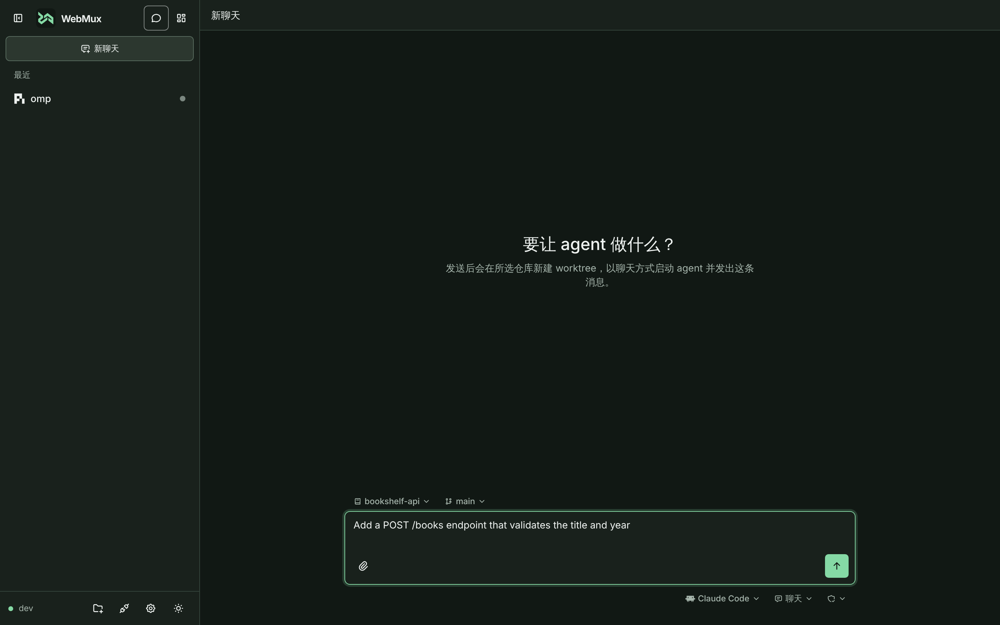

# 聊天模式

聊天模式让你把任务直接交给 agent：选好仓库和 agent，写下任务并发送，WebMux 会新建一个独立的 Git worktree、以聊天方式启动 agent 并发出第一条消息。适合在手机上派活、阅读回复和回答授权请求。

## 快速开始

1. 点侧栏左上角切到**聊天模式**，或在侧栏点「新聊天」，进入快速开始页 `/new`。
2. 在输入框上方选择**仓库**与**基准分支**（可搜索本地分支，按名称区分）。
3. 在输入框下方选择 **Agent**，按需调整它的配置项与**权限模式**（默认“全部接受”）。
4. 写下任务并发送。服务端新建 worktree、以聊天视图启动 agent，并把你的消息作为第一条消息发出。

快速开始页上还可以：

- **添加附件**：与聊天视图相同，可通过上传按钮、粘贴或拖放添加。会话创建前附件暂存在服务端，创建后随首条消息发送。
- **插入快捷指令**：输入框底部、发送按钮左侧的 ⚡ 按钮。
  - 选择指令只在光标处插入正文（或替换选区），不自动发送，指令的“回车”选项在这里不起作用；草稿照常保存，发送或创建中禁用。
  - 正文里的 `{{dir}}`、`{{webmux}}`（无论手写还是由快捷指令插入）在会话创建后由服务端替换为临时文件夹路径和 WebMux 工具说明。
  - 菜单中的“管理快捷指令”进入设置页的快捷指令分区，返回后草稿仍在。
- **附带仓库初始化指令**：仓库设置了初始化指令时，输入框上方显示“使用初始化指令”勾选框，见下文。

Agent 列表只列出开启了混合模式的启动配置。选中或切换 Agent 时会临时读取它的配置项：读取期间相关控件禁用，失败时沿用上次记住的清单。

## 侧栏中的聊天

聊天模式下侧栏分为两部分：

- **上方：正在运行的聊天**，按创建时间从新到旧排列。输出与状态变化不会让行跳动。点一行进入该聊天。
- **下方：已归档记录**，默认折叠并显示数量。点已归档的聊天会直接恢复到聊天端。

行尾的标记表示状态：

| 标记       | 含义                                                  |
| ---------- | ----------------------------------------------------- |
| 绿色圆点   | 工作中                                                |
| 琥珀色圆点 | 等待你（提问、授权或本轮完成）                        |
| 灰色圆点   | 空闲                                                  |
| 空心圆点   | 已结束（已归档）                                      |
| 空心三角形 | 已归档且已释放 worktree 空间，恢复前需要重建 worktree |

已释放记录的原路径与提交显示在悬停提示中。

进入已有聊天后，输入框上方只读显示该会话所在的仓库与 worktree 分支（每次进入时刷新）。

## 聊天视图的日常操作

- **回答授权与表单**：在输入框位置作答；多台设备同时打开时，第一个答复生效。
- **回合进行中继续发送**：消息进入服务端队列，所有设备共享，可编辑、调整顺序、删除或立即发送。
- **调整模型、模式与权限**：输入框下方的会话选项一行；窄屏（<640px）收在上传按钮旁的“会话选项”按钮里。
- **切到终端**：会话页顶栏的“聊天 | 终端”控件，在原生 TUI 里继续同一段对话。
- **查看代码位置**：点击 agent 消息里的文件位置链接，在代码面板打开对应文件。

完整的聊天视图说明（计划、用量、插话、附件规则、提醒）见 [混合会话](../hybrid-sessions.md#聊天视图)；支持的 agent 与连接器安装见 [支持的 agent 与连接器](../hybrid-sessions/agents.md)。

## 归档、恢复与释放空间

- **停止并归档**：在侧栏行的“⋯”菜单、会话页或首页卡片选择“停止会话并归档”。agent 进程停止，会话变成已归档记录。
- **恢复**：点已归档记录，或在菜单选“恢复聊天”。原 agent 会话不存在时页面列出同目录下的其他会话供选择。
- **释放空间**：记录位于可用的 linked worktree 时，菜单提供“释放空间”：删除 worktree 目录、保留分支与提交，记录标为已释放（空心三角形）。
  点已释放的记录会先确认在原路径重建 worktree，再恢复。详细规则与推送检查见 [仓库与 worktree](worktrees.md#释放空间)。
- **删除记录**：确认后只删除记录，关联工作树保持不变。
- **删除记录和工作树**：仅当关联的 linked worktree 可删除时出现；先走删除 worktree 确认流程，成功删除工作树后再删除该记录。已释放或位于主工作区 / 直接目录的记录只提供“删除记录”。

> [!WARNING]
> 释放空间和删除 worktree 只保留提交：未提交修改、未跟踪与忽略文件随目录永久删除，重建也找不回。

## 仓库初始化指令

初始化指令是给某个仓库保存的一段开场要求，快速开始或新建会话时可以选择附带，省去每次手动粘贴。

1. 在工作台首页侧栏选中该仓库（只登记了一个仓库时无需选择），点工具栏的「仓库设置」。
2. 在“初始化指令”里写多行模板（最多 4000 字符），可点“可插入”里的名称插入引用：
   - `{{快捷指令名称}}`：设置里的快捷指令；
   - 内置的 `{{user}}`：你的第一条消息放在哪里（不写则接在指令后面）；
   - 内置的 `{{dir}}`：新会话的临时文件夹路径；
   - 内置的 `{{webmux}}`：WebMux 工具说明，含手册地址、命令路径与临时文件夹，见 [用脚本和 agent 控制 WebMux](shell-control.md)。
3. 之后快速开始页和新建会话弹窗会显示“使用初始化指令”勾选框（默认勾选，只影响本次发送）。勾选时，展开后的指令随首条消息一起发送。

留空保存即清除指令。引用不存在的快捷指令名称时只提示，不阻止保存。
