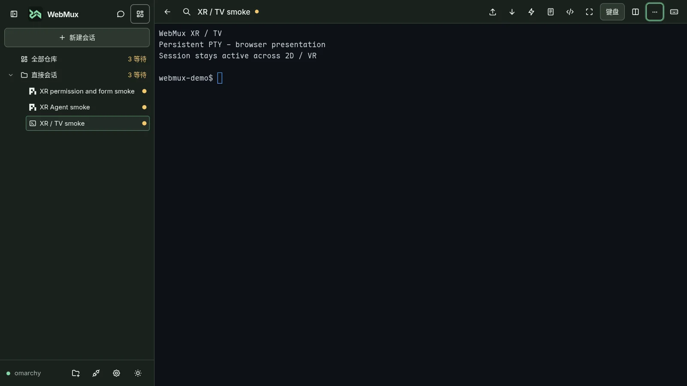
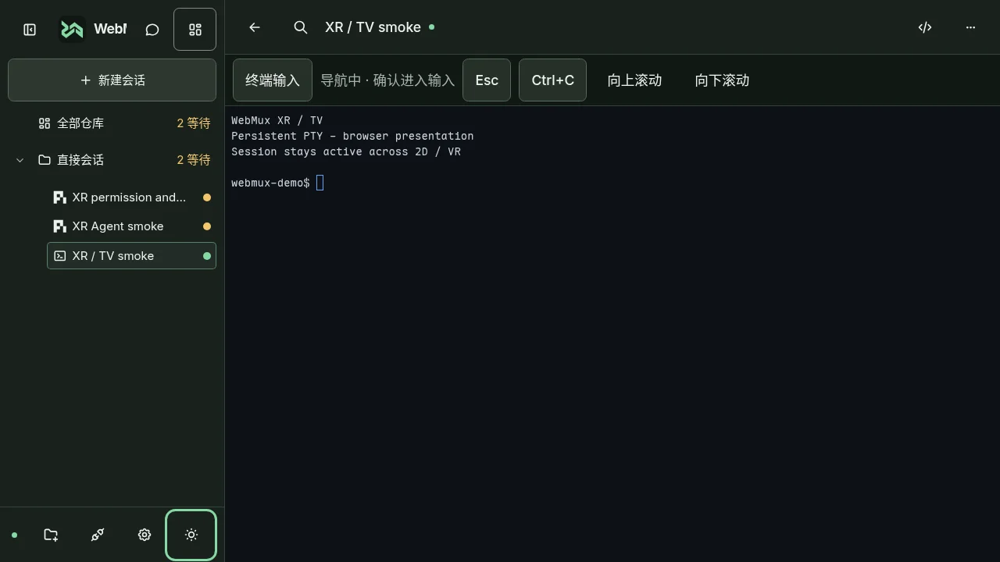
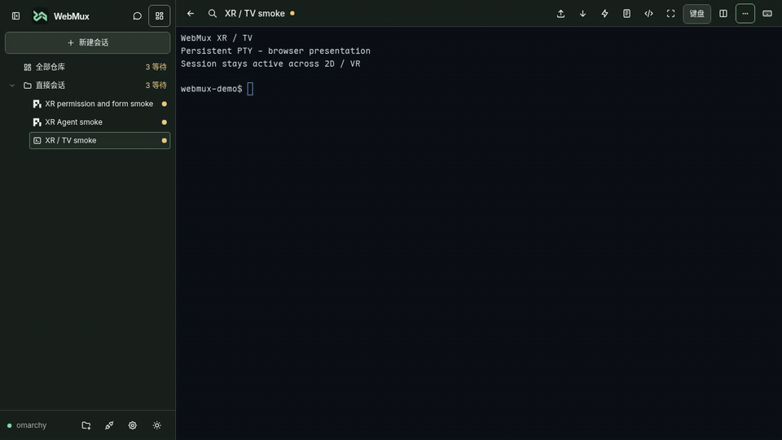

# 头显与 TV 浏览器

在头显的普通浏览器窗口中使用 2D 工作台，在电视浏览器里用遥控器导航。打开已有会话后，从终端菜单选择「头显浏览器模式」或「TV 模式」；这两个开关也在设置的外观区，只保存在当前浏览器，不跨设备同步。

## 选择模式

- **头显 2D**：继续使用浏览器窗口里的终端、聊天与代码工作区，通过系统键盘或实体键盘输入。
- **TV 浏览器**：放大界面与焦点目标，用方向键、确认和返回操作；这是网页模式，不包含电视应用商店安装或原生遥控器适配。

## 头显 2D：主动打开键盘

1. 在终端菜单或设置中开启「头显浏览器模式」。
2. 大窗口下不照搬手机的触屏软键布局；需要文字输入时点「键盘」，或使用实体键盘。
3. 系统键盘开合不会反复抢焦点或让终端随键盘高度循环缩放；仍保留显式键盘入口，不要求始终连接实体键盘。

## TV：在导航与终端输入间切换

1. 开启「TV 模式」，用方向键移动可见焦点、确认激活控件；可滚动阅读区也能获得焦点并上下滚动。
2. 方向键聚焦普通文本框后，按确认开始编辑；再次确认完成编辑，方向键回到页面导航。多行内容用 `Shift+Enter` 换行；确认不会直接发送正文。
3. 树、菜单、命令面板、聊天编辑器和代码编辑器保留自身的键盘协议，控件内的选择、光标移动和提交仍由控件处理。
4. 在终端点击「终端输入」捕获按键，再用方向键和确认操作 Shell / TUI；按返回释放输入，回到页面导航。
5. 使用工具栏的「Esc」「Ctrl+C」「向上滚动」「向下滚动」明确向终端发送控制键或阅读历史；遥控器返回不等于向程序发送 Esc。

返回按当前层处理：先关闭顶层菜单或弹窗，再释放终端输入或退出文本编辑，随后关闭工作区面板，最后才返回页面。
实体键盘仍可使用；浏览器或电视系统保留的按键可能无法传给网页，具体遥控器映射需在目标设备确认。

## 验证与限制

尚未完成真实头显系统键盘或 TV 遥控器验收。实际兼容性取决于设备、浏览器和系统保留键；浏览器 fixture 与视口截图不等于硬件兼容证明。

## 浏览器验证示例

以下使用隔离会话和固定演示数据。

