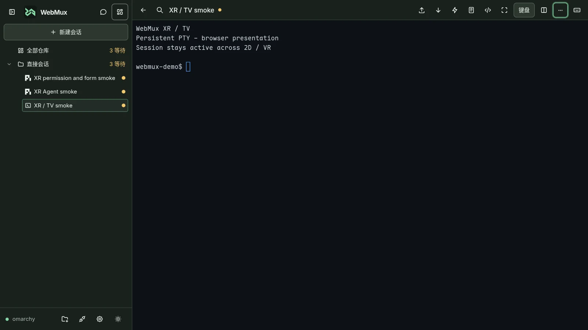
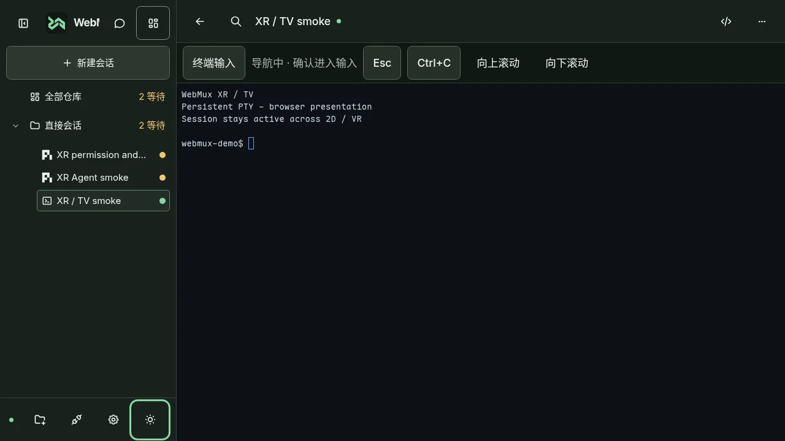
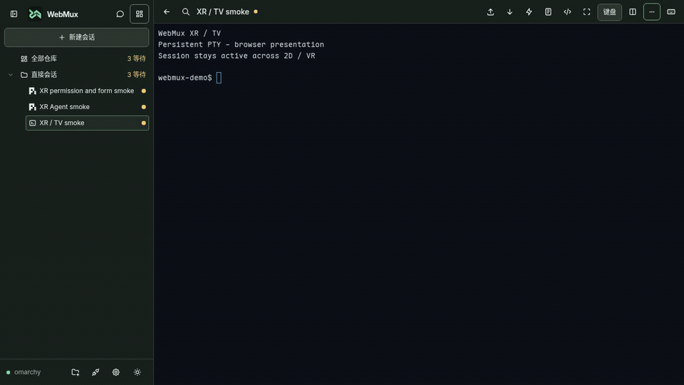
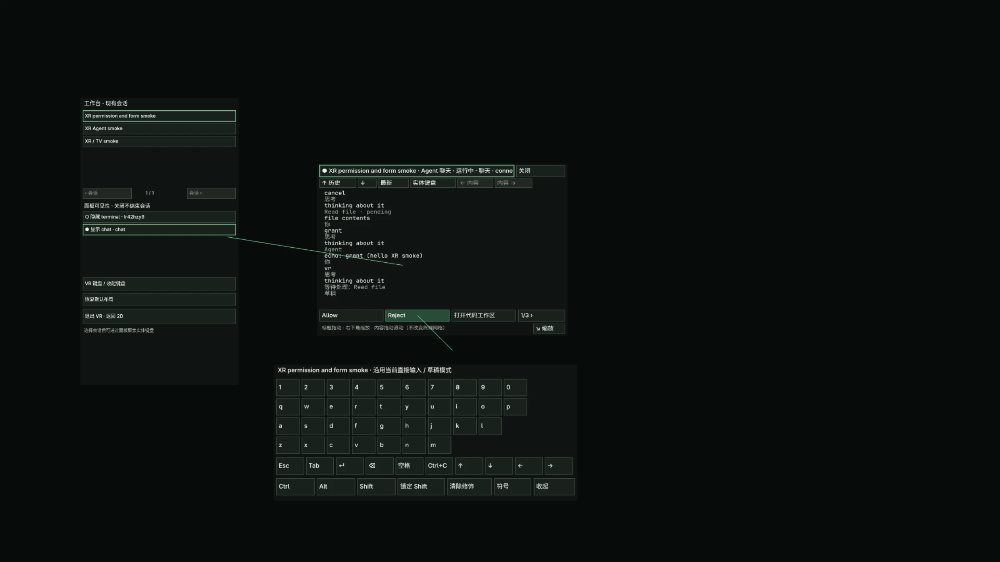
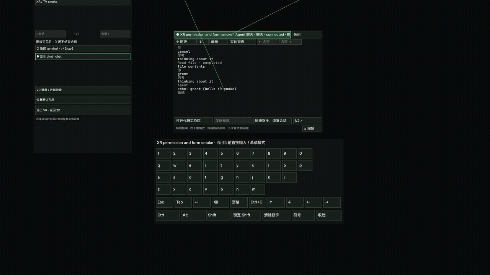
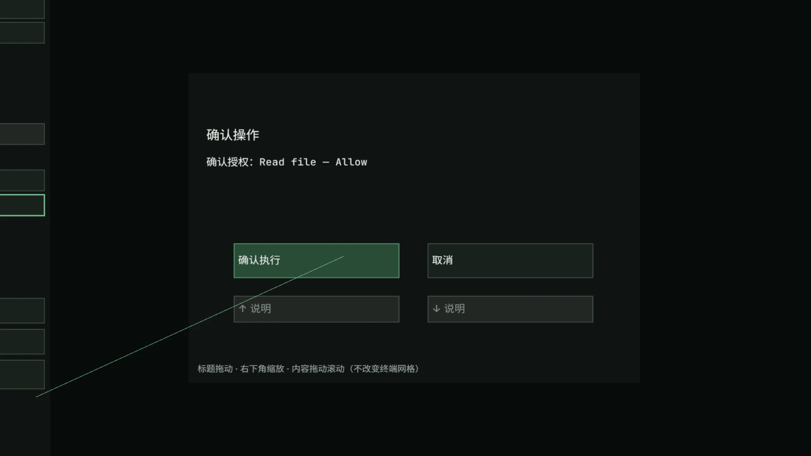
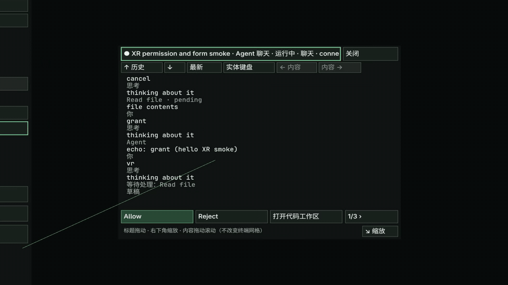
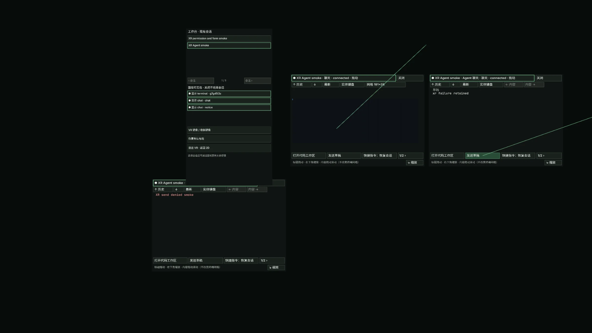
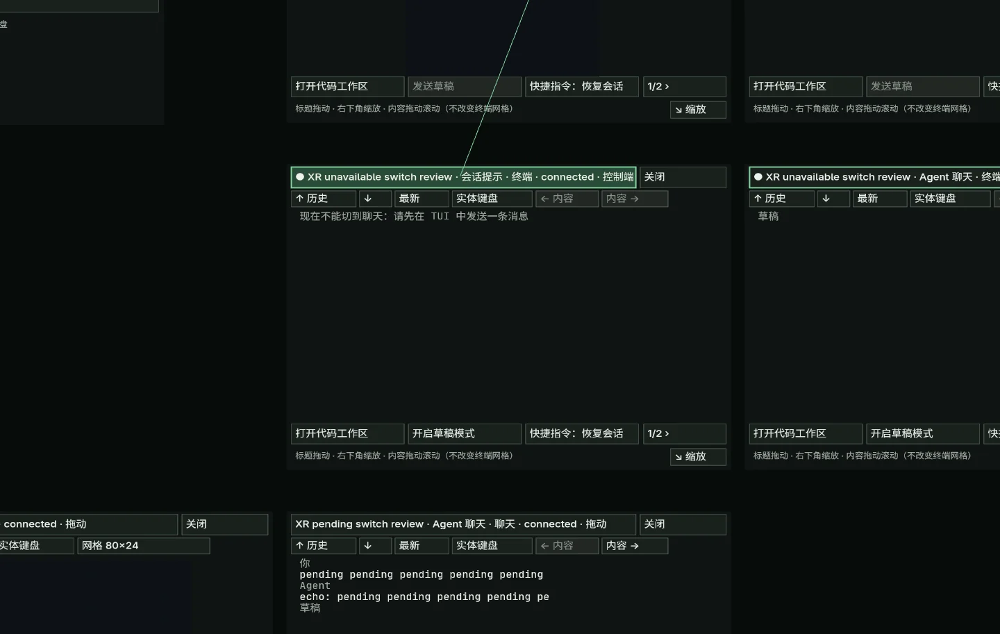
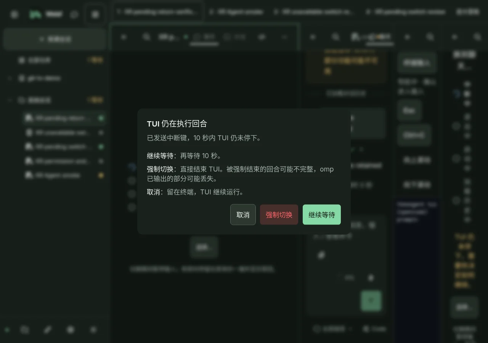

# 头显与 TV 浏览器

在头显里先用普通 2D 工作台，在电视浏览器里用遥控器导航；支持 WebXR 的头显还可主动进入沉浸式 VR。
打开已有会话后，从终端菜单选择「头显浏览器模式」或「TV 模式」；这两个开关也在设置的外观区，只保存在当前浏览器，不跨设备同步。

## 选择模式

- **头显 2D**：继续使用浏览器窗口里的终端、聊天与代码工作区，不要求 WebXR。
- **TV 浏览器**：放大界面与焦点目标，用方向键、确认和返回操作；这不是原生电视应用，不包含电视应用商店安装或原生遥控器适配。
- **沉浸式 VR**：在支持 `immersive-vr` 的浏览器与设备上，把同一工作区的内容放到空间面板中。

进入 VR 前，使用 HTTPS 或浏览器认可的受信任安全上下文；远程头显访问可参考 [远程访问与 HTTPS](../deployment/remote-access.md)。
页面会探测 WebXR 能力；只有用户主动点击「进入 VR」（Enter VR）才请求沉浸式会话，不会因打开页面自动进入。
缺少能力、权限被拒绝或启动失败时仍可使用 2D；终端菜单中的入口会说明不支持的原因，不应把出现入口视为硬件兼容证明。

## 头显 2D：主动打开键盘

1. 在终端菜单或设置中开启「头显浏览器模式」。
2. 大窗口下不再照搬手机的触屏软键布局；需要文字输入时点「键盘」，或使用实体键盘。
3. 系统键盘开合不应反复抢焦点或让终端随键盘高度循环缩放；仍保留显式键盘入口，不要求始终连接实体键盘。

## TV：在导航与终端输入间切换

1. 开启「TV 模式」，用方向键移动可见焦点、确认激活控件；可滚动阅读区也能获得焦点并上下滚动。
2. 方向键聚焦普通文本框后，按确认开始编辑；再次确认完成编辑，方向键回到页面导航。多行内容用 `Shift+Enter` 换行；确认不会直接发送正文。
3. 树、菜单、命令面板、聊天编辑器和代码编辑器保留自身的键盘协议，不把控件内的选择、光标移动或提交误当成页面导航。
4. 在终端点击「终端输入」捕获按键，再用方向键和确认操作 Shell / TUI；按返回释放输入，回到页面导航。
5. 使用工具栏的「Esc」「Ctrl+C」「向上滚动」「向下滚动」明确向终端发送控制键或阅读历史；遥控器返回不等于向程序发送 Esc。

返回按当前层处理：先关闭顶层菜单或弹窗，再释放终端输入或退出文本编辑，随后关闭工作区面板，最后才返回页面。
实体键盘仍可使用；浏览器或电视系统保留的按键可能无法传给网页，具体遥控器映射需在目标设备确认。

## VR：复用现有工作区

1. 打开会话，主动点击「进入 VR」。空间工作台列出现有会话，可切换会话并显示或隐藏终端、聊天、代码和 Diff 面板。
2. 用控制器射线选择控件；浏览器提供 gaze 或 screen 输入源时也沿用同一命中与选择路径，不把这些输入源冒充左右手控制器。
3. 拖动面板标题移动位置，拖动「缩放」改变物理大小。它们不改变终端逻辑行列数；需要改变共享 PTY 网格时打开「网格」并显式确认。
4. 点「实体键盘」聚焦当前会话的终端或聊天输入视图；通过「切换到终端 / 聊天」改变视图，繁忙时保留原有切换确认。
   从菜单开合 VR 键盘，沿用同一输入路由和修饰键状态，可点「清除修饰」解除锁定。

空间终端继续使用已有 xterm 缓冲、PTY 与连接，不创建替代服务器会话；聊天、代码和 Diff 也复用当前数据与操作。
面板显示会话标题、状态与选择信息；隐藏或关闭面板不结束会话，可从工作台菜单重新显示。
多设备观察与接管规则不变，显式终端网格调整仍受控制权约束，见 [终端使用](terminal.md)。
共享设置里的快捷指令更新后，VR 会使用最新正文和回车设置；即使名称不变，也不需要退出重进。
阅读聊天历史时，新回复不会打断当前位置；点「最新」跳到当前回复末尾，并恢复跟随后续内容。

终端在 VR 中使用 Canvas 文字表面，不支持把 Kitty 等图片协议内容绘制到空间终端；出现图形提示时返回 2D 查看。
聊天权限授权和带破坏性确认的操作保留确认步骤；复杂表单可返回 2D 填写，不会因为射线点选就绕过授权。
聊天发送失败会保留草稿并显示空间错误通知；可直接重试，成功后清除提示。
无法切换或切换失败的原因也会显示在空间面板中。若 TUI 中断后仍未停止，选择「返回 2D 处理切换」后，可在所属会话中继续等待、强制切换或取消；不会自动强制结束 TUI。

## 布局、退出与限制

- 布局只在本设备浏览器保存至多 16 个面板的几何与可见性元数据（含会话与面板标识），不额外保存终端输出、聊天正文或文件内容。
- 位置与大小有界，损坏或失效记录不作为可信布局使用；在 VR 菜单点「恢复默认布局」可重置。
- 选择「退出 VR · 返回 2D」、浏览器结束 XR 或图形上下文丢失时恢复 2D；上下文丢失后可重新进入，不结束服务端仍在运行的会话。
- 这些模式不增加跨服务重启的持久终端会话，也不改变原有混合会话记录的持久化规则。浏览器断开与服务重启的区别见 [会话与工作台](sessions.md)。

已在 Chromium + IWER 沉浸模拟器中验证真实 PTY、聊天、代码/Diff、空间输入及上下文丢失后返回 2D；这些是模拟器证据，不是设备兼容认证。

尚未完成真实头显系统键盘、控制器、双眼可读性或 TV 遥控器验收。实际兼容性仍取决于设备、浏览器、系统保留键及 HTTPS 信任链。

## 浏览器验证示例

以下使用隔离会话；沉浸画面来自 Chromium + IWER，不代表真实头显效果。
桌面、平板与手机的亮暗主题前后对照保存在本次 PR 的截图中。

### 头显 2D 与 TV

### 沉浸工作台

