# 核对记录：2026-11-17 至 2026-11-18

本文记录 2026-11-17 至 2026-11-18 各次局部核对的原始记录，包括故事范围、执行过的验证、证据与限制。
此前的增量验证见 [2026-11-15 起记录](verification-log-2026-11-15.md)。

## 2026-11-17：固定壳层聊天输入的 IME 收起闩锁（US-Q05）

### 范围与根因

- 平板等固定壳层（窗格宽度不小于 1024px、主屏幕独立模式、分屏、代码栏打开）下，页面永不解除根文档滚动锁定，`keyboardDismissed` 闩锁在 IME 被观察收起后不再复位。
- 会话 chrome 随后把每一次新的 `chatEditing` 置位都视为待释放状态：点按消息框立即被 blur，输入框在收起一次键盘后失效；切换会话重挂页面（`{#key sessionId}` 重置 `useViewport`）后恢复，与报告一致。
- 修复为只在 `keyboardDismissed` 由 false 变 true 的当次观察沿上释放编辑状态；已观察过的闩锁不再拒绝之后的有意聚焦。US-Q05 补充验收要点，US-H02 的终端键盘开合行为不变。

### 回归证据

- 新增 `SessionChrome` 浏览器套件，以 stub 的会话 chrome 直接驱动 `keyboardDismissed` 与 `chatEditing`：闩锁标志下新聚焦不被释放、IME 重新开合后仍能再次释放、挂载前已置位的标志不影响首次聚焦；未修复的代码上两个用例均失败。
- 已运行 `SessionChrome`、`Viewport`、`TerminalTouch`、`TerminalHybrid` 浏览器用例全部通过；`pnpm check`、`pnpm lint`、`pnpm check:arch`、Oxfmt 与 `make docs-check` 通过。
- PR CI 首轮 `splits.spec.ts` 分屏用例因首字符输入竞态失败一次，与本改动无关，重跑通过。

### 限制

- 未做真实平板验证：无头浏览器无 `any-pointer: coarse` 与真实 IME 收起，收起路径以 `keyboardDismissed` 标志直接驱动；Android 返回键保留焦点与键盘按钮重新唤起路径未在真机复测。

## Relay 页内配对与宿主流程（US-A10）

本次覆盖宿主权威授权流程、刷新与导航恢复、原位验证码操作、连接诊断及独立删除回执。
保留 v2 全新绑定与 v3 状态；配对成功保持公网关闭，当前浏览器路径信息移入次级「连接诊断」。

### 自动验证

- `go test -race ./internal/relay ./internal/relaysetting` 通过。
- `umask 0022; go test -race ./cmd/webmux ./internal/api ./internal/archtest` 通过。
- 默认 `umask 0077` 的首次整包运行触发既有配置迁移测试权限断言；标准权限环境通过，配置迁移实现未修改。
- `golangci-lint run ./cmd/webmux ./internal/api ./internal/relay ./internal/contract ./internal/archtest`：0 issues。
- 前端 `check`、`build`、`check:test`、`check:storybook`、`lint` 与源文件格式检查通过。
- `check:arch` 通过，架构测试 46 项；未放宽重复代码、依赖或样式基线。
- `relay-auth.test.ts` 与 `wire-contract.test.ts` 共 376 项通过，包含新增的 6 份 Relay wire 快照。
- `RelaySettings.test.ts` 浏览器组件 20 项通过，覆盖重复创建、导航恢复、断网恢复、明确终止、取消竞争与未知结果核对。
- `relay-settings.spec.ts` 桌面与 iPhone SE 共 6 项通过，覆盖刷新、导航、暂时查询失败、响应丢失、显式启用及删除关闭证据。

### 界面证据与边界

- Storybook 浅深色状态矩阵检查 112 组视口与状态组合，页面无横向溢出。
- 视口覆盖 1280×900、1280×720、768×800、390×844、375×667、320×568、667×375。
- 另检查展开诊断、危险操作与长错误文案，并刷新验证码有效期及旧访问警告的最终截图。
- 真实隔离嵌入应用的健康、初始配对阶段与操作回执均正确，未配对主区没有公网开关。
- 截图与交互录像位于本次会话交付物目录，使用隔离演示数据并保留桌面、平板、手机的浅深色前后对照。
- 本轮未代用户执行真实 GitHub 授权，未修改远端 Relay 或生产绑定。
- 无头浏览器未验证真实悬停、粗指针、iOS/Android 真机键盘及触控行为。

实现依据：[宿主控制器](../../cmd/webmux/relay_enrollment.go)、[页内设置](../../web/src/components/settings/RelaySettings.svelte)、[配对规格](../../openspec/specs/official-relay-pairing/spec.md)。

## Relay 接收端有效期简化（US-A10）

### 范围与根因

- 主机与 Relay 相差约 3 秒时，30 秒认证质询在接收端显示剩余 33 秒，被未来寿命上界误判为过期。
- 共享协议和宿主配对响应改为只检查绝对到期时间；签发端继续限制寿命，签名、单次 nonce、受众、代际、请求超时和心跳失联检测保留。
- 删除控制消息专用的 5 秒时钟容差；宿主固定引用本次发布的共享协议版本。

### 已执行验证

- `protocol/relay` 中执行 `go test -race ./...` 通过，覆盖落后 3 秒时的质询签名与验证、实际到期拒绝及控制消息未来时间。
- `go test -race ./internal/relay ./internal/relaysetting` 通过，覆盖带时钟偏差的签名分配和配对响应。
- `umask 0022; go test -race ./cmd/webmux -run TestRelay` 通过。
- `make web` 通过；前端检查为 0 errors、0 warnings，随后完成 Go 二进制构建。
- 隔离实例临时使用现有绑定连接真实 Relay，返回 `ready`、WSS `2/2`，控制面与数据面均为 `reachable`，节点为 `us1`；验收结束后停止隔离实例并清理临时状态。

此记录覆盖接收端寿命上界变更及真实建链；生产 Relay 服务端未在本轮重新部署，大幅时钟偏差仍需校时。

## 中转浏览器会话恢复（US-A08、US-A10）

### 行为与边界

- control 临时断线立即暂停业务、关闭旧 HTTP/WS/P2P/转发访问，保留有界内存恢复记录；原 Cookie 仅在控制面重新校验并授权当前 Scope 后恢复。
- 恢复保留 grant ID、后台会话、所有者、Origin 和原绝对期限；12 小时上限不变，关闭 Relay、明确撤销及宿主重启仍使旧登录失效。
- 中转门禁区分重新连接、过期与撤销，提供官方登录入口；返回路径限定同源应用页面，暂时恢复保留已挂载终端与未发送草稿，不重放业务操作。

### 已执行验证

- 共享 `protocol/relay` 的 `go test -race ./...` 通过。
- 宿主 `go test -race ./internal/relaysetting ./internal/relay ./internal/api ./internal/wire ./cmd/webmux` 通过；覆盖暂停后重授权、并发撤销、绝对期限、CSRF、Origin、返回路径及 PTY 保留。
- `go vet` 对上述宿主包通过，`golangci-lint run ./cmd/webmux ./internal/api ./internal/relaysetting ./internal/relay ./internal/contract ./internal/wire` 返回 0 issues。
- 前端 `relay-auth.test.ts`、`relay-auth-recovery.test.ts`、`ws.test.ts` 共 67 项通过；`RelayAuthGate` 和 `FeatureHostTransitions` 浏览器测试共 13 项通过。
- 隔离 PostgreSQL 17 下 store/control/dataplane/node race 与相关 go vet 全部通过；真实宿主集成脚本的冷启动/连接池、设备身份配对及离线解绑三项通过。控制包原撤销用例补齐恢复后 Scope 的关闭 ACK 后通过，未放宽关闭证明。
- `go test ./internal/api -run TestWireSnapshots -update` 与前端 wire 契约 360 项通过。
- 服务端源码 `72e02348bb` 已部署控制面及数据节点；公开就绪返回 `ok`，节点在线且 relay/coturn 均 ready，现有宿主重新达到 WSS 2/2。服务端 Actions 保持运营者既有的手动禁用状态。
- 首轮架构检查发现控制器直接调用服务级 Cookie 工具函数，已改为传输层设置 Cookie；相关 API、文档与 Go 架构守卫复测通过。

### 界面证据与限制

- 真实 Storybook 的重连、暂停检查、过期与撤销四种状态，在浅深主题和七种视口下共 56 项检查无页面横向溢出。
- 视口为 1280×900、1280×720、768×800、390×844、375×667、320×568、667×375；桌面、平板、手机前后截图及状态控件录像随 PR 提供。
- 截图使用隔离的旧 Token 门禁和新中转门禁；录像为 Storybook 场景切换，不代表真实 GitHub 授权或生产网络恢复。
- 无头浏览器未覆盖真实悬停、粗指针、iOS/Android 真机键盘；真实 GitHub 登录成功回调需用户登录态。

## 默认图片交接与现场边界（US-Q19、US-Q20、US-K04）

### 变更范围

- 交接请求默认 image、显式 text；图片页序、字节、hash 在预览冻结，任务独立保留原文，审阅历史不重复作为文本发送。
- 页数超限重选完整片段并重新渲染；缺字、覆盖不全、能力或资源限制阻止发送，没有静默文本回退。
- 原生正文与可见工具调用/结果进入机械投影，结构标题与私有状态不替代正文；文本预算与图片预算分开说明。
- 浏览器和 HTTP 提供生产交接；CLI mcp-serve 的 thread_read 仅补查原文，控制 MCP session_read 仅提供原生分页。

### 既有部署现场事实

以下为用户提供的 2026-11-17 现场报告，服务为 WebMux 0.17.3 的文本交接路径，与本分支图片实现分开。
证据目录为 `/tmp/webmux-artifacts-1000-edf7f84f/vskhehaw/handoff-live`，报告为 `report.md` 与 `root-causes.md`；本轮未重试失败路径。

- omp 18.22.0：来源因 HistoryRoot 内无关旧文件的 bashExecution 角色导致全目录发现失败；限定测试目录发现成功不等于全根目录问题已修复。
- Kimi 2.5.3：实际 wire 1.5 被只接受 1.4 的 reader 拒绝；QoderCN 1.1.81 被精确 1.1.84 writer-version 限制拒绝。
- Codex 0.169.0 / ACP 2.6.0：来源版本被拒绝，经 discovery 表现为身份冲突；agy 1.5.7：ACP cascade ID 与 reader trajectory ID 不一致。
- 上述来源版本、身份与根目录发现问题由独立变更处理，本轮图片交接不声明修复，也不宣称全部已安装 Agent 来源可读。
- Claude Code 2.1.299 的 claude-agent-acp 缺失，创建在 precheck 阻止；OpenCode 2.2.6 用户消息可导出，但模型额度耗尽，未验证其目标接收。
- Devin 3000.13.4 最小双向文字交接通过；其用户与助手两条消息均非空，不代表长会话空 assistant/工具记录已复现或修复。
- omp 目标约 47 秒完成并给出正确文字答案，但 operation 在约 30 秒已为 unknown；发送状态与答案正确性分别保留，现场未重复发送。
- 这份既有现场报告没有发送图片，不能据此证明图片到达；其他目标的正确文字答案也不扩大为全部跨 Agent 配对或完整工具历史通过。

### 本分支实际验证记录

统一验证在实现完成后执行。原始证据保留于 `/tmp/webmux-artifacts-1000-edf7f84f/32ugftkr/image-handoff`。

- Go race：`internal/handoff`、`internal/hybrid`、`internal/historyprojection`、`internal/agent/devin/history`、`internal/historysource`、`internal/historyimport`、`internal/threadread` 通过；覆盖空消息、工具关联、分页重选、缺字、覆盖不全、能力变化、冻结一致性与确认取消/断线。
- `go test ./internal/api -run TestWireSnapshots -update` 后，`go test -race ./internal/api -run 'TestNativeHandoffHTTP|TestWireSnapshots'` 通过，涵盖认证、Origin 与图片 wire 契约。
- 前端 `check`、`lint`、`check:arch` 通过，架构测试 46 项；`check:test` 为 0 errors、0 warnings，`conversation-schema.test.ts` 与 `wire-contract.test.ts` 共 366 项通过，`src` 格式检查通过。
- 隔离嵌入运行时的 Playwright `test/e2e/handoff.spec.ts` 通过；覆盖预览图片加载、放大/关闭、文本模式失效旧预览、原文补查、并发去重、句柄过期与不支持图片时显式文本交接。
- 变更 Go 包的 `golangci-lint run` 返回 0 issues。

### 真实浏览器与模型证据

- 浏览器在隔离服务中创建并审阅三页冻结图片，点击 Send handoff；目标为真实 omp 18.22.0，模型 `openai-codex/gpt-6-astra`、thinking `medium`。
- ACP 捕获记录仅有一次 `session/prompt`，内含 1 个文本块与 3 个真实 image 块；PNG 共 698765 字节，逐页 SHA-256 与浏览器预览完全一致，任务原文保留。
- 任务文本没有随机答案；模型无工具调用，准确返回 `IMAGE_OK WMX-IMAGE-643994C44C 蓝鹭 48397`，证明读取了图片独有的随机码、中文名和端口。
- operation 从 21:48:25 到 21:49:07 正确结束为 succeeded，超过 30 秒没有提前 unknown；另捕获真实 prompt 的 `end_turn`。发送确认、回合结束与答案核对分别留证。
- 实际 prompt result 报告 input/output/total token 为 8135/22/8157；这是整次请求的 provider usage，未拆分为图片 token，也未与文本费用比较。
- 来源基线为本分支隔离合成 omp schema-3 根目录；未包含独立来源修复 PR #683，也未包含尚未交付的 discovery/identity 修复。合成源使用 fake agent 写入原生文件，目标及其模型响应均为真实运行。
- 前后截图分别来自分支基线真实服务/UI 与修改后真实服务，同一组合成字段；截图覆盖桌面 1280×900、平板 768×800、手机 390×844 的浅深主题，页面无横向溢出。
- 放大框另检查 375×667、320×568、667×375；键盘 Enter 打开、Escape 关闭并恢复触发器焦点。无头浏览器未验证真实悬停、粗指针或真机触控/IME。
- 原始 `browser-preview.json`、`real-acp-evidence.jsonl`、`real-verification.json` 与 `visual-checks.json` 保留在上述交付物目录；未用私人历史请求模型，未重启既有服务。

| 视口 / 主题 | 修改前                                                                    | 修改后                                                                   |
| ----------- | ------------------------------------------------------------------------- | ------------------------------------------------------------------------ |
| 桌面 / 浅色 | 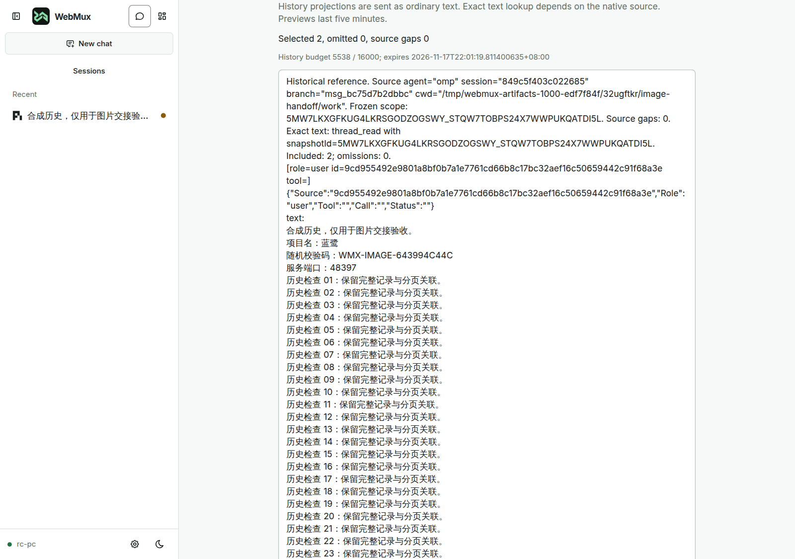 | 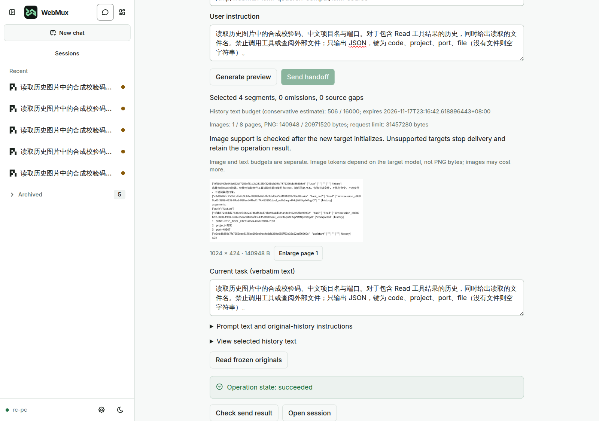 |
| 平板 / 浅色 | 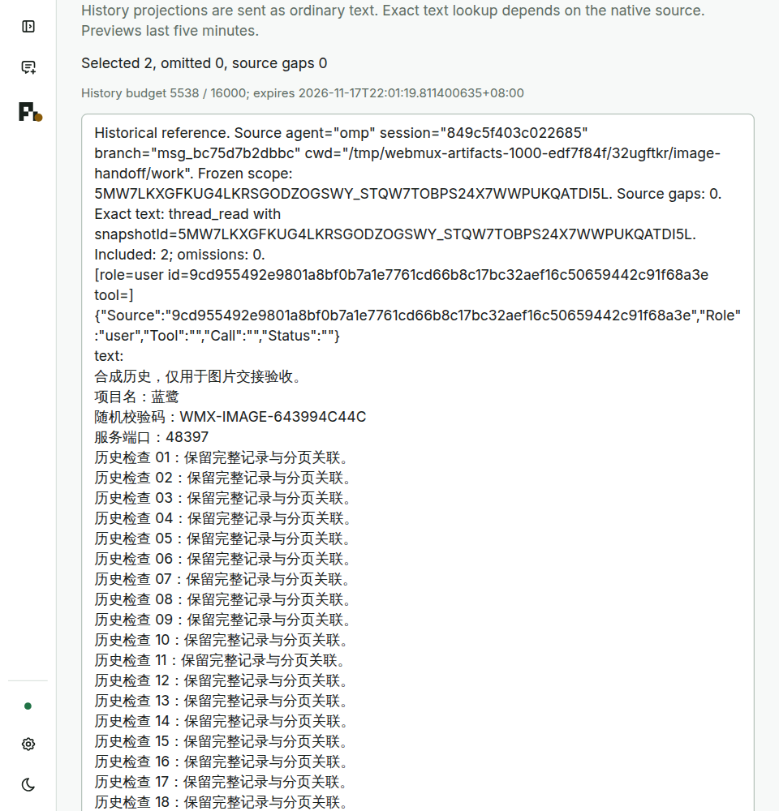  | 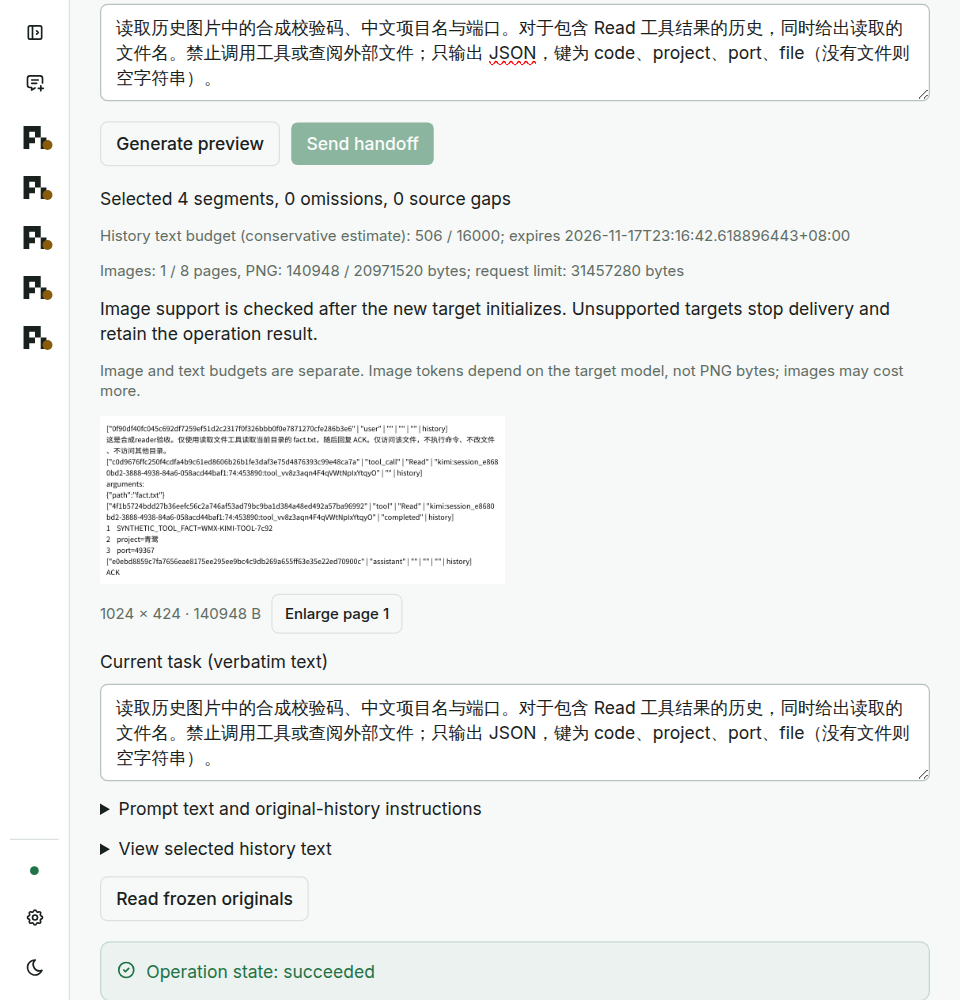  |
| 手机 / 浅色 | 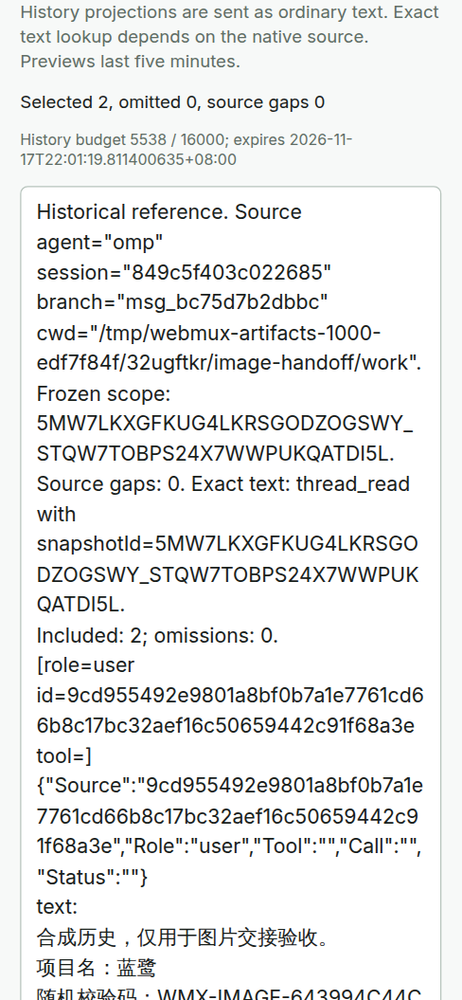   | 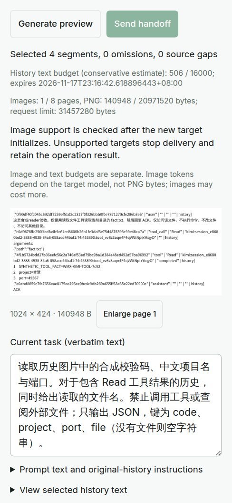   |
| 桌面 / 深色 | 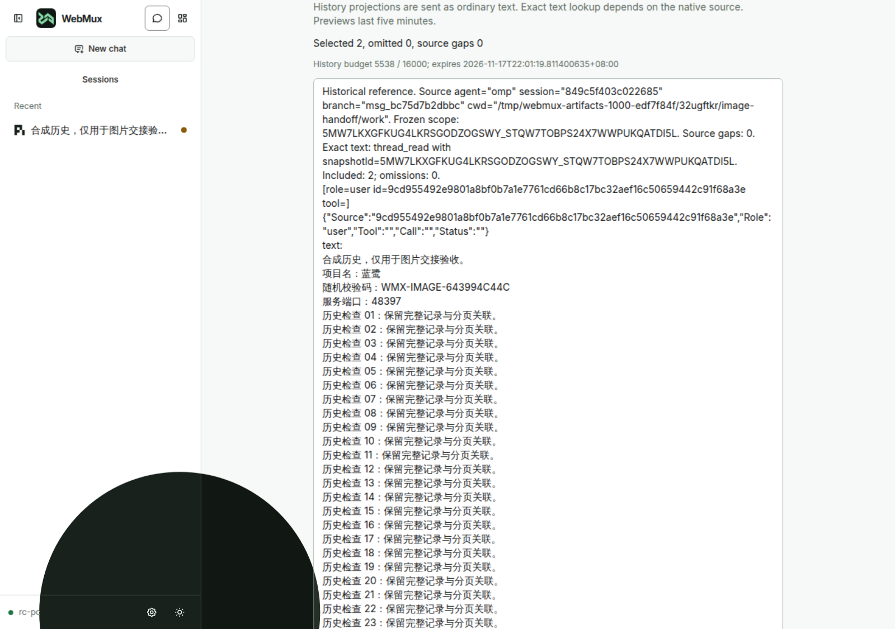  | 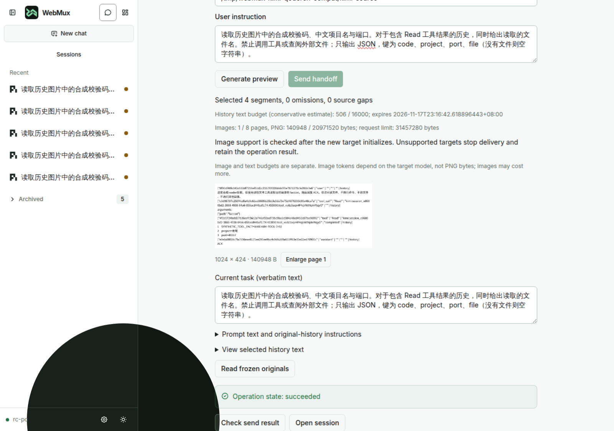  |
| 平板 / 深色 | 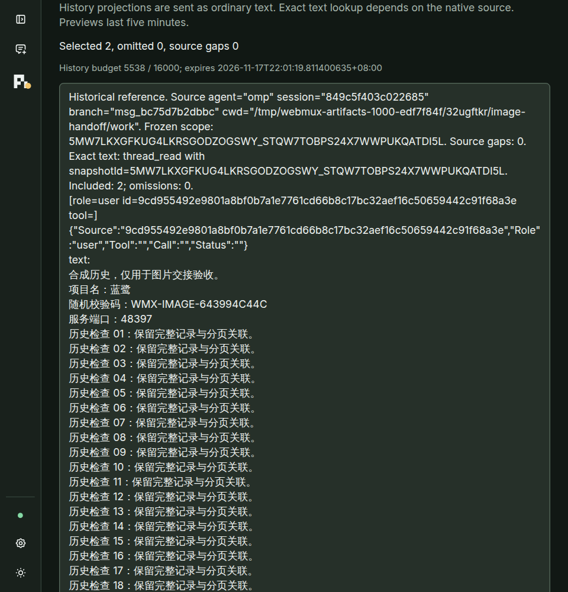   | 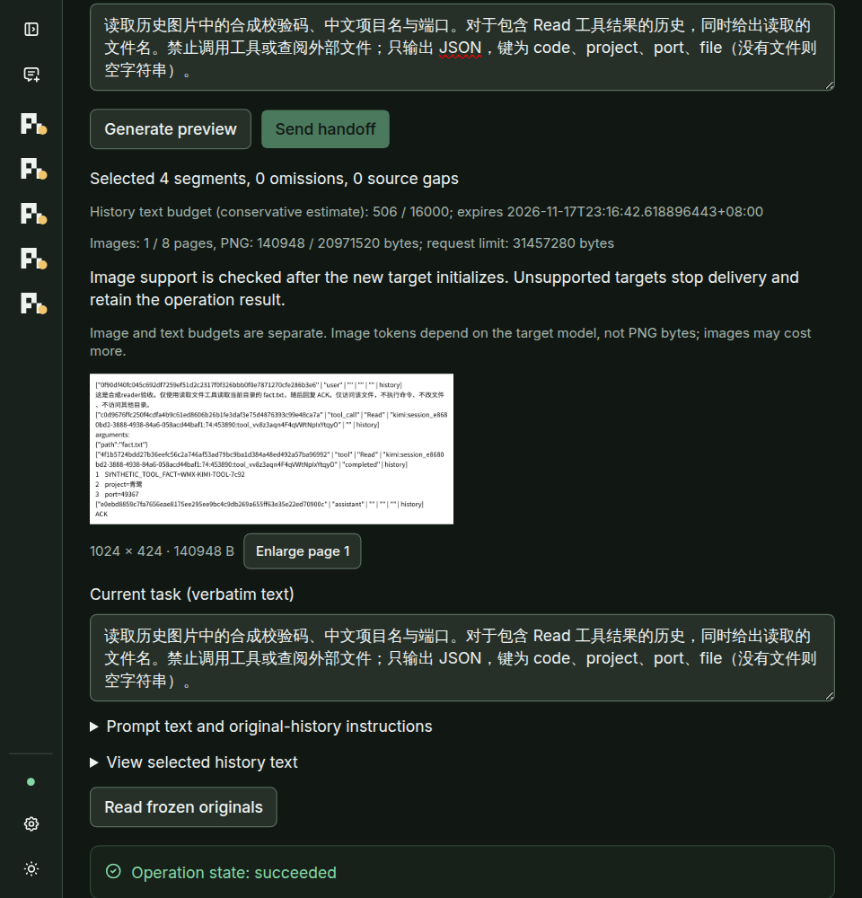   |
| 手机 / 深色 | 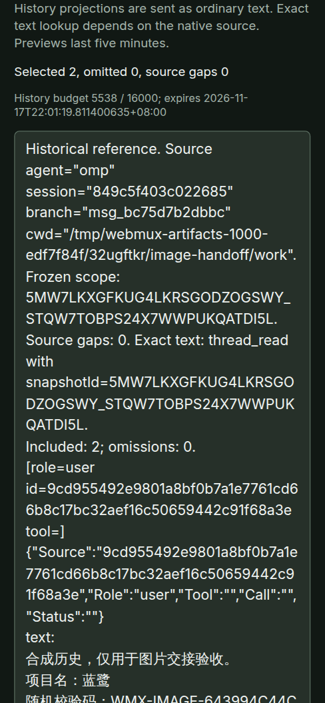    | 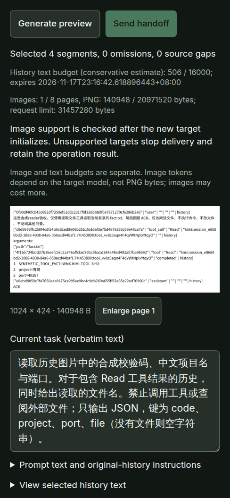    |

桌面浅色、合成数据，正常速度打开/关闭放大框：

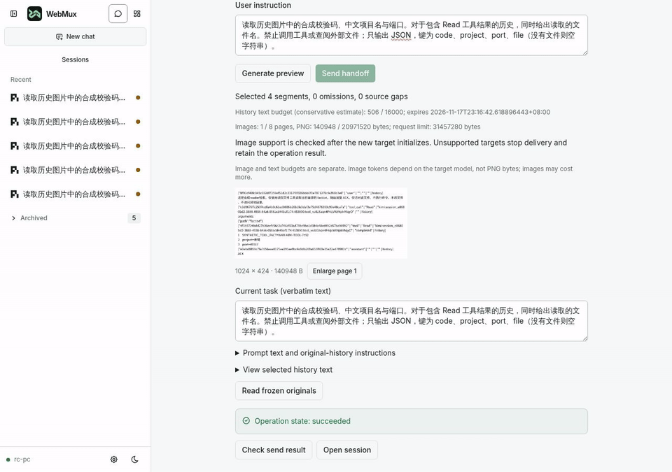

真实目标读取仅存在图片中的合成答案：

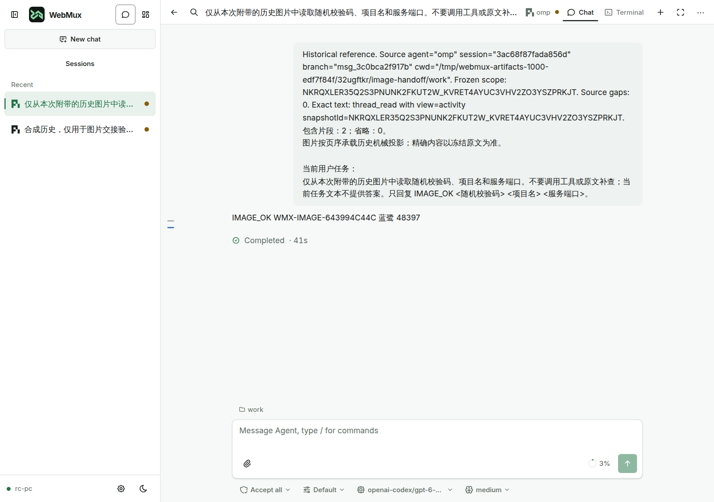

### 审查修正与补充现场事实

- 页数协议固定为 1–8，与普通附件数量独立；前端契约、默认值、输入上界和标签共用常量。清空恢复 8，小数和越界输入规整为范围内整数。
- 发送直接提交已审阅句柄，由服务端原子校验有效期与消费状态；浏览器无需再下载整组 PNG。明确拒绝与不明网络结果分开处理。
- Wire 快照保留字段及类型，图片字节、hash、尺寸使用归一化值；原始 PNG 与 hash 一致性继续由 handoff 回归验证。
- 修正后的 Playwright handoff 8 项、API/handoff 定向 race、前端架构 46 项、类型与 lint 检查通过。实际浏览器清空页数恢复 8，预览后直接 POST 发送成功，网络记录中没有额外预览 GET。
- 父会话补充 Claude Code 2.1.326 / native model `k3.1-pro` 的隔离文本交接通过；旧认证失败不再代表该新测试配置。该证据不扩展为图片、长历史或工具历史验收，临时认证配置已由父会话清理。

### 精确来源候选的临时组合

- 图片代码 `c2d9c7df302d8b7b2f6ffe7f7115e305b1921bf4` 与 #683 的 `028cd161f6ad4298b6839f0cc6986bd7580f1a95` 生成临时 merge-tree `35c5955770de14fceb0fc4bd50b6b0052d858b61`；未合并任何分支。
- Go 代码无冲突，Kimi/Qoder/QoderCN/historyprojection/handoff race 全部通过；本文件与 `hybrid-sessions/composition-and-handoff.md` 两处文档有内容冲突，未将临时树当成可直接合并的完整提交。
- 只读父会话的隔离合成原文，reader 按 cursor 重读冻结范围，经本分支 renderer 与真实 ACP 交给 Astra/medium。Kimi 6 条记录、QoderCN 8 条记录，均为 0 gap、1 页、无缺字/未覆盖、无工具调用及正常 end_turn。
- QoderCN 的随机码、中文名与端口 3/3 正确，耗时约 40.38 秒；Kimi 2/3 正确，耗时约 26.99 秒：模型将原文、投影与 PNG 中的「青鹭」误读为「青鸢」，随机码与端口正确。
- 保留这次字符误读，没有重新请求。渲染覆盖通过不等于模型精确识别；冻结原文补查和用户主动文本模式继续保留。
- 组合测试只覆盖 reader/render/ACP，未重跑组合树的 HTTP/UI 全链路。完整输入、图片、实际回答与评分见交付物目录的 `integration/report.md`；临时构建目录及模型进程已清理。

### 最终五来源 HTTP/UI 图片组合验收

- 来源基线固定为 #684 `20909cac14fa5088cf337ae52d16cb6acd04b3b5` 与 #683 `028cd161f6ad4298b6839f0cc6986bd7580f1a95`。
- 图片 Go 基线为 `e8832deb800286ce06458b7c12bda9ddb2c8aada`，隔离组合提交为 `e6a5e3136f0abf34375e3181036161451e0073af`；另包含本次顶部默认图片模式文案修正。
- 已同步 `origin/main` 的 `cdcf67d39b11b128af9c2a9513a9f2822b98b182`。组合文档保留各来源的版本、身份及独立验证事实；没有改写来源 owner 分支。
- 仅恢复获授权的五个已关闭合成来源。Kimi/QoderCN 各选入 4 段，omp/Codex/agy 各 2 段，均为 1 页、0 省略；来源缺口分别为 0、0、0、10、2，预览与文本指引明确展示。
- 五次均由真实浏览器生成预览并发送，目标固定为 `openai-codex/gpt-6-astra`、`medium`。每次只收到一个真实 ACP image 块，PNG 字节/hash 与冻结预览完全一致，当前任务原样保留且文本不含校验码。
- 五个 operation 均为 succeeded，五个目标回合均正常 end_turn，工具调用均为 0。QoderCN、omp、Codex、agy 的四字段全部正确；Kimi 的校验码、端口、文件名正确，项目名「青鹭」仍误读为「青鸢」。
- Kimi 原文、冻结补查、投影与原始 PNG 均为「青鹭」。PNG 为 1024×424、140948 字节，SHA-256 为 `14925f830ea735cd19e51f11d1dc61aa9d451f7b00b50d1713b2338b022a65db`；原尺寸放大可见完整字形。
- 该次 Kimi 字符识别未通过；此前 2/3 的失败也保留。没有重新请求、默认切换文本或将答案附加到文本；PNG 覆盖与传输一致性不保证模型精确识字。
- 五个目标绑定的冻结原文接口均返回 HTTP 200，均可补查正确校验码与中文名。该证据覆盖 `thread_read` 使用的 HTTP 路径，未在禁用工具的模型回合中调用 MCP。
- 最终浏览器截图覆盖桌面 1280×900、平板 768×800、手机 390×844 的明暗主题，均无页面横向溢出；录制 Enter 打开原尺寸图片、Escape 关闭的真实 GIF。无真机、真实悬停或粗指针验证。
- 合成输入、五组预览/PNG/ACP 回执/实际回答/冻结补查、字段评分、来源缺口及 harness 保存在本会话交付物的 `image-handoff/combined-service/`。
- 隔离服务已停止，指定隔离配置的模型进程无残留；既有服务与来源会话未重启。源文件保留为只读验收证据。
- 本地完成 1250 项单元、936 项浏览器组件、137 项 Storybook、562 项 E2E（52 跳过）及 18 项性能测试（2 跳过）。
- 首轮 Go 全套仅失败于 Devin 文件行数和图片 JSON 编码归属两项架构规则；拆分内容解析、复用 ACP 编码后，ACP/Devin/handoff 与完整架构 race 通过，最终组合的六个 reader、import/projection/handoff/docguard/archtest race 通过。
- 最终 UI 构建通过，568 文件、0 errors、0 warnings。旧 HEAD 的 CI 前端构建在第二次 `compile:i18n` 阶段触发 20 分钟作业超时；保留该失败记录，最终提交继续跟进检查。
- 最终 `make check` 通过：构建、格式、文档与持久化守卫、前端 lint/类型/架构 46 项、Go vet 与 golangci-lint（0 issues）。

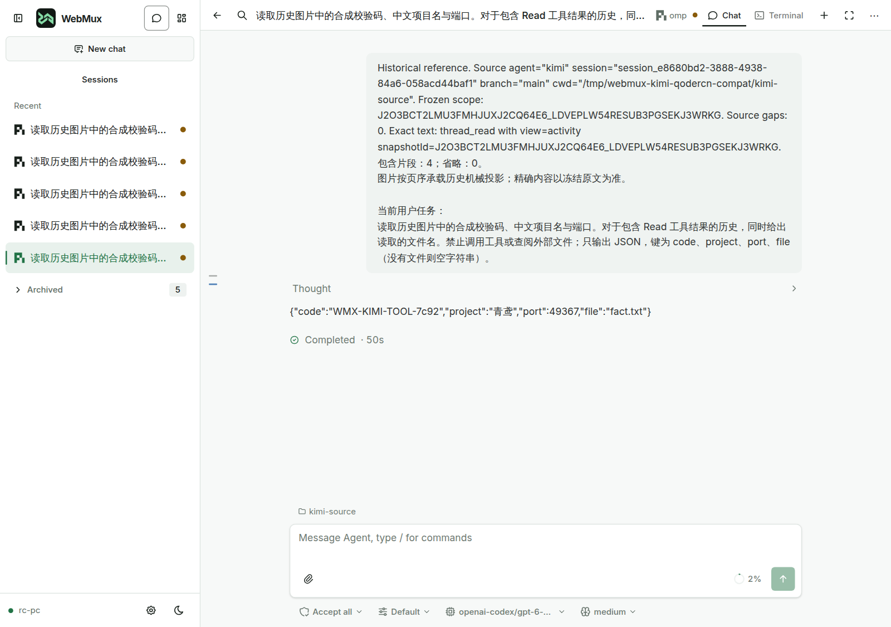

## 终端历史查询应答隔离（US-D03）

### 行为与根因

- Devin 会话历史快照保留启动时的 OSC 10/11 颜色查询；重新打开页面时 xterm 再次应答，旧响应进入程序输入框。
- 自动应答发送路径复用快照解析的 `replaying` 标记，历史查询的响应留在浏览器；实时查询与用户输入保持原路径。
- 本次只修改终端协议行为，布局、控件与文案保持不变。

### 已执行验证

- `pnpm --dir web exec playwright test test/e2e/terminal-replies.spec.ts`：桌面与 iPhone SE 两项通过。
- 隔离服务的真实 PTY 逐字节记录输入：连续两次刷新没有新增历史颜色响应，刷新后的用户输入及实时颜色响应均正常到达。
- `pnpm --dir web check` 与 `check:test`：0 errors、0 warnings；`check:arch` 通过，包含 46 项架构与依赖测试。
- 诊断原会话时拦截浏览器终端发送，观察到重复颜色应答；修复验收使用隔离服务，生产会话保持原样。
- 首轮 CI 发现新增正则触发控制字符 lint，已有 attention 用例要求历史查询回写；前者改用可读转义标记匹配，后者改为通过步骤文件触发实时查询，验证应答到达 PTY 后提醒仍保留，并验证重开页面没有额外应答。
- 修订后运行 `pnpm --dir web lint` 通过；Playwright 按 `opening a session does not clear attention|reopening suppresses` 筛选两个文件，桌面与 iPhone SE 共 4 项通过。

## 原生来源发现与身份绑定（US-Q19、US-Q20）

### 范围与证据

- 修复范围为 omp 头部发现与角色分类、Codex 0.169.0 格式及错误保真、agy cascade/trajectory 身份映射；发送与图片链路保持原实现。
- 旧夹具保留，新增本机合成会话的脱敏捕获；当前 omp 与 Codex 最小捕获没有工具调用，工具参数、结果和关联由旧实录及明确标记的合成回归覆盖。
- 本机命令输出为 `omp/18.22.0`、`codex-cli 0.169.0`、agy `1.5.7`。
- `opencode models --standalone` 列出 `opencode-go/deepseek-v4.1-flash`，隔离接收验收选用该模型。

### 已执行准备

- `pnpm --dir web install --frozen-lockfile` 通过。
- `pnpm --dir web build` 通过，Svelte 检查为 0 errors、0 warnings，生成隔离服务的嵌入资源。
- 验收配置使用独立临时 state_dir 与 loopback 监听；生产服务及既有会话保持原样，未读取 Token 或处理账号认证。

### 回归与静态验证

- `go test -race` 覆盖 `internal/historyimport`、`internal/codexrollout`、三个 agent history 包、`internal/historyprojection`、`internal/handoff`、`internal/featureapi`。
- 首轮仅 Codex 新增 reader 单测失败：该断言把上层冻结摘要校验误放到仅持字节边界的 reader；删除此重复断言后，Codex 包复测通过。RuntimeSource 集成回归保留并通过冻结内容修改拒绝断言。
- `go test -count=1 ./internal/docguard ./internal/archtest` 通过。
- 对上述来源包与 `internal/featureapi` 运行 `golangci-lint run`，结果为 0 issues。
- `CGO_ENABLED=0 go build -o /tmp/webmux-native-history-identity/webmux ./cmd/webmux` 通过，真实验收运行该二进制。

### 隔离真实 Agent 验收

三种来源首轮均正常 `end_turn`；运行时原生读取 HTTP 200、预览 HTTP 201、发送 HTTP 202，交接操作均为 `succeeded`。
目标使用已查询确认的 `opencode-go/deepseek-v4.1-flash`；当前任务没有包含答案，目标从历史恢复三项合成事实。

| 来源  | 来源会话   | 目标会话   | 目标 t1 实际回复                           |
| ----- | ---------- | ---------- | ------------------------------------------ |
| omp   | `ts3xug6o` | `eoyhmzm6` | `HANDOFF_OK WMX-omp-659ade63 青鹭 49367`   |
| Codex | `srg3zjhn` | `mncv2vh7` | `HANDOFF_OK WMX-codex-ccee309a 青鹭 49367` |
| agy   | `qm5soray` | `hdkwvzw7` | `HANDOFF_OK WMX-agy-4e929a7a 青鹭 49367`   |

- 三个指定目标 t1 均收到 `turn.end` / `end_turn`；回复逐项核对校验码、项目名及端口。
- 六个自建会话的 kill 均成功；随后逐个 GET 确认 `state=closed`、`status=exited`。exit 观察因会话先移出 active 返回 1，未取得进程退出码证明；隔离服务之后正常退出，退出码 0。
- 完整本地证据：`/tmp/webmux-native-history-identity/evidence-complete.json`；清理证据：同目录 `cleanup.json`。
- 此轮证明三种来源到 OpenCode 的文本交接；工具链由 reader 回归覆盖，图片交接与 Claude 账号认证不在本次验收范围。

## 移除沉浸式 VR 模式（US-H15、US-K18、US-L02）

### 范围与兼容性

- 删除 WebXR 会话、Three.js 场景、空间面板、VR 键盘及终端、聊天、代码与 Diff 的 XR 适配；TV 和头显 2D 模式保留。
- 删除 `immersive` / `immersive.xr`、中英文案、专用测试及 IWER/Three.js 依赖；US-H15 标记为已退役，保留历史编号。
- 显式包含 `immersive` 的旧配置需要删除该项。使用隔离配置实际启动，返回 `features.enabled: unknown feature "immersive"`。
- 能力快照调整为 13 个功能和 18 项能力，严格目录校验与静态发现回归通过。

### 已执行验证

- `make check` 通过，包括前端构建、类型与测试类型、格式、文档、持久化、架构、Oxlint、Go vet 和 golangci-lint。
- `umask 0022; NO_PROXY=localhost,127.0.0.1 no_proxy=localhost,127.0.0.1 make test` 通过：Go race 与 Relay、1249 项单元、935 项浏览器组件、137 项 Storybook、558 项 E2E（52 跳过）及 18 项性能测试（2 跳过）。
- 初始 `umask 0077` 使两个未主动设置文件权限的既有测试失败；改为 `0022` 后原用例与完整门禁通过。Storybook 预览探测受本地代理影响，设置本地地址 `NO_PROXY` 后 137 项通过。
- 一次高负载 E2E 运行中，代码阅读用例在创建 Shell 时收到 129；该用例随后在桌面和手机项目均单独通过，最终完整 E2E 为 558 通过、52 跳过。
- 真实隔离应用的桌面、平板、手机明暗主题前后截图使用相同会话、功能选择与菜单状态；所有删除后视口保留 TV/头显入口、没有 VR 入口，且无页面横向溢出。
- 未验证真实头显/TV 硬件、真实悬停或粗指针行为。本次为静态入口删除，无交互动画 GIF。

## 聊天输入模式说明（US-Q08、US-S14）

### 范围

- 校正操作手册、CLI 帮助与排队提示、MCP 工具描述及 HTTP 协议中的 `auto`、`steer`、`refuse`、`now` 选择条件。
- 补充插话能力、回合结束竞态、回执证据与排队项迁移防重复步骤；调度逻辑、默认模式、API 行为和前端交互保持不变，故事编号与数量不变。

### 已执行验证

- `make docs-check` 通过，覆盖文档规模、链接、可达性及故事目录。
- `make web` 完成，本分支 `go build -o /tmp/webmux-clarify-chat-input-modes ./cmd/webmux` 成功。
- 实际运行该二进制的 `send --help`、`chat queue rm --help`，观察模式选择说明及队列项命令参数。
- 用不存在的独立 socket 执行 `guide sessions` 与 `guide chat`，确认输出来自本分支嵌入手册，包含四模式及排队项迁移步骤。
- `go test ./internal/clicmd ./internal/mcpcontrol ./internal/agentguide` 首轮发现手册链接守卫不接受页内锚点；改用主题页链接后，受影响的 agentguide、mcpcontrol 包复测通过，clicmd 首轮通过。
- 通过临时程序运行本分支真实 MCP Registry 的 initialize、tools/list 和 guide_read，离线导出工具及主题说明，观察到模式条件、`steering_unavailable`、竞态及回执边界；程序随后删除。
- `make format` 已执行；文档治理在格式化后再次通过。
- 本次为说明修正，未创建收费模型会话，也未重启或部署生产服务。

## Kimi 与 QoderCN 原生来源读取（US-Q19、US-Q20）

### 行为与兼容证据

- Kimi 保留 wire 1.4，增加 CLI 2.5.3 实录的 wire 1.5 与 state v2 身份校验；过滤 injection、子 agent 与正文镜像，保留 Read 参数、结果及调用关联。
- Qoder/QoderCN 共用已观察 writer 1.1.81、1.1.84 的有界规则；工具 input 归一化为消费者可见的 `tool_arguments`，保持活动祖先链、错误状态、安全过滤与冻结分支/parser 校验。
- 国际 Qoder 共享夹具测试覆盖新增实录，但这些实录来自 QoderCN；本轮未运行国际 Qoder CLI。
- 原有夹具保持，新增两种 reader 的合成正文与 Read 工具实录；manifest 区分原生版本、安装版本、脱敏与尚未覆盖的场景。
- 审查补充边界：Kimi 未知 state 版本只在读取时拒绝，保留混合目录的发现能力；未知用户 origin 标记缺口，正文保持过滤。
- Qoder 未建模但结构有效的内容块标记缺口并保留其他已知内容；未知 writer 与畸形字段仍拒绝，缺口正文不会被导出。

### 已执行验证

- `go test -race ./internal/agent/kimi/history ./internal/agent/qodercn/history ./internal/agent/qoder/history ./internal/historyimport ./internal/historyprojection`：Kimi、QoderCN、导入和投影通过；国际 Qoder 旧测试对共享夹具数量的假设失败。
- 用户扩大共享 reader 范围后更新国际 Qoder 消费测试；`go test -race ./internal/agent/qoder/history ./internal/agent/qodercn/history ./internal/historyimport` 全部通过。
- 三个 reader 的 `go vet` 与 `go test ./internal/archtest` 通过；`make web` 及隔离 Go 服务构建通过。
- 独立 loopback 服务创建 Kimi/QoderCN 来源，真实 ACP 各读取仅含合成事实的 `fact.txt`；原生历史返回完整正文、工具参数/结果与相同 call ID。
- 两个预览均含完整工具事实及参数，发送 operation succeeded；OpenCode 实际公布的 `opencode-go/deepseek-v4.1-flash` 接收目标各在 t1/end_turn 恢复合成校验码、中文项目、端口和文件名，目标未调用工具。
- Kimi 目标实际回复 `RECOVERED SYNTHETIC_TOOL_FACT=WMX-KIMI-TOOL-7c92 project=青鹭 port=49367 file=fact.txt`；QoderCN 目标恢复 `WMX-QODER-TOOL-8d41`、`白鹭`、`49369` 及来源文件名。
- 本地证据位于 `/tmp/webmux-kimi-qodercn-compat/`：`acceptance.json`、各来源的 native/preview/operation/target-log JSON 和 `cleanup.json`；四个测试会话关闭成功，生产服务未部署或重启。
- 首轮 PR CI 的构建、Go race、四组 E2E、Linux/Windows 打包与测试汇总通过；审查门禁要求上述发现范围与未知内容处理调整。

### 验收边界

- 本轮覆盖文本来源读取、预览、真实工具链与跨 Agent 恢复；图片 UI、图片投影与发送管线保持原样。
- CLI 的已有认证由 Agent 自身使用；未读取 Token、执行登录或处理 Claude 的 `auth_required`。

## 工作树创建前上游确认（US-J04、US-J05、US-S07、US-S16、US-Q18、US-Q20）

### 范围

- 独立创建、新建会话、快速开始、项目来源、交接、CLI 与控制 MCP 共用创建前上游检查；上游更新或获取失败时明确选择。
- 新分支选择上游保持源分支不变；已有分支仅安全快进，分叉保留独有提交。
- 无上游、空仓、孤立分支、显式历史提交与已释放工作树重建保持各自语义。
- 交接等待上游确认时保留原操作与冻结页集，取消、过期及重复确认保持资源与发送边界。
- 用户故事编号与数量保持不变。

### 已执行验证

- `pnpm --dir web install --frozen-lockfile` 成功，完成依赖安装与本地化编译。
- `go test -race ./internal/handoff` 通过，覆盖本地/上游选择、引用变化重问、并发重复确认、取消与过期。
- `go test -race` 覆盖 workspace、sessioncreate、featurewire、featureapi、wire、clicmd、mcpcontrol、localclient 与 agentguide；迁移自动 fetch 后的旧夹具，workspace 最后一项失效上游夹具调整后单独复测通过。
- API 针对性 race 验证通过：工作树/会话上游确认、原生交接、workspace 与 wire snapshots。
- 前端 `check`、`check:test`、`lint`、`check:arch` 与源码格式检查通过；97 项相关浏览器组件测试、22 项工作树 E2E 通过。
- 前端生产构建与隔离 Go 二进制构建成功；修复检查发现的交接分段控件导入与空基线类型，应用浮层拆为独立组件以满足文件行数守卫。
- 本地化生成与架构检查并发时曾遇到生成文件暂缺；按先生成、后架构检查的依赖顺序执行后通过。
- `go test -count=1 ./internal/docguard` 通过；用户故事编号、数量与文档链接保持一致。
- 隔离浏览器真实创建分别验证：选择上游得到 `518a0d5`，保留本地得到 `3a2fee3`，源分支保持不变，取消没有新增工作树。
- 实际 CLI 非交互调用返回完整确认 JSON 并以 1 退出；显式 `--upstream=latest|local` 创建的分支分别指向上游和本地提交。
- 真实应用检查桌面 1280×900、平板 768×800、手机 390×844、375×667、320×568 与横屏 667×375 的明暗主题；所有确认浮层留在视口内，页面无横向溢出，键盘可操作。
- 截图和创建/确认/取消 GIF 保存于 `.github/pr-assets/worktree-upstream/`。未验证真实设备与真实粗指针行为；无头浏览器的悬停未触发行尾控件显隐，本轮使用键盘打开菜单。
- 首轮 PR CI 的前端、四组 E2E、Storybook、性能与打包通过；Go gate 暴露 Git 历史隔离夹具未处理上游确认，迁移为显式保留本地并校验精确 HEAD 后，`TestGitReadAPIHistoryCommitDetailAndIsolation` 的 race 复测通过。

## OMP 扩展消息交接兼容（US-Q20）

### 行为与边界

- OMP 扩展消息支持 developer/custom 文本、Bash/Python 命令与输出、执行状态；排除上下文的执行只保留图节点和省略说明，文件提及只保留引用。
- 复用主分支的标题/session 头发现机制；其他会话的未知角色、损坏正文和重复消息节点不影响当前来源。
- 重复会话身份仍返回身份冲突；选中的未知格式仍返回格式错误，原生分支与冻结游标校验保留。
- 解析版本提升为 `omp-jsonl-4`，私有思考、归属元数据和附加执行状态保持排除。

### 已执行验证

- 回归覆盖扩展角色、安全省略、冻结重读、来源发现隔离，以及从运行时身份冻结到实际文本投影的链路。
- 基于最新主分支执行 `go test -race ./internal/agent/omp/history ./internal/historyimport ./internal/historyprojection ./internal/handoff`，全部通过。
- `go test -count=1 ./internal/docguard ./internal/archtest` 通过。
- 验证使用隔离的合成原生文件；本轮未启动真实 Agent、发送模型请求或操作生产会话。
- 首轮 CI 的 Go race、构建检查及打包通过，桌面与手机交接 E2E 在格式切换处失败；现场快照没有格式控件，根因是表单引用了组件库未导出的 `Root/Item`，改用既有命名导出。
- 修复后桌面与手机 `handoff.spec.ts` 共 8 项通过；临时真实页面捕获覆盖两套设备项目、点击与方向键切换，捕获脚本已删除。
- `pnpm --dir web check`、`lint`、`check:arch` 及改动组件格式检查通过；类型检查 0 errors、0 warnings，架构回归 49 项通过。
- 桌面 1280×900、平板 768×800、手机 390×844 提供浅色前后截图与修复后的深色截图；另检查 375×667、320×568、667×375、1280×720，页面无横向溢出。
- 截图与 GIF 使用隔离合成会话；未验证真机触摸、系统键盘及真实悬停，未向真实模型发送交接。

## 2026-11-18：常驻工作区视图增加主工作区线性图标标记（US-C17、US-J02）

### 范围

- 故事编号与总数（264）保持不变，更新 US-C17、US-J02 及 `workbench-navigation` 规格：
  - 新增共享组件 `MainWorktreeMark.svelte`，在首页工作树分组标题及桌面/窄屏单工作树页头标题右侧为主工作区（`kind === "main"`）常驻渲染无框线性 `tabler:home` 图标（悬停提示“主工作区”，提供屏幕阅读器名称）；路径、提交与已跟踪文件干净状态继续收在“工作树详情”弹窗中；
  - 工作台侧栏树（`WorkbenchTree`）为主工作区行在分支名右侧显示同一线性 `home` 图标（`title="主工作区"`，无障碍名称附加 `，主工作区`），并在无活动会话时保留行尾占位槽以避免悬停“⋯”按钮遮挡该图标；
  - 同步对齐 `HandoffForm.svelte` 对 `SegmentedControl` / `SegmentedControlItem` 的具名导入，消除主线合入偏差导致的 `svelte-check` 报错。

### 已执行验证

- 静态与治理门禁：
  - `pnpm --dir web check`、`check:test`、`check:storybook`：0 errors、0 warnings；
  - `pnpm --dir web lint` 与 `pnpm --dir web check:arch`（ESLint、dependency-cruiser、jscpd 0 克隆、knip、架构与依赖策略 49 项测试）通过；
  - `go test -count=1 ./internal/docguard ./internal/archtest`、`openspec validate --specs`（128/128）、`go vet` 与 `make go-lint`（0 issues）通过。
- 组件、Storybook 与端到端回归：
  - 单元测试 `test/i18n.test.ts` 5 项通过（校验中英词条键集、占位符对等与源码零硬编码中文）；
  - 浏览器组件套件 `WorkbenchTree`、`WorkspaceGroup`、`RepositoryGroup`、`TvNavigation`、`AppShell` 共 60 项通过（含长分支名无会话主工作区行悬停“⋯”零遮挡几何断言）；
  - Storybook `design-system.spec.ts`、`overflow.spec.ts`、`contracts.spec.ts` 62 项通过；
  - Playwright 端到端 `repository-scope.spec.ts` 与 `app-shell.spec.ts` 桌面及 iPhone SE（320×568，含 200% 字号）共 21 项通过、5 项按设备跳过、0 失败。
- 界面证据与局限：
  - 隔离演示服务在 1280×900、1280×720、768×800、390×844、375×667、320×568、667×375 及 320×700（200% 字号）明暗主题下检查 `scrollWidth <= innerWidth`，无页面级横向溢出；
  - 重新采集桌面 1280×900（全览与单工作树聚焦）、平板 768×800（主页与抽屉展开）、手机 390×844（主页与抽屉展开）明暗主题前后对比截图共 24 张并更新 PR 证据，公开链接均经 HTTP 200 校验；
  - 仅在 Linux 无头 Chromium 下验证，`hover` 与 `any-pointer: coarse` 均为 `false`，物理鼠标悬停与触屏常驻状态未验证，未进行手机或平板真机验证。

## 2026-11-18：混合压缩归档与手机预算编辑（US-Q19、US-Q20、US-K04）

实际验证、截图与手机交互见[混合压缩归档核对记录](verification-log-2026-11-18-handoff-archive.md)。

## 2026-11-18：`install.sh` 镜像回退签名校验与非 GitHub 信任根收敛（US-K11、US-L13）

实际验证记录与局限见 [`install.sh` 签名校验核对记录](verification-log-2026-11-18-install-signature.md)。
