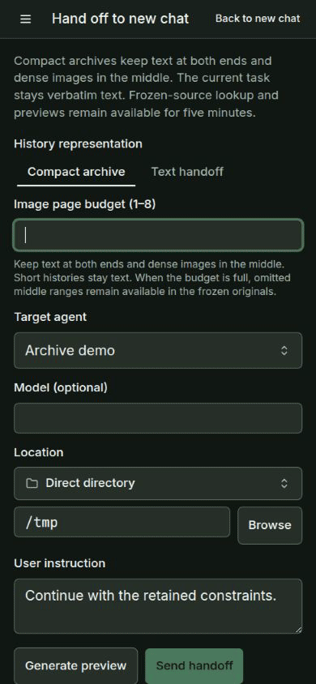

# 2026-11-18：混合压缩归档与手机预算编辑（US-Q19、US-Q20、US-K04）

- 依赖固定为 Snapcompact `969040513d9e`：按模型选择点阵布局，保留首尾文本，中段分级密度；文本、图片与省略范围精确划分投影正文。
- 预览冻结文本与图片，ACP 按首部、图片、尾部与任务发送；图片估计计入上下文，附件字节独立限制。无法容纳任何图片时阻止发送截断归档。
- 手机页数保留字符串草稿；清空、逐字输入、失焦校验及无效/变更草稿阻止旧预览发送均已覆盖。
- 独立模块：race、CGO-disabled 测试、vet、Darwin arm64/Windows amd64 cross-build 通过；依赖 PR 的 Go CI 通过。
- WebMux：`go test -race ./internal/handoff ./internal/historyprojection ./internal/hybrid` 对应包通过；`TestWireSnapshots -update` 完成。
- `golangci-lint run ./internal/handoff ./internal/historyprojection ./internal/hybrid ./internal/contract` 为 0 issues；`make docs-check` 通过。
- 前端 build、test 类型检查、lint、`check:arch` 通过；架构测试 49 项。
- handoff E2E 首轮 6 项通过，4 项因合成长记录超出默认 4000 字节原文页而未看到助手记录失败；夹具显式请求 16000 字节后，桌面/手机对应 4 项全部通过。
- [真实模型实验](../native-image-experiment.md#2026-11-18上游式混合归档)：约 10 万投影字符，工具/代码输入节省 40.6%，长段落节省 15.4%；各表示 13/13 字段正确，无预算省略或补查。
- 隔离嵌入应用实际操作：手机页数 `8 → 空 → 3` 可生成预览；`12` 失焦显示范围错误，改为 `3` 恢复。截图均为合成数据。
- 视觉覆盖 1280×900、768×1024、390×844 的浅深色；未做 iOS/Android 真机键盘、真实粗指针或悬停验证。

| 视口与主题 | 修改前                                                   | 修改后                                                  |
| ---------- | -------------------------------------------------------- | ------------------------------------------------------- |
| 桌面浅色   | [前](../images/handoff/archive-before-desktop-light.png) | [后](../images/handoff/archive-after-desktop-light.png) |
| 桌面深色   | [前](../images/handoff/archive-before-desktop-dark.png)  | [后](../images/handoff/archive-after-desktop-dark.png)  |
| 平板浅色   | [前](../images/handoff/archive-before-tablet-light.png)  | [后](../images/handoff/archive-after-tablet-light.png)  |
| 平板深色   | [前](../images/handoff/archive-before-tablet-dark.png)   | [后](../images/handoff/archive-after-tablet-dark.png)   |
| 手机浅色   | [前](../images/handoff/archive-before-phone-light.png)   | [后](../images/handoff/archive-after-phone-light.png)   |
| 手机深色   | [前](../images/handoff/archive-before-phone-dark.png)    | [后](../images/handoff/archive-after-phone-dark.png)    |

## 2026-11-18：默认预算与上游布局（US-Q20、US-K04）

- `go run ./cmd/native-image-experiment -scenario tools -model openai-codex/gpt-6-astra -history-cap 16000 OUTPUT_DIRECTORY` 对照主分支，正文保留由 29431 增至 47713 字符；生成器明确报告省略。
- `bun upstream.mjs MANIFEST OUTPUT_DIRECTORY 8` 使用官方 18.22.2 包，短样本输出零图，两组长样本各六图、无预算省略。OMP CLI 模型读回与实测输入见[归档实验](../native-image-experiment.md#2026-11-18上游原版对照)。
- `go test -race ./internal/handoff ./internal/historyprojection ./internal/archtest` 通过；默认预算保留量、首尾原文、短历史零页、冻结发送及图片请求限制均有回归覆盖。
- `go test ./internal/api -run TestWireSnapshots -update` 通过，快照相同。`make docs-check` 通过。
- `pnpm --dir web check:arch` 49 项通过。复用隔离 E2E 二进制运行 `pnpm --dir web exec playwright test test/e2e/handoff.spec.ts --workers=2`，桌面与手机共 10 项通过。

## 2026-11-18：原版归档运行器（US-Q20、US-K04）

- 在 `cmd/omp-snapcompact` 运行 `bun test`，短历史、长历史完整覆盖和长历史截断共 3 项通过，序列化块和图片字节与官方包直接调用相同。
- 隔离的 WebMux Go 交接预览通过配置的 Bun 运行器生成工具与代码样本。64000 历史预算下 6 张 PNG 的 SHA-256 全部匹配原版，未执行目标模型调用。
- Go 回归覆盖运行器接收可导出记录、图片页序、预览冻结、运行器缺失阻止发送及显式文本预览。
- 在隔离 WebMux 服务写入运行器 TOML 并重启，调用冻结历史和交接预览 HTTP 接口。同输入直接运行官方包，3 张 PNG 的 SHA-256 及历史文本块全部吻合，当前任务保留原样。
