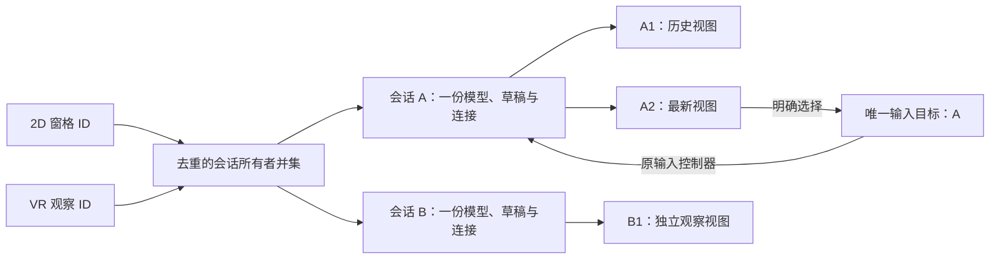

## Context

现有前端以 `AppShell`、`SessionTerminal` 和 `useTerminal` 组合 DOM 应用；xterm 6 同时承担终端解析、缓冲与 2D 呈现，`createTerminalSocket` 已拥有回放、控制端 resize 和续接语义。TV 与头显 2D 支持可以复用这棵树，但当前没有全局空间导航，且 1920px 视口只会选择普通桌面布局。

沉浸式模式有三个独立边界：

- xterm 的 WebGL 上下文不能直接充当 `XRWebGLLayer`；普通 DOM、菜单、Kitty 图形层也不会自动出现在 VR 中。
- `document.hidden`、`ResizeObserver`、`visualViewport` 和普通 fullscreen 的状态不能代替 XR 生命周期。
- 实现沿用当前 `platform/`、`domains/`、`hooks/`、`components/` 与 `pages/` 主题分层，不恢复旧扁平路径。

基础能力已随 PR #598 合并，以下原设计保留其交付背景。本轮增强针对两个现有限制：XR 的 `options.open` 通过 `Terminal.svelte.openExistingPane` 加入 2D 分屏，继承八窗格上限；空间缓存则把内容标识直接当作视图标识，同一聊天无法拥有两个阅读位置。

`Terminal.svelte` 已按会话键将窗格作为绝对定位的兄弟节点渲染，不必引入门户或复制控制器。`XrPanel` 已有实例局部的滚动偏移、横向位置和确认状态，可在分离身份后复用。

## Goals / Non-Goals

**Goals:**

- 用一套会话、输入和草稿状态支撑普通 DOM、TV 与 XR 呈现，不建立第二套协议栈。
- 将 TV 遥控器导航限制在明确区域，保留文本编辑、终端控制键和 Bits UI 弹层语义。
- 用公开终端缓冲和共享视图模型生成 XR 面板，避免依赖 xterm 私有画布结构或 DOM 截图。
- XR 依赖按需加载，会话结束可完整释放；2D 页面在无 WebXR 时不承担 3D 初始化成本。
- 让 VR 观察集合独立于 2D 布局，同时保留每个会话唯一的终端、聊天模型、草稿和连接所有者。
- 让同一聊天的多个空间实例拥有独立阅读状态，并把输入目标精确到实例，而不是同时高亮同一会话的全部面板。

**Non-Goals:**

- 不把现有 CodeMirror、Diff DOM 或聊天 DOM 原样搬入 WebGL，也不追求 XR 与 2D 的每个视觉细节一致。
- 不修改 Go 服务、REST/WebSocket 契约或服务端设置存储。
- 不用 User-Agent 判断 TV，不为兼容浏览器保留的系统返回键注入历史记录或绕过浏览器安全限制。
- 本轮不复制终端、代码、Diff、通知或草稿视图，不增加原生 VR 表单或混合切换确认，不将 TUI 输出转写为聊天。

## Decisions

### 1. 以呈现模式分离会话状态与显示表面

在 `useTerminal` 暴露稳定的会话控制器：终端实例、缓冲、输入提交、滚动、草稿、当前控制端和连接状态仍只有一份。新增呈现适配接口，普通 DOM 与 XR 互斥取得“显示所有权”，但显示切换不拥有或重启 socket。

普通 DOM 保持当前 `createTerminalRenderer` 与 FitAddon 流程。XR 激活时暂停 2D 的 ResizeObserver 适配和绘制提交，保留终端解析与 socket；退出后按原 DOM 区域恢复。XR 的每眼尺寸、头部姿态和面板网格不调用 FitAddon。

备选方案是进入 VR 时销毁并重建 xterm/socket。该方案会引入回放竞态、控制端变化与重复连接，因此不采用。

### 2. 第一阶段复用 DOM，并用设备本地模式驱动 TV 外观

新增 `hooks/shared/tv-mode.svelte.ts`，复用 `deviceToggle` 保存布尔值，在应用根设置 `data-ui-mode="tv"`。TV 的字号、控件高度、焦点线条与菜单密度通过设计系统 variant/size 和 `styles.css` 的布局钩子实现；需要新增 Button/ListButton variant 时同步登记架构文档。

头显 2D 使用 `hooks/shared/headset-mode.svelte.ts` 的显式设备本地开关，根属性为 `data-headset-mode="true"`，不通过 UA、窗口大小或 pointer 猜测硬件。
宽视口继续使用桌面外壳；coarse pointer 只表达触控能力，不推导窄屏或强制软键。模式抑制意外键盘聚焦，保留显式键盘入口与强制软键选择。
系统键盘继续走 `hooks/shared/viewport.svelte.ts` 和 `hooks/terminal/terminal-input.ts`，真实设备差异由硬件验收补充。

备选方案是按宽度或 UA 自动进入 TV。大屏桌面也会被误判，且无法让用户退出，因此不采用。

### 3. TV 使用区域化几何导航与显式终端捕获

新增纯基础设施模块 `platform/spatial-navigation.ts`：输入当前矩形、候选矩形和方向，按主方向距离与横向偏移选择唯一候选。`hooks/shared/tv-navigation.svelte.ts` 只在 TV 模式监听方向键，找到候选后才 `preventDefault`；无候选时保留原生行为。

导航区域限定为侧栏、主内容、终端工具栏和当前弹层。输入框、textarea、contenteditable、代码编辑器、已有 roving tabindex 树和 Bits UI 菜单先执行自己的方向键规则。焦点通过原生 `focus({preventScroll})` 加 `scrollIntoView` 管理，不建立第二个 Tab 顺序。

`SessionTerminal` 增加 TV 捕获状态，并复用 SoftKeys 的按键编码提供真正的 Esc 与 Ctrl 键：

- 导航状态下，Enter 进入终端；捕获时方向键进入现有终端输入，返回释放到工具栏。
- 返回协调器按“最上弹层 → 文本/终端捕获 → 抽屉/面板 → 现有路由返回”分派。
- 只处理网页实际收到的标准 Back/Escape 映射，不伪造浏览器历史。

备选方案是全局拦截所有方向键或引入空间导航库。前者破坏输入和弹层，后者仍需适配 xterm 与 Bits UI，且增加一套焦点模型，因此不采用。

### 4. XR 会话由独立状态机和单一所有者管理

`hooks/terminal/xr-session.svelte.ts` 维护能力检测、进入中、活动、退出与错误恢复的单一所有者；场景运行时独立处理 XR hidden。
进入前检查 `isSecureContext`、`navigator.xr` 和 `isSessionSupported("immersive-vr")`，在点击调用栈内请求会话，随后动态加载场景；优先使用 `local` reference space，避免把 floor 校准设为额外前提。

`components/terminal/TerminalHeader.svelte` 与 `TerminalDisplayControls.svelte` 只展示状态和发起意图，动态导入 `hooks/terminal/xr-workspace.ts` 后才创建 Three.js renderer。
普通 fullscreen 与 XR 不互为前提，但不得并发请求；XR 活动或进入中禁用普通全屏，普通全屏切换中禁用 XR 请求。
`end`、`inputsourceschange`、`visibilitychange` 和 WebGL context loss 统一进入清理路径，取消 XR frame、释放输入捕获、几何体、材质、纹理和 renderer。

`terminal-socket` 获得“沉浸式可见性”输入：XR 隐藏只暂停场景绘制，不被当作普通后台标签断开；恢复时沿用既有 offset/代际续接。2D 与 XR 同时只允许一个 XR owner，重复进入返回当前状态而不请求第二个 session。

### 5. 第二阶段使用 Three.js，终端纹理由公开 xterm Buffer 生成

新增按需加载的 `three` 依赖。Three.js 负责 XR 帧、reference space、控制器射线、面板网格和资源生命周期；不引入 React 生态或完整 UI 框架。相比直接操作 WebXR/WebGL，它减少双眼渲染与输入数学的自有代码；相比 Babylon.js，当前场景只需轻量面板和射线，依赖面更小。

新增纯 `XrTerminalCanvas` 绘制器，通过 xterm 公共 `Terminal`、`buffer.active`、行和 cell API 绘制当前可视行、颜色、宽字符、组合字符和光标。`onRender`/输出事件只标记 dirty，每个 XR frame 至多更新一次变化行；场景仍以设备帧率渲染。Canvas 纹理有尺寸上限，面板缩放只改变纹理采样和网格，不改变 PTY。

2D xterm 的 WebGL/DOM canvas 和 Kitty 图形层保持原所有权。XR 首版检测到未支持的图形内容时显示降级提示与 2D 入口，不抓取私有 `.xterm-screen` 结构。

备选方案包括复制 xterm canvas、html2canvas/foreignObject 截图和 DOM Overlay。私有 canvas 易受渲染器切换影响；DOM 截图有样式保真、跨域字体与高频光栅化问题；DOM Overlay 不能作为沉浸式 VR 的通用面板基础，因此均不采用。

### 6. 聊天与代码使用专用 XR 视图模型和 Canvas 面板

定义扁平的 XR 面板视图模型：`id`、`sessionId`、`kind`、标题、状态、只读内容块与操作列表。聊天适配器消费现有 ACP/chat 状态；代码与 Diff 适配器复用现有 API、Zod schema 和只读数据，不复制请求或缓存。Markdown 复用解析后的块结构，代码/Diff 以文本行和差异类型绘制，不嵌入第二套 CodeMirror。

通用 XR Canvas 布局器输出内容纹理和有界 hit regions。射线命中后按 region 执行滚动、打开会话、切换面板、确认或发送；所有操作调用现有业务控制器。首版 XR 聊天/代码聚焦阅读、滚动和已有操作，不实现富文本编辑或代码编辑。

这样只新增显示适配，不让 XR 组件反向拥有服务端状态。代价是 XR 与 2D 外观不同，但协议、内容和操作结果一致。

### 7. 控制器捕获与 VR 键盘共用现有按键语义

Three.js 输入源以 `XRInputSource` 身份跟踪 target ray。`selectstart` 记录命中 region 和拖动捕获，`selectend` 在同一目标上激活；`inputsourceschange` 取消该源的捕获，不把拖动转交给另一只手。面板标题柄用于移动，边角用于缩放，内容区用于滚动和选择。

将 SoftKeys 的 Escape、Tab、方向键、修饰键和重复发送逻辑提炼为领域级按键命令编码，供现有 SoftKeys、TV 工具栏与 VR 键盘复用。VR 键盘不派生合成 DOM KeyboardEvent，而是调用同一输入控制器；直接模式和草稿模式继续互斥。实体键盘仍聚焦现有隐藏输入目标，以保留浏览器按键和 IME 顺序。

### 8. 本地布局使用版本化、边界受限的 Zod 文档

在 `domains/terminal/xr-layout.ts` 定义版本化布局：面板 ID、类型、会话 ID、位置、尺寸和可见性。数值必须有限并限制范围，面板数量设上限；会话 ID 只用于重新查找现有记录，不保存标题、输出、草稿或代码正文。

读取时先校验，再按当前会话清单过滤；无效面板单独丢弃，整体不可读时回退默认布局。写入在拖动/缩放结束后进行，不在每个 XR frame 写 localStorage。TV 与 XR 均不修改 `settings.json`、Go contract 或 `/api/settings`。

增强版使用布局 version 2：保留 `id` 作为空间实例 ID，增加 `sourceId` 表示会话内的内容标识；`sessionId` 仍是 WebMux 会话 ID，不是 agent 会话 ID。终端使用固定来源标识，文本视图绑定现有 `XrTextPanel.id`；所有记录仍共用 16 个名额。

读取时将有效 version 1 记录迁移为 version 2，保持实例 ID、位置、尺寸、可见性与顺序。旧文本 ID 按已知 `kind + sessionId` 前缀提取来源，不能随意按冒号拆分；`draft`、`notice` 不得误识别为真实 `chat`。

只写 version 2，不保留双写或旧运行时路径。布局不包含消息、草稿、游标、修饰键或待确认操作；聊天视图重入从最新内容开始。合法空布局与损坏布局须区分，防止用户移出所有观察对象后又自动加回。

权威会话列表未就绪时暂缓永久清理来源引用；就绪后再移除确实不存在的对象。读取布局不触发服务端创建、切换或设置写入。

### 9. 自动化证明状态与行为，真机证明设备能力

- 纯 Vitest：几何候选选择、返回层级、XR 状态转换、布局校验和按键编码。
- 浏览器组件：TV 焦点、终端捕获、弹层焦点返回、公开 Buffer 的宽字符/颜色纹理内容、XR 资源清理；XR 系统边界用可注入适配器模拟，不伪造真机支持结论。
- Playwright 隔离后端：1280×720 与 1920×1080 TV 工作流、真实 PTY 输入/尺寸、断线续接；XR 用模拟会话验证入口、退出和输出连续。
- Storybook：TV 大视口、长文本、亮暗主题和焦点态；XR 面板以真实 Canvas 渲染 fixture 做视觉检查。
- 真机：至少一台沉浸式 VR 头显和一台电视浏览器记录版本、HTTPS、系统键盘、控制器、实际 Back 映射、帧率与资源恢复。Chromium 模拟不能替代这些结果。

### 10. 观察集合使用稳定的会话所有者并集

图中的三个视图同时更新；输入示例只选择 A2，因此 B 不接收输入，A1 仅同步同一会话的草稿与状态。

在 `Terminal.svelte` 管理 VR 观察引用，唯一挂载列表取 2D 会话与观察会话的去重并集。将现有窗格承载抽为局部 `TerminalSessionHost.svelte` 展示组件，仍按会话 ID 与显式 reopen 代际键入；组件内部保留唯一 `SessionTerminal`，不抽出另一套聊天或终端运行时。

2D 成员继续使用现有几何、无障碍标签和分屏菜单；仅观察成员使用离屏且可显式聚焦的输入承载，不计为 `.split-terminal` 或 2D 几何成员。成员在两类引用间转移只改呈现属性，不卸载后重新挂载；无 XR 时不保留额外观察成员。

新增观察所有者在终端附着和 DOM fitting 前取得 immersive 状态，避免隐藏容器大小写入 PTY。已有控制端不能被观察动作主动接管；无控制端时仍接受既有首个附着者规则，但不因离屏尺寸发送 resize。

将现有 `options.open` 的职责拆为获取观察来源、选择空间输入和显式返回 2D。前两者不调用 `openExistingPane`；仅显式返回某会话处理原有表单等操作时才走原导航与容量反馈。

关闭视图只隐藏记录；观察引用由当前绑定记录去重得到。移出观察删除该来源的空间绑定；回收最后一个隐藏槽位时也释放对应观察引用，不能留下无限增长的无视图连接。2D 仍引用的所有者不释放。

会话删除由权威生命周期事件驱动，不能依赖把已挂载来源再加入 available 集合的旧逻辑。入场会话或最后一个 2D 窗格被删除时，若仍有 VR 观察来源，先维持当前页面及 XR 所有者，退出时再按有效原布局或既有删除后导航处理。

备选方案是另建一个隐藏观察组件树，或为每个聊天副本创建控制器。两者都会产生重复 socket、聊天归约与同客户端控制连接替换，因此不采用。

### 11. 会话、内容与视图三种身份分别管理

`XrSessionSource.id` 标识会话，`(sessionId, kind, sourceId)` 标识内容，布局 `id` 标识空间实例；`Map<id, XrPanel>` 继续按实例缓存。`source.panels()` 每次刷新按会话读取一次，把同一派生内容对象分发给匹配视图，不按副本重新解析聊天。

只允许真实聊天来源 `kind === "chat" && sourceId === "chat"` 拆分。新实例使用现有随机标识约定、在原视图旁有界放置并默认跟随最新；原实例保持自己的偏移、横向位置和跟随状态。新的实例成为明确选中的输入视图，所属会话不变。

场景刷新只更新已绑定视图，不再通过“缺少旧 canonical ID”每帧补默认面板。首次无有效布局时初始化默认呈现；显式加入、重新显示和重置才创建或恢复视图，合法空布局保持为空。

加入观察默认创建一个主要内容视图：聊天端为聊天，普通 Shell 为终端；TUI 端按已有可用内容显示终端或带说明的聊天缓存。终端、代码和 Diff 等附加呈现沿用面板菜单按需打开，不把不可用来源替换成别的内容。

现有错误、权限与切换原因必须继续可达；可用通知须通过当前会话的空间提示或明确通知入口呈现，不能因为改为按需建面板而静默隐藏。复杂表单和停滞切换保留原来的返回 2D 路径。

加入或拆分前验证 16 面板预算；待加入期间占用明确的预留名额，同来源并发加入合并为一次。成功后提交布局和观察引用，失败则撤销新增引用及预留，不改旧视图或焦点。仅回收隐藏槽位，不逐帧淘汰可见内容。

重置保留当前观察成员，每个来源回到一份默认呈现，释放重复实例。它不删除服务器会话，不变更 2D 布局，也不切换混合会话所在端。

### 12. 输入选择精确到有效视图

工作台持有 `selectedViewId`，再从当前绑定解析所属唯一来源；不再仅用 session ID 决定所有视图选中。键盘与菜单显示会话和视图标识；滚动、拖动和悬停不转移输入，明确选择或点击操作才激活对应实例。

为现有所有者提供只在 XR 活动且视图仍被选中时可用的聚焦路径，聚焦原聊天编辑器、草稿编辑器或 xterm 输入，而不是合成并转发 DOM KeyboardEvent。离屏所有者不能继续被 `active && visible` 的 2D 守卫拒绝，也不能借聚焦改写 2D active。

VR 键盘和实体键盘复用该目标；挂载、tick 或聚焦完成前后均核对视图 ID 与所有者代际，旧任务不抢回焦点。目标关闭、失效或退出 XR 时取消输入捕获、撤销旧聚焦并禁用键盘，不自动转投其他来源。

真实聊天投影只有在规范会话允许聊天编辑时才可输入；TUI 端缓存、未就绪或失效内容只读，说明原因并保留显式切换入口。绝不能因来源的通用 `input()` 当前指向终端，就把历史视图中的文字送入 TUI。

同一会话的草稿、修饰键、提交锁和答复状态保持共享。普通动作及确认执行时都按当前 ID 重新读取操作，检查请求存在与可用状态；另一个视图或设备先答复后，全部副本撤下失效确认。

备选方案是让每个副本拥有独立编辑器和草稿，或由全局键盘监听复制输入。前者造成并发提交歧义，后者破坏现有 IME、粘贴与事件归属，因此不采用。

### 13. 在现有覆盖之上验证真正的多视图行为

扩展 `XrPanel.test.ts`，用两份生产面板与同一聊天投影观察真实 Canvas：一份历史、一份跟随，分别移动、缩放、关闭和“最新”。保留旧长度缓存与实时快捷指令回归，不以回调次数或对象转发代替内容和路由结果。

扩展 `xr-layout.test.ts` 与终端页面集成，覆盖旧绑定迁移、合法空布局、16 槽位回收、会话列表延迟和唯一所有者；验证 2D 八窗格已满时仍可在 VR 预算内观察其他会话。

隔离后端 + IWER 场景使用 A1、A2、B 三个聊天视图和真实 fake ACP 流，证明同步更新、独立历史、共享草稿、一次提交及另一设备先答复。另用真实 Shell/控制端记录加入观察和空间变换期间的 PTY 网格，不连接已有开发会话。

物理键盘必须在“只存在于 VR 的会话”上实际输入，之后切换目标、关闭目标、断线和退场，检查字节或真实回复。仅模拟场景启动的 `XrSession.test.ts` 不能代替此场景；头显系统键盘、IME、双眼可读性和帧率仍按真机任务验收。

## Risks / Trade-offs

- [电视浏览器返回键和方向键映射不统一] → 只消费标准事件并提供可见替代控件；真机矩阵记录浏览器保留行为，不通过历史注入规避。
- [头显系统键盘的视口事件与手机不同] → 保留显式唤起和稳定后适配，真机验证 IME；不以强制 resize 修正遮挡。
- [公开 Buffer 自绘与 xterm 2D 存在视觉差异] → 将契约限定为文本、颜色、基本属性和宽字符，建立字符 fixture；特殊图形明确降级而非伪装完整。
- [聊天和代码 Canvas 面板增加一套展示层] → 只读视图模型共享数据与操作，复用解析结果；不复制网络、缓存、编辑器和会话状态。
- [高频终端输出导致纹理上传和 GC 压力] → dirty 行合帧、纹理尺寸上限、复用 Canvas/材质/几何体，性能测试观察长输出和隐藏恢复。
- [XR 结束或上下文丢失泄漏渲染循环] → 所有进入路径使用同一清理函数，测试重复进入、系统 end、输入源断开和 context loss。
- [VR 面板布局损坏或引用旧会话] → 版本化 Zod、有界数值和按 ID 过滤；坏数据只回退显示，不影响会话。
- [非 HTTPS 部署无法进入沉浸式模式] → 入口明确说明并复用 Tailscale Serve/受信 HTTPS 部署，不放宽认证、Host/Origin 或公网安全边界。
- [离屏所有者无法取得实体键盘焦点] → 优先完成稳定挂载与真实输入 smoke，直接聚焦既有编辑器；不能用新键盘编码器绕过原路由。
- [默认面板反复生成或隐藏记录回收后遗留连接] → 默认创建只在显式状态转移发生，观察引用随绑定记录清理；容量失败保持旧布局和焦点。
- [入场会话删除导致整个 XR 提前卸载] → XR 活动期延后 2D 最后窗格的导航清理，保留其他观察来源，退场后再执行有效导航。
- [副本共享模型但保留过期动作确认] → 所有确认在执行时读取当前规范请求，沿用共享提交保护与服务端冲突处理。

## Migration Plan

1. 第一阶段先交付头显 2D 与 TV 模式。TV 默认关闭，现有桌面和手机行为不变；头显改进只修正浏览器布局与输入。
2. 第二阶段以独立提交加入懒加载 XR 呈现和版本化本地布局。只有能力检测通过的会话显示可用进入入口，无 WebXR 的构建运行路径不初始化 Three.js。
3. 无需服务端数据迁移。回滚 XR 只需移除入口和动态模块，已有本地布局因命名空间与版本隔离可保留并被忽略；回滚 TV 可关闭开关，现有会话与服务端状态不受影响。
4. 每个阶段分别完成前端门禁、真实 PTY smoke、UI 证据与对应真机验收；未做真机验证时交付说明必须明确限制。
5. 本轮先迁移布局身份并建立唯一所有者并集，再接入观察菜单、多视图及输入选择；增强任务全部单独勾选，不复用原基础任务的完成状态。
6. 部署只写 version 2，读取并迁移 version 1。旧程序回滚时会按既有未知版本回退默认布局；服务端会话与草稿不受影响，不以双写保留旧行为。

## Implementation mapping and acceptance status

- `hooks/terminal/terminal.svelte.ts` 保有共享 emulator/socket/input；`domains/terminal/xr-workspace.ts` 定义来源与操作契约，`xr-text.ts` 和 `domains/code/xr-code-panel.ts` 提供只读文本适配。
- `hooks/terminal/xr-*` 拥有专属场景、Canvas、输入和清理；普通页面仅通过 `xr-session.svelte.ts` 的动态边界进入 Three.js。
- 此映射说明实现位置，不证明任务完成或验收通过。电视与头显真机验收仍待执行；保留 tasks 8.3/8.4 的全部设备能力与证据要求，模拟环境不能替代。
- 基础二阶段已合并；本轮多会话／多视图尚待 tasks 第9节实施。上述新增结构、行为和验证方案不表示代码或真机验收已完成。
- 主要接点为 `pages/Terminal.svelte`、`SessionTerminal.svelte`、`xr-session-source.svelte.ts`、`xr-session.svelte.ts`、`xr-workspace.ts`、`xr-panel.ts`、`xr-menu.ts`、`xr-keyboard.ts` 与 `domains/terminal/xr-layout.ts`。
- 用户故事计划扩展 US-H15，设备验收仍保留2.3、8.3、8.4；本轮不替这些任务宣称真机通过。
