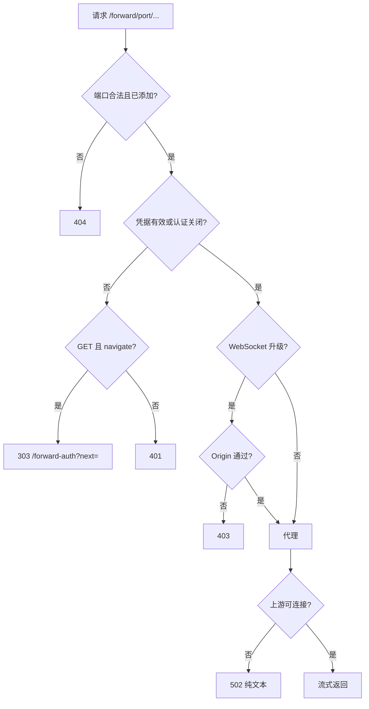

# Design

## Context

- **认证。** 现在只有一个共享主 Token：
  - 前端保存在 `localStorage`，HTTP 请求用 `Authorization: Bearer` 发送，WebSocket 改用子协议发送；
  - 中间件（`internal/api/router.go` 的 `middleware`）只对 `/api/` 和 `/ws/` 做认证和 Origin 检查，其他路径只做 Host 检查；
  - `access-link` 规定主 Token 不能写入 Cookie，`security_test.go` 也断言 Cookie 不能认证。
- **新标签页没有 Bearer 头。** 用新标签页打开转发页面时，页面里的脚本、图片和 HMR 请求都不会带 Bearer 头，所以网关需要靠 Cookie 认证。
- **不支持子路径部署。** WebMux 只部署在 `/`，静态服务对未知路径回退到 `index.html`，`/api/`、`/ws/` 和 `/local/` 是保留路径。
- **会话层已有进程快照。** `Manager.updates()` 每 500 ms 运行一次，每秒取一次进程快照（`processSnapshot`），用来判断状态和获取子进程。目前还没有检测 socket 或监听端口的代码。Linux 通过 `/proc` 获取进程信息，macOS 通过 `SYS_PROC_INFO` 系统调用（无 cgo），其他平台只有空实现。
- **发布构建不能用 cgo。** 发布构建设置了 `CGO_ENABLED=0`。
- **已选定的方案**（用户确认）：
  - 路径前缀 `/forward/{port}/`；
  - 专用转发 Cookie；
  - 只转发本机回环端口；
  - 扫描会话进程树中的 socket 检测端口；
  - 首页顶栏按钮加对话框；
  - 转发只能手动移除，否则保留到服务重启；
  - 原型用 Storybook 实现。

## Goals / Non-Goals

**Goals:**

- 只用现有监听地址，同一套机制在本机、Tailscale 和 Cloudflare Tunnel 下都能用。
- 泄露转发 Cookie 不会让对方拿到 shell，也就是说这个 Cookie 不能访问 `/api/` 和 `/ws/`。
- Vite 配置 `--base /forward/{port}/` 后，用默认选项就能同时跑通页面和 HMR。
- 检测端口不增加新的进程扫描周期，复用现有的每秒快照。

**Non-Goals:**

- 不使用子域名或泛域名方式，也不改写 HTML、CSS 或 JS 响应体里的绝对路径，所以使用绝对路径的应用必须自己设置 base。
- 不转发其他主机，不转发 UDP。
- 不做转发的公开分享链接或只读访客链接。
- 不持久化转发、忽略状态和兼容选项的默认值。
- 不检测其他网络命名空间（例如 Docker 容器）里的监听端口。

## Decisions

### 1. 路径前缀而不是子域名

| 方案 | Vite 是否需要配置 | 远程访问 | 与 WebMux 同源隔离 |
| --- | --- | --- | --- |
| `/forward/{port}/`（选定） | 需要设置 base | 所有接入方式可用 | 否 |
| `{port}.host` 子域名 | 不需要 | 需要泛域名 DNS，MagicDNS 和 quick tunnel 都不支持 | 是 |

用户的主要场景是在远程服务器上开发、在本地预览，所以接入方式必须能覆盖 Tailscale 和 quick tunnel。这个方案的代价是同源风险，见“Risks”。

### 2. 转发凭据与兑换流程

```mermaid
sequenceDiagram
  participant T as 新标签页
  participant S as WebMux SPA
  participant G as /forward 网关
  participant A as /api
  T->>G: GET /forward/5173/ (无 Cookie, navigate)
  G-->>T: 303 /forward-auth?next=/forward/5173/
  T->>S: 加载 SPA，localStorage 有主 Token
  S->>A: POST /api/forwards/tickets (Bearer)
  A-->>S: {code, expiresAt} 60 s 一次性
  S->>G: 表单 POST /forward/_auth {code, next}
  G-->>T: Set-Cookie webmux_forward; 303 next
  T->>G: GET /forward/5173/ (带 Cookie)
  G->>G: 代理到 127.0.0.1:5173
```

- **凭据保存在服务端内存。** `forward.Credentials` 保存从凭据值的 SHA-256 到过期时间的映射。凭据为 32 字节随机数，以 base64url 编码。校验时与 `authorized` 一样，先计算 SHA-256 再用常数时间比较。过期条目在签发或校验时顺带清理。
- **兑换码不出现在 URL 中。** 兑换码以表单 POST 提交，所以不会进入地址栏、历史记录或访问日志，这延续了 `access-link` 的规则：认证信息不写进 URL。兑换端点要求请求带 Origin，并且 Origin 与 WebMux 同源（复用 `originAllowed`）；`next` 必须以 `/forward/` 开头，不能包含 `//`、反斜杠或协议。
- **使用 `SameSite=Strict`。** 其他站点发起的跨站请求都不会带上这个 Cookie。用户从别的站点点进转发链接时，浏览器同样不带 Cookie，这时网关先跳到 `/forward-auth` 认证，认证由 WebMux 自己的页面发起，之后的请求都属于同站请求，所以不影响使用。
- **备选方案：用 HMAC 无状态签名。** 优点是不需要在服务端保存状态；缺点是没法单独撤销某个凭据。凭据本来就会在服务重启后失效，内存表的实现也足够简单。

### 3. 分层与代码位置

| 位置 | 职责 |
| --- | --- |
| `internal/forward`（新服务） | 维护转发登记表、校验端口、签发和兑换凭据、探测上游状态、通过订阅通道推送变化；不处理 HTTP |
| `internal/api/forward.go` | 实现 `/forward/` 网关（`httputil.ReverseProxy`）、`/forward/_auth` 兑换端点和 `/api/forwards*` 接口，并把错误映射到 `errors.go` |
| `internal/session` | 扫描监听 socket，生成 `Info.ListeningPorts` |
| `internal/contract` / `wire` | 新增 `Forward`、`ForwardOptions`、`ForwardRequest`、`ForwardTicket` 和 `ListeningPort` |
| `internal/hub` | 在 `/ws/sessions` 快照中加入 `forwards` 字段，新增 `forwards` 事件 |
| `cmd/webmux` | 构造 `forward.Service`，传入 WebMux 自身端口作为排除项，注入 `api.Deps` |

- **`forward` 是叶子服务。** 它不依赖 `session`，来源会话 ID 只当作普通字符串保存。`internal/archtest/layers_test.go` 中要把它登记为服务层。
- **网关只注册在 TCP 监听器上（`New`）。** 本机控制面的 mux 不注册网关。
- **上游状态探测。** 每 3 秒对每个转发用 300 ms 超时拨号一次 `127.0.0.1:{port}`（IPv4 失败时再试 `[::1]`），状态有变化才推送。探测和推送都不持有登记表的锁。

### 4. 网关请求处理



- **每次请求重新读取转发配置。** `Rewrite` 钩子从登记表读取最新的前缀模式和兼容选项，所以修改选项只影响之后的新请求。
- **连接的生命周期。** 每个转发都持有一个 `context`，移除转发时取消它。请求的 context 与这个 context 合并，`ReverseProxy` 处理升级连接时会监听 context，因此移除转发后，该端口上的 WebSocket 会随之关闭。
- **流式响应。** 设置 `FlushInterval: -1`，让 SSE 和分块响应立即刷新。
- **请求头。**
  - 删除 `webmux_forward` Cookie，其余 Cookie 原样转发；
  - 设置 `X-Forwarded-*` 头（`forwardedHeaders` 开启时）；
  - `rewriteHost` 开启时设置 `req.Host`；
  - `rewriteOrigin` 开启时，只改写 Origin 和 Referer 中与网关同源的部分。
- **响应头。**
  - `rewriteResponse` 开启时，改写 `Location`、`Access-Control-Allow-Origin` 和 `Set-Cookie`；
  - 删除 `Service-Worker-Allowed`；
  - 中间件会为所有响应加 `Referrer-Policy: no-referrer`。转发响应改为使用上游自己的 Referrer-Policy，因为部分开发服务器依赖 Referer。`nosniff` 保留。
- **错误页。** 上游无法连接时，由 `ErrorHandler` 返回 502 纯文本：“端口 5173 没有可用的服务。请确认开发服务器正在运行。”

**为什么这样能让 Vite 正常工作。** Vite 6.0.9 及以后的版本有两项检查，默认只允许 localhost，通过 Tailscale 主机名访问时都会失败：

- `server.allowedHosts` 检查 `Host` 头；
- WebSocket 握手检查 Origin。

把 Host 和 Origin 改写为 `localhost:{port}` 后，就满足了 Vite 的默认配置。HMR 客户端根据 `import.meta.url` 和 base 计算 WebSocket 地址：设置 `--base /forward/5173/` 后，它会连接 `/forward/5173/`。前缀模式默认为 `keep`，所以上游收到的路径与 base 一致。

### 5. 监听端口检测

- **Linux 实现。**
  1. 在每秒的进程快照周期中，每 2 秒读一次 `/proc/net/tcp` 和 `/proc/net/tcp6`，筛选出状态为 `0A`（LISTEN）、本地地址为回环或通配地址的条目，建立 inode 到端口的映射。
  2. 对每个会话进程树中的 PID，读取 `/proc/<pid>/fd/*` 的链接目标，匹配 `socket:[inode]`。
  3. 如果 LISTEN 的 inode 集合和各会话的 PID 集合都没有变化，就直接复用上一次的结果，不再扫描 fd。
- **macOS 实现。** 使用 `SYS_PROC_INFO` 系统调用：
  1. 用 `PROC_PIDLISTFDS` 列出 fd，筛出 socket 类型；
  2. 用 `PROC_PIDFDSOCKETINFO` 读取 `socket_fdinfo`，保留 `SOCKINFO_TCP`、`TSI_S_LISTEN` 状态以及回环或通配本地地址的 socket。

  CI 没有 macOS runner，只运行 `GOOS=darwin go vet`。因此结构体偏移用固定字节的解析单元测试锁定（在 Linux 上也能运行）；真实监听测试在 macOS 真机上手动运行，并在 PR 中记录结果。
- **结果写入会话信息。** 扫描结果写入会话的 `Info.ListeningPorts`，并纳入 `sameDisplay` 比较，因此端口变化会触发现有的 `updated` 事件。扫描与现有分类逻辑一样，在 manager 锁之外进行。
- **排除自身端口。** WebMux 自身的端口通过 `session.Options` 的新字段 `ExcludePorts` 传入，由 `cmd/internal/assemble` 填写。

### 6. 前端

- **数据。**
  - `ws.ts` 的会话列表连接接收 `forwards` 快照和事件，存进一个 `forwards.svelte.ts` 中的 rune 状态。
  - 写操作通过 `api.ts` 新增的 `createForward`、`updateForward`、`deleteForward`、`forwardTicket` 发出，响应先用 Zod 校验。
- **`/forward-auth` 页面。**
  - 在 `App.svelte` 中注册为新路由。
  - 已有主 Token 时，页面只显示一行“正在打开转发…”，同时请求兑换码，然后用一个隐藏表单提交。
  - 没有主 Token 时，复用现有的登录表单。
  - 失败时显示错误，并提供“返回 WebMux”按钮。
- **弹出窗口拦截。** 如果点击“转发并打开”后才调用 `window.open`，此时已不在点击事件的同步调用中，浏览器会拦截弹窗。所以要在点击时同步打开一个空白标签页，转发创建成功后再设置它的 `location`，并把 `opener` 设为 `null`；创建失败时关闭这个标签页。
- **忽略状态。** 保存在 `forwards.svelte.ts` 的一个模块级 `Map<sessionId, Set<port>>` 中，不写入存储。会话的 `listeningPorts` 中不再有某个端口时，就把它从忽略集合中移除。
- **复用的组件。**
  - 对话框：`ResponsiveDialog`；
  - 表单：`Input`、`Button`、`Switch`；
  - 前缀模式：`SegmentedControl size="form"`；
  - 高级选项：`Collapsible`；
  - 空状态：`Empty`；
  - 计数：`Badge`。
- **图标**（tabler）：
  - 入口按钮：`plug-connected`；
  - 打开：`external-link`；
  - 复制：`copy`；
  - 设置：`adjustments`；
  - 移除：`trash`。

### 7. UI 原型

原型位于 Storybook 的 `Workspace/Port forwarding` 和 `Terminal/Port prompt` 下。线框如下。

首页顶栏：

```text
┌───────────────────────────────────────────────────────────────┐
│ WebMux                 devbox 在线 ●  [＋ 新建会话] [⇄ 2] [⚙] [☾] │
└───────────────────────────────────────────────────────────────┘
```

端口转发对话框（桌面）：

```text
┌ 端口转发 ─────────────────────────────────────────────── ✕ ┐
│ 通过 WebMux 访问服务器本机端口，转发不会保存，服务重启后清空。 │
│ [ 端口，例如 5173        ] [添加转发]                         │
│ ▸ 兼容选项（默认适合 Vite 等开发服务器）                      │
│ ── 已转发 ───────────────────────────────────────────────── │
│ 5173  web · node        ● 可访问   /forward/5173/  ↗ ⧉ ⚙ 🗑 │
│ 8000  docs              ○ 无法连接 /forward/8000/  ↗ ⧉ ⚙ 🗑 │
│ ── 检测到的端口 ─────────────────────────────────────────── │
│ 6006  storybook · node                              [转发] │
└──────────────────────────────────────────────────────────────┘
```

展开某个转发的“设置”后：

```text
│ 名称      [ web                 ]                           │
│ 路径前缀  保留前缀 | 去除前缀                                │
│           Vite 需以 --base /forward/5173/ 启动               │
│ [✓] 改写 Host   [✓] 改写 Origin/Referer                    │
│ [✓] 添加 X-Forwarded-*   [✓] 改写重定向和 Cookie           │
│                                        [取消] [保存]        │
```

终端页端口提示：

```text
┌ 终端头部 ──────────────────────────────────────────────────┐
├────────────────────────────────────────────────────────────┤
│ 检测到端口 5173（node）正在监听  [转发并打开] [转发] [忽略] │
│ 另有 2 个端口                                    [查看全部] │
├────────────────────────────────────────────────────────────┤
│ $ pnpm dev                                                 │
│   VITE v6 ready  ➜ Local: http://localhost:5173/          │
```

转发后的提示：

```text
│ 端口 5173 已转发到 /forward/5173/   [打开] [复制链接] [知道了] │
```

在手机上，对话框改为底部抽屉，转发行分成两行：第一行是端口、名称和状态，第二行是路径和操作按钮。终端提示条中的按钮换到文字下方，按钮高度为 44px。

## Risks / Trade-offs

- **[转发页面与 WebMux 同源，页面脚本能读取 `localStorage` 中的主 Token，进而调用 `/api/`]**
  - 开发服务器本身就以 WebMux 服务用户的身份在服务器上运行，这个风险不会扩大它已有的权限。但浏览器中加载的第三方脚本（CDN、广告 SDK）也能读到 Token。
  - 缓解：在对话框和用户故事中明确说明，只转发自己信任的开发服务器；删除 `Service-Worker-Allowed` 头，防止转发页面的 Service Worker 接管 WebMux 页面。
  - 彻底的隔离需要子域名方案，本次不做。
- **[同主机其他端口的服务能收到 `webmux_forward` Cookie]** 浏览器按主机隔离 Cookie，所以同一主机其他端口上的服务也能收到它。
  - 缓解：设置 `Path=/forward/` 和 `HttpOnly`，凭据有效期 12 小时，并且只能访问网关，不能访问 shell。
- **[使用绝对路径、没有设置 base 的应用打开后是白屏]**
  - 缓解：路径前缀设置旁、终端页“已转发”提示和用户故事都说明如何为 Vite（`--base`）和 Next.js（`basePath`）设置 base。
- **[macOS 上 `proc_info` 的结构体布局没有公开 ABI 保证]**
  - 缓解：用固定字节的解析单元测试锁定布局；实现 PR 在 macOS 真机上运行真实监听测试并记录结果；解析失败时返回空结果，不影响会话。
- **[每 2 秒扫描一次 fd 带来开销]**
  - 缓解：监听集合和 PID 集合不变时跳过扫描；只扫描会话进程树中的进程，不扫描整个系统。

## Migration Plan

功能是纯新增的，没有需要迁移的持久状态。前端嵌入在同一个二进制中，前后端版本始终一致。回滚到旧版本后，`/forward/` 会走 SPA 回退返回首页，旧的 `webmux_forward` Cookie 不再被任何路由识别，不会出现安全问题。

## Open Questions

- 实现时需要确认 macOS 14 和 15 上 `socket_fdinfo` 的结构体偏移是否一致。这个问题不影响规格。
